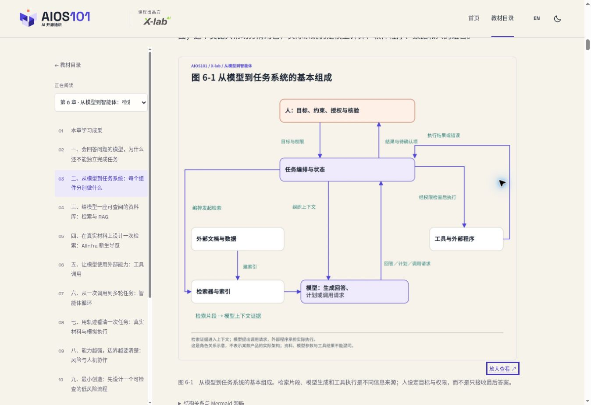
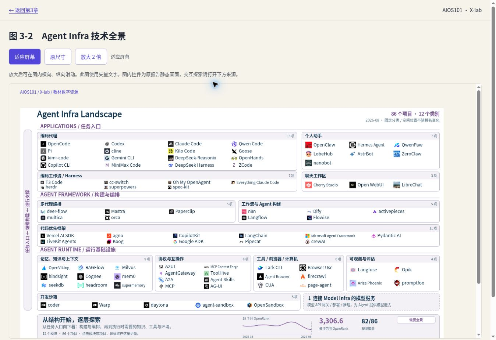

# 前六章图文精审与 Pages 评审版

> 历史记录：保留当轮决定与检查证据，文件中的版本、数量和“当前”均指当时状态。现行基线见[当前状态](../STATUS.md)；不据此恢复旧功能或宣称本轮已验收。

日期：2026-10-29。基线：`02b48c3e3ee0fcc9b7deb15f3d804d2910f23a3e`。范围：前六章 44 幅图；第四至第六章 28 幅逐图复核。

## 本轮修订

11 幅图版更新，保持图号与插入位置稳定。修正训练初始参数、检查点保存时机、采样设置适用范围与人机协作执行顺序；消除连线压字和含混交点。图 6-6 改为固定来源代码的天气分支字段节选，保留作者、Apache 2.0 许可、版本与省略说明。

所有 44 幅图统一短图题、邻近说明、替代文本及来源入口。章节状态统一为前六章图文评审版，清理“正式绘制”等制作占位语句和“前三章”旧摘要。31 份 Mermaid 结构源码继续保留，文字回退补全带标签的虚线关系。

正文继续加载压缩 WebP；独立大图页提供适应屏幕、原尺寸和两倍查看。首轮上线 25 幅 SVG 大图，同日续办补齐四幅 GOSD 后为 29 幅，使用本地字体子集，避免移动设备缺字体导致换行与字形差异。真实截图保留原始像素边界，不宣称无限清晰。

## 第四至第六章逐图记录

| 图号 | 概念与正文对应检查 | 来源／类型 | 本轮处理 |
|---|---|---|---|
| 4-1 | 训练使用初始／已有参数，再形成或更新参数 | 本章概念示意 | 修正图内绝对化措辞和图注 |
| 4-2 | FineWeb 八步链、96 个快照和约 15 万亿 token | 论文 v2 | 保留；明确不证明其他模型使用该数据 |
| 4-3 | 累计过滤条件、坐标、图例完整 | Penedo 等，Figure 9，CC BY 4.0 | 保留原图与未复算说明 |
| 4-4 | 假想切分与候选概率为两个独立示例 | 教学示意 | 保留；概率合计 1，不等于正确率 |
| 4-5 | 预测、损失、梯度、更新闭环 | 本章结构 | 保留；普通推理不自动训练 |
| 4-6 | 批次顺序、epoch、保存策略相互区分 | 本章结构 | 重绘；同步 Mermaid |
| 4-7 | R1-Zero／R1 路线及蒸馏两类上游 | DeepSeek 固定 README | 保留；未添加未公开阶段细节 |
| 4-8 | Model Summary 与 Downloads 对应图 4-7 | DeepSeek 0cf7856，MIT | 保留局部组合与版本说明 |
| 4-9 | 训练／验证／测试用途与近重复泄漏 | 本章结构 | 保留；文字回退补全虚线标签 |
| 5-1 | 已有输入、新输出上限与实际长度 | 本章结构 | 保留；容器面积不是固定配额 |
| 5-2 | 预填充与逐 token 解码 | 本章结构 | 保留；不误接参数更新 |
| 5-3 | k=2 与 p=0.90 的独立对照 | 教学概率 | 重排；0.92 达到阈值，消除压字 |
| 5-4 | 候选选择与停止控制 | 本章结构 | 保留；参数不保证真实性 |
| 5-5 | 原项目 Usage Recommendations | DeepSeek 0cf7856，MIT | 保留；0.6 非通用值 |
| 5-6 | 客户端、服务、引擎、模型和硬件 | 概念分层 | 修正结果返回线穿越节点 |
| 5-7 | 首 token、完整响应与吞吐不同口径 | 时间示意 | 保留；无虚构时长 |
| 5-8 | 从任务到有限结论的七步证据链 | 本章结构 | 清理制作过程措辞 |
| 5-9 | 主表四类任务与五项例值 | DeepSeek 0cf7856，MIT | 限定需采样基准的设置；未改截图数值 |
| 6-1 | 人、编排、检索、模型与外部执行 | 角色关系 | 重排请求／证据／结果路径 |
| 6-2 | 三文档块及元数据、查询与候选 | AIInfra b97c038 | 保留；切分与排序为教学设计 |
| 6-3 | 近邻关系不等于事实或充分证据 | 二维教学示意 | 移动标签；删除正式绘制占位语 |
| 6-4 | 索引、检索、筛选和生成 | RAG 结构 | 保留；不表示训练或参数更新 |
| 6-5 | 请求、检查、执行、反馈及拒绝 | 工具调用结构 | 保留；执行主体是外部程序 |
| 6-6 | 定义→assistant 请求→tool 结果对应 ID | 李博杰 dbc046e，Apache 2.0 | 原文字段节选重排，替换过小截图 |
| 6-7 | 观察、规划、行动、反馈、停止 | 任务循环 | 标签避开反馈连线 |
| 6-8 | 纠错、路径确认与假设写入 | 模拟轨迹 | 保留；未发生真实写入 |
| 6-9 | 技术约束、用户同意、隐私和工具安全 | MCP 2025-06-18，MIT | 保留原文强制／建议语义 |
| 6-10 | 人工决定和技术检查先于实际执行 | 人机协作结构 | 重绘拒绝不执行分支；同步 Mermaid |

## 验证状态

已完成：44 幅原图视觉复核、前三章批准插画风格保留、固定来源与图号核对，以及下述构建和线上检查。

本次不冒称完成实体手机、真实触屏手势、纸张灰度与缩印、课堂使用或正式出版清权验收；这些保留给维护者后续评审。

GOSD 四幅图首轮仅上线高分辨率 WebP；同日续办已补齐矢量大图并上线验收，发布结果见后续记录。正文仍使用原 WebP，来源入口和固定取样日期保留。

本地验证通过：品牌基线、整站构建、44 图与 31 份 Mermaid 对应、相对链接、脚本语法、阅读模式回归。

## 发布与线上验收

图文主体提交：`57f81c49e69e25f2b8aadb4d02e860af6974d986`。窄屏修复与验收工具补充后的发布提交：`04ddd7444bed195e74d3d0c6f4df1e303045e0e1`。

[GitHub Actions 40744324001](https://github.com/X-lab2017/AIOS101/actions/runs/40744324001) 的 build 与 deploy 均为 success。[第六章线上评审入口](https://www.x-lab.info/AIOS101/#/learn/CH06)。

- 前六章分别在 320px、390px 的浏览器 iframe 容器检查；有滚动条时可用宽度分别为 305px、375px。12 组检查均为整页 scrollWidth 等于 clientWidth，没有页面级横向溢出。
- 检查中发现并修复 320px 页眉约 10px 的溢出；保留三个 40px 控件，允许课程标志按剩余宽度缩小，不改变品牌基线文件。
- 第四至第六章 28 个大图页逐一完成图片加载、图号标题、非空图注、两倍放大及页面宽度检查，全部通过。
- 图 6-6 另行检查原尺寸、两倍查看以及图内横向／纵向滚动；中文和代码文本清晰，放大不撑开页面。
- 真实截图以原有像素为限；以上属于窄屏浏览器验收，不替代实体手机触屏操作验收。

详细记录：[线上检查数据](../review-assets/first-six-live-checks-20261029.json)。下图为已上线第六章正文中的图 6-1，包含课程标识、章节目录、图注和放大入口。

## 同日续办：四幅 GOSD 矢量大图

范围：第三章图 3-2、3-3、3-6、3-7，原报告图号分别为 4-1-1、4-1-2、4-2-1、4-6-1。复用 2026-10-28 已导出的课程图版，未重新抓取或更新项目与数据。

四个 SVG 从 2,572,775 字节压缩至 886,013 字节，减少 65.6%。合并重复样式、压缩部分嵌入项目图标；保留全部原文节点、数值、分组及几何属性。135 个图标经 WebP 压缩处理，其他图标保留原编码。图标不是矢量，不能据此宣称无限清晰。

已执行：四图的文本和几何属性对照、全部文字的字体字形覆盖检查、逐图渲染检查、整站构建、44 图与 31 份 Mermaid 检查、相对链接及品牌基线检查。来源校验值和压缩记录见 [优化清单](../../textbook/assets/figures/sources/gosd-vector-optimization.json)。

续办发布以主分支 `263bc36` 为基础，保留维护者刚更新的序言与前六章数字节号体例。最终部署提交为 `6d5d9c38269700845832f5d8c471849b6a8c1f9a`；[Actions 40756858798](https://github.com/X-lab2017/AIOS101/actions/runs/40756858798) 的 build 和 deploy 均为 success。

线上四图分别在 320px 与 390px 容器完成两倍放大检查，8 组均使用 SVG 文字、未撑开页面，完整保留 137／110／225／214 个文字节点。原报告导出中的按钮焦点和按钮角色在课程大图页中移除，并明确说明图内控件为静态画面；交互探索仍指向原报告。新大图沿用 WebP 像素尺寸作为“原尺寸”基准，因导出倍率不同，SVG 坐标宽度不等于该基准的像素宽度。

证据：[窄屏检查数据](../review-assets/gosd-vector-live-checks-20261029.json)、[图 3-2 在线大图](https://www.x-lab.info/AIOS101/figures/3-2.html)。本项仍不宣称完成实体手机测试。

