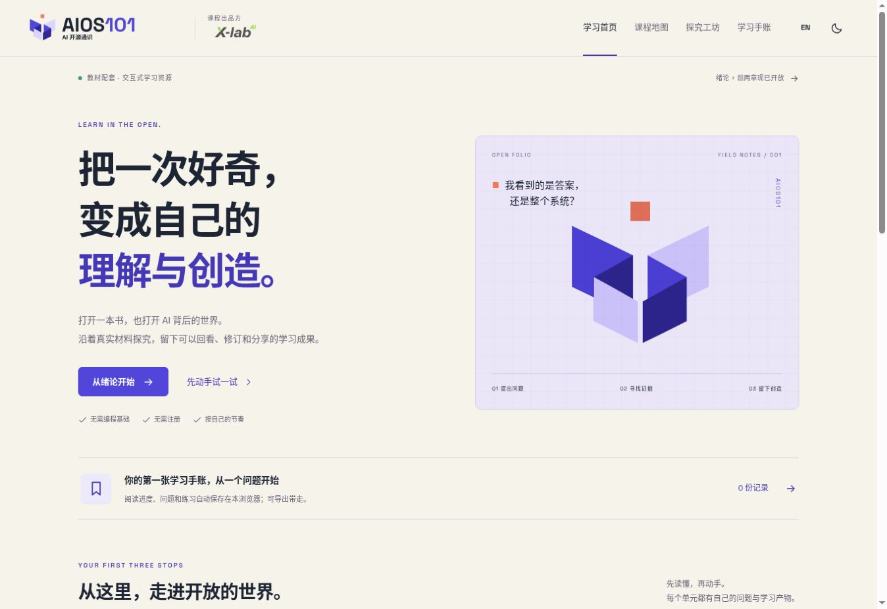

# 交互学习打样 v0.4 发布核验

日期：2026-10-28。公开网站：https://www.x-lab.info/AIOS101/

- 实现提交：[8a529d1](https://github.com/X-lab2017/AIOS101/commit/8a529d1bfc74c62995d83787823770a059059d3d)。
- [GitHub Actions](https://github.com/X-lab2017/AIOS101/actions/runs/40674762560)：build 与 deploy 两个 job 均 completed / success。
- 公网实际打开新版首页、第一章完整阅读和 ACT-CH02-02 模拟贡献活动；第一章来源链接已指向上述部署提交。未向公网表单写入测试答案。
- 私有 Sites 评审版同步部署成功，受众保持 owner-only；源码提交 1eb6d279cd19f498a6c805bff121a7dd6e73acba。
- 发布前合入并保留 b043bfb 新增的第三章原文、规格与来源，第三章只开放草稿阅读，配套活动待制作。
- 功能核验与未完成项见[学习版核验记录](../specs/learning-review-record.md)。教学验收、常用浏览器文件下载落盘和课堂实测待评审。

