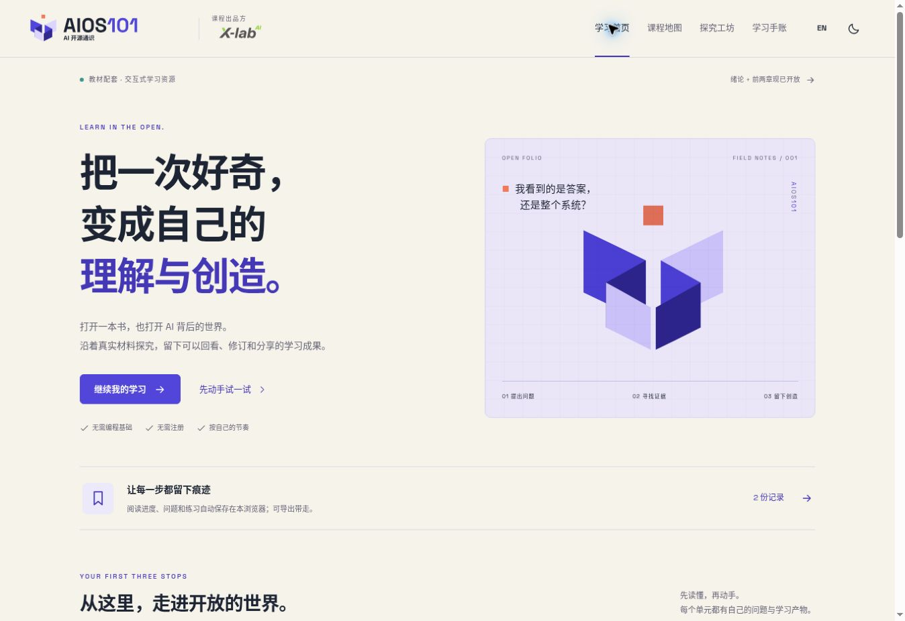
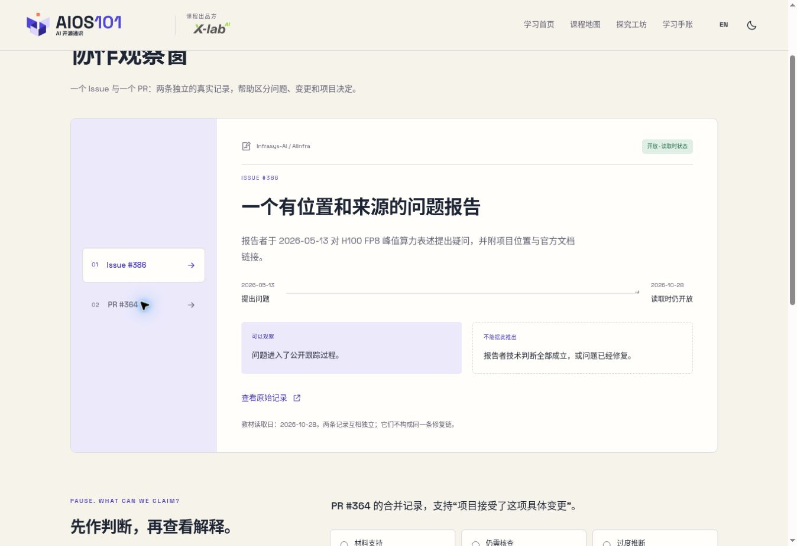

# AIOS101 v0.4 交互学习打样核验记录

> 历史记录：保留当轮决定与检查证据，文件中的版本、数量和“当前”均指当时状态。现行基线见[当前状态](../../docs/STATUS.md)；不据此恢复旧功能或宣称本轮已验收。

日期：2026-10-28。对应 [WEB-LEARN-AIOS101](../learning-experience-spec.md)。状态：工程打样完成，等待维护者体验评审；不代表正式教学验收。

## 1. 实现与材料

读取课程宪法、总规格、章节与活动规格、展现和验收要求；完整读取绪论、前两章、附录 A、四项学生任务单与交互需求。最初教材以 5739ee3 为基线；发布前检测到 b043bfb 新增第三章，保留并合入其原文、章节规格与来源登记，自动生成第三章阅读页。第三章未扩展定制活动或重新作内容审定。对照读取 DeepSeek-R1 固定 README、AIInfra Issue #386 与 PR #364；两条社区记录在页面中明确独立，状态绑定教材读取日。

实现完整阅读、分节目录/批注/书签，三个观察窗，四项共 23 步的活动，个人手账、修订快照与严格恢复。四项活动字段分别为 48、43、61、43 项；数据检查对全部字段执行验证，不以数量作为教学完整性的唯一证据。

视觉基线 v1.0.0 原资产保持不变；新增布局使用既有纸白、靛蓝、珊瑚橙与青绿体系。

## 2. 已执行检查

- Python 构建成功：5 个完整阅读单元、4 份任务单、12 章目录。
- 教材原始 Markdown 与正本逐字相同；分节 ID、内容摘要、固定来源和站内附录链接通过检查。
- Node 数据逻辑核验：v1 迁移后再读、旧长文本原文保留、全部活动字段、矩阵维度、修订快照不被后续编辑改变、导出完整性、模拟标识、非法导入拒绝、冲突合并前原稿保留。
- JavaScript 语法、仓库结构及相对链接、Pages 子路径资产、品牌版本包及 SHA-256 校验通过。
- 浏览器实际操作：章节标记与批注刷新保留；材料选择与先判断后解释；活动草稿、步骤跳转、快照、缺项定位和完整产物预览；首页恢复具体活动步骤；文本备份验证、非法格式保护、确认合并和刷新后仍可取得导入前备份。
- 桌面 1348 px 内容宽度，嵌入视口 320/390/768 px 检查无整页横向溢出；窄屏批注编辑、移动导航、Escape 关闭、四次发布切换可用。嵌入视口是浏览器布局检查，非真实移动设备实测。
- 英文界面与深色主题、课程全文关键词检索、既有视觉页均检查可用。浏览器日志中发现的扩展元数据错误来自浏览器扩展，不属于页面运行错误。

## 3. 限制与待评审

- 浏览器的下载事件报告文件下载失败，故没有宣称文件落盘端到端通过；生成内容由核心测试与产物预览验证，文本 JSON 恢复流程实际通过。仍需维护者在常用浏览器检查 Markdown/JSON 下载。
- 本轮没有实际课堂测量、教师评分、同伴反馈或真实社区提交。页面给出的活动时长是设计估计。
- 全量屏幕阅读器审计、真实手机/平板、完整离线缓存、并发多标签编辑冲突测试未完成；核心学习记录建议在一个标签页编辑并定期备份。
- 导入大小上限 2 MB，活动最多保留 20 次主动修订快照；不提供云同步。超限会拒绝导入，不改变当前记录。
- CH04—CH12 正文未发布；第三章为 v0.1 草稿，仅接入阅读；正式插图占位仍保留；教材、任务单和案例解释尚未提供审定英文译本。

建议首轮评审：选择一个真实 AI 使用场景，完成 CH01-01 的小范围试学，观察“证据—结论边界—反馈修订”是否足够清楚，以及分步填写是否过重。之后再根据反馈扩展更多章节。

## 4. 评审截图

本地构建预览的实际界面，非合成设计稿：

公开部署以 GitHub Actions 对本次提交的执行结果为准；此文件不将待运行部署标记为已通过。
