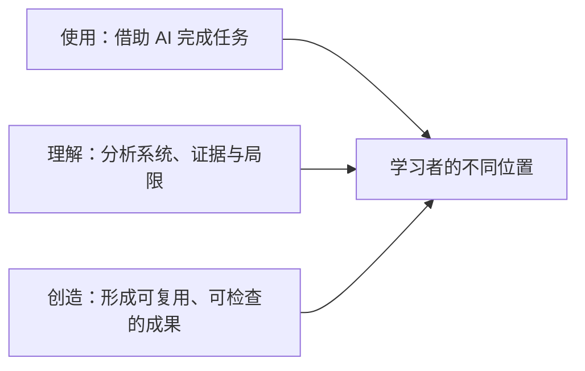
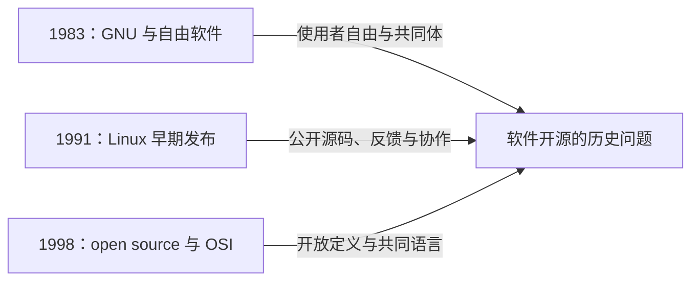
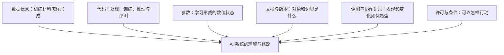

# 第 1 章　智能时代为什么需要 AI 开源通识

> 版本：v0.5
>
> 状态：打印教材修订稿
>
> 对应规格：[CH01](../../specs/chapters/CH01-ai-open-source-literacy-spec.md)

## 本章学习成果

完成本章学习后，你应能够：

1. 围绕一个真实 AI 工具，区分“使用”“理解”与“创造”三种学习位置；
2. 准确解释自由软件、开源、源代码、许可和复用等基本概念；
3. 用 GNU、Linux 和 OSI 三个历史坐标，说明自由软件与开源运动关注的基本问题；
4. 结合 DeepSeek-R1 官方仓库，说明为什么 AI 开放不能只检查源代码或模型权重。

## 一、从 DeepSeek 的一次回答说起

许多大学生已经使用过 DeepSeek 等 AI 工具：输入一个问题，得到一段解释、一份提纲或一组参考文献线索。这个过程十分自然，也很容易让人把“得到答案”当成“理解 AI”。

但当你准备把答案用于课程作业，或者进一步研究这个工具时，问题就开始变化：

- 我使用的是网页或 App 中的**产品**，还是一个可以独立运行的**模型**？
- 产品所说的模型，与公开仓库中的模型文件是不是同一个对象、同一个版本？
- 回答中出现的资料来自模型已有能力，还是来自联网检索等外部环节？
- 我能否检查它的工作过程，验证一项结论，或者修改其中某个组件？
- 公开仓库、模型下载和免费使用，分别意味着什么权利？

这些问题并不要求每位学习者都成为算法工程师。它们要求我们把“会用工具”再向前推进一步：知道自己正在使用什么，知道判断需要哪些证据，也知道现有证据不能说明什么。

### 1. 使用、理解与创造

| 学习位置 | 学习者主要做什么 | 典型产物 |
|---|---|---|
| 使用 | 借助 AI 完成任务 | 回答、摘要、代码、图片及其使用记录 |
| 理解 | 分析系统组成、证据、条件和局限 | 概念图、材料清单、版本与许可核查笔记 |
| 创造 | 形成可供他人使用、检查或改进的成果 | 文档、评测、数据、应用或研究作品 |

三种位置不是能力等级。初学者可以创造一份有用的核查指南，专业工程师在某些任务中也可能只是使用者。AI 通识教育的目标，是让学习者能够在需要时从使用走向理解与创造，而不是否定工具带来的便利。

图 1-1　使用、理解与创造是三种学习位置，而非由低到高的能力等级；同一个人可以随任务转换位置。

### 2. 模型、产品与 AI 系统

日常语言中，“我用这个 AI”“我用这个模型”经常混用。为了准确分析，本书采用以下工作定义：

> **AI 模型**：通过学习过程形成、能够根据输入产生预测或生成结果的计算对象。许多机器学习模型需要结构、参数和相应运行代码才能实际工作。
>
> **AI 产品**：面向特定用户和场景封装的服务或工具，可能包含一个或多个模型，也包含界面、账号、内容规则、检索、计费和运营配置。
>
> **AI 系统**：本书用来观察整体的工作概念，指模型、数据、代码、计算资源、产品规则、使用者和应用情境共同形成的运行整体。

DeepSeek-R1 官方仓库同时提供聊天网站与 API 入口、模型下载链接和本地运行说明。**API（应用程序编程接口）**是让其他程序按照约定格式请求某项能力的接口；在 AI 场景中，调用 API 通常是使用远程模型服务，不等于下载模型文件，也不等于获得该服务的全部代码。聊天产品、API 服务、模型权重与代码仓库相互关联，却不是同一个对象。分析其中任何一个，都不应把结论无条件推广到其他对象。

“黑盒”也不是绝对属性。它描述观察者当前无法充分看见或解释系统内部过程的状态。开源能够降低其中一些不可见性，但材料存在并不等于普通人已经能够理解，更不能消除所有技术与认知困难。

## 二、理解开源之前：源代码、许可与复用

### 1. 源代码

**源代码**是程序员用于理解和修改程序的形式。开放源代码定义进一步强调，它应当是适合程序员修改的首选形式，而不是故意混淆、难以修改的表示。

许多程序还会被编译或转换为可执行形式。普通用户运行的是可执行程序，开发者修改的通常是源代码。不同语言和项目的工作方式并不完全相同，有些语言不需要传统的编译步骤，但仍然存在适合修改的源文件、运行环境和依赖。

一个软件从源文件到实际运行，可能还需要编译器或解释器、依赖库、配置、资源文件、测试和发布文档。因此，“有源代码”与“能够顺利构建和运行”不是同一结论；“能够运行”与“有权修改和再分发”也不是同一结论。

### 2. 许可

**许可**是权利人或有权授权者给予他人的使用许可，可以说明使用、复制、修改、再分发等行动的条件。开源许可并不意味着作品没有版权，也不意味着作者放弃一切权利。

本书先建立三个原则：

1. 许可应当对应明确的对象和版本；
2. 获得副本不等于获得所有权利；
3. 有条件不等于不开放，关键在条件是否符合相应定义。

例如，一个代码仓库适用某种许可，不表示其中的模型、数据集、图片和第三方材料都自动适用同一许可。具体条款与合规操作将在第 7 章展开。

### 3. 复用

**复用**是在理解原有成果及使用条件的基础上，把它用于新任务，或作为新成果的组成部分。复用可能包括阅读文档、选择版本、适配情境、验证结果、保留署名和说明修改。

复制只说明文件被拷贝，复用则关心成果能否在新情境中正确、合规并可持续地工作。第 2 章将结合真实仓库进一步分析这一过程。

| 概念 | 主要回答的问题 | 不能单独证明什么 |
|---|---|---|
| 免费 | 是否需要为获得或使用支付价格 | 是否允许研究、修改和再分发 |
| 自由软件 | 用户是否拥有定义所述的四项基本自由 | 软件一定易用、安全或适合所有任务 |
| 开源 | 软件及其分发条款是否符合相应开源定义 | 项目一定活跃、质量一定更高 |
| 公开可见 | 内容是否能够被访问或查看 | 是否获得开放许可和完整材料 |

## 三、软件开源从哪里来：三个历史坐标

共享软件和协作改进并不是某一年突然出现的发明。在正式的“自由软件”和“开源”运动之前，计算领域就存在分享代码、互相修改和共同解决问题的实践。下面三个历史坐标不是完整编年史，而是理解开源基本问题的三个窗口。

### 1. GNU 与自由软件：使用者应当拥有怎样的自由

1983 年 9 月，Richard Stallman 发布 GNU 工程初始声明，提出构建一个自由的 Unix 兼容软件系统，并邀请他人贡献时间、程序、设备和资金。后来形成的自由软件定义，把讨论推进到使用者应当拥有哪些自由。

自由软件定义所说的四项基本自由是：

| 编号 | 自由的含义 | 为什么需要它 |
|---|---|---|
| 自由 0 | 按自己的目的运行程序 | 使用目的不应只能由开发者预先限定 |
| 自由 1 | 研究程序如何工作，并修改它以适应自己的需要 | 使用者可以理解并改变工具，而不只是接受结果 |
| 自由 2 | 复制并再分发程序 | 可以把成果分享给他人 |
| 自由 3 | 分享修改后的版本 | 改进可以成为共同体的成果 |

自由 1 和自由 3 都以获得源代码为先决条件。编号从 0 开始是自由软件定义的历史约定，并非遗漏第一项。

这里的 free 首先指自由，而不是价格。自由软件可以收费，也可以用于商业活动；判断关键是用户是否获得相应自由，而不是获取价格是否为零。

GNU 的历史意义不只是启动一个大型软件工程，更在于把软件使用中的自由、分享和共同体责任变成清晰的公共议题。

### 2. Linux 与协作开发：公开之后如何形成共同工作

1991 年，Linus Torvalds 发布早期 Linux 内核。Linux 0.01 的发布说明包含完整源代码，邀请感兴趣者编译、尝试并反馈问题与建议；同时也坦诚系统尚不成熟，只支持部分硬件，许多功能仍未实现。

这个片段呈现出一种朴素的工作方式：公开一个不完美但可以阅读的系统，让其他人观察、测试、讨论和参与改进。它没有证明“只要公开就必然成功”，反而提示我们注意公开之后还需要反馈、版本、分工和维护。

还要保留两个历史边界：

- Linux 0.01 的发布条件具有时代背景，不能直接套用后来形成的开源定义；
- Linux 是操作系统内核，不是完整操作系统的全部。编译器、工具、文档、测试、发行版和长期维护都依赖大量协作者。

因此，Linux 的故事既不是“一个人创造了整个系统”，也不是“公开代码自动产生协作”，而是技术材料、反馈和共同劳动逐渐连接的过程。

### 3. OSI 与开源定义：怎样形成共同语言

1998 年，“open source”作为新的公共标签逐渐得到采用。OSI 的历史记录显示，这一术语在 2 月的一次策略讨论中被提出，Christine Peterson 是最初建议者；Eric Raymond 与 Bruce Perens 随后共同创立 Open Source Initiative（OSI），推动相关教育、倡导与定义维护。

开放源代码定义（Open Source Definition，OSD）源自 Debian 自由软件指导方针。OSD 1.9 开篇即指出，开源不只是能够访问源代码，软件的分发条款还必须符合相应标准。其十项标准涉及自由再分发、源代码、衍生作品、不歧视个人或群体、不歧视使用领域、许可传递与技术中立等。

自由软件与开源在实践中高度重叠，但价值表述并不完全相同。自由软件更明确强调使用者的自由与共同体伦理；开源运动通常更强调开放开发、复用、协作及其实践优势。FLOSS（Free/Libre and Open Source Software）这一写法常被用来同时指称二者，既承认交集，也不必抹去不同的历史和价值重点。

图 1-2　三个历史坐标分别突出自由、协作和开放定义。它们不是完整编年史，也不表示后一个事件由前一个事件单独造成。

## 四、当学习对象从软件变成 AI

### 1. 六类开放材料分别能回答什么

一个传统软件项目通常可以通过源代码、构建说明和依赖关系理解其主要行为。机器学习系统的能力还与训练数据、模型参数和训练过程密切相关。到了实际产品中，检索、工具调用、内容规则和运行配置还会继续影响输出。

| 材料 | 通俗解释 | 仅有它时仍然缺少什么 |
|---|---|---|
| 数据信息 | 关于训练材料来源、范围、选择、处理和标注的信息 | 具体参数、训练实现和实际表现 |
| 代码 | 数据处理、训练、推理或评测的程序 | 数据内容、训练结果和运行条件 |
| 参数 | 模型在训练过程中形成的数值状态，权重是常见形式 | 参数如何形成，以及如何评估其影响 |
| 文档与版本 | 使用说明、适用边界和变更记录 | 文档之外的真实表现与维护情况 |
| 评测与协作记录 | 任务、数据、结果、问题和修订过程 | 未覆盖任务、长期使用和实际受益 |
| 许可与使用条件 | 对具体材料和使用行动的授权 | 技术材料是否足够、实践是否可行 |

“参数”与“超参数、产品配置”也不宜混为一谈。参数通常通过学习过程形成，超参数和运行配置则可能由开发者或部署者设定。它们都会影响系统，但作用与形成方式不同。

本书用**开放权重**描述模型权重可以公开获得这一现象。它告诉我们可以取得什么，却没有自动说明训练与运行代码、数据信息、许可以及整个产品系统的情况。因此，开放权重不应被直接写成完整开源 AI 的同义词。

**开放材料**是本书的学习性概念，指能够用于观察、研究、修改、验证或复现的材料。它不是替代官方开源定义的认证标签。

OSI 发布的《开源 AI 定义》1.0 将使用、研究、修改和分享的自由延伸到 AI 系统，并把“便于修改机器学习系统的首选形式”展开为数据信息、代码和参数。数据信息要求提供足够详细的信息，使有技能的人能够构建基本等效的系统；这不等于简单宣称所有情况下都必须公开原始训练数据集。

图 1-3　六类材料从不同方向支持对 AI 系统的观察。缺少其中任何一类，都不宜用剩余材料推出整个系统已经开放或可复现。

### 2. 真实案例：DeepSeek-R1 官方仓库能说明什么

下面观察 [DeepSeek-R1 官方 GitHub 仓库的固定版本](https://github.com/deepseek-ai/DeepSeek-R1/tree/0cf78561f1d51c84a21b2190626b21116d5c68bb)。这里的 `0cf7856` 是仓库一次提交的编号缩写，作用是定位本书写作时阅读的材料，**不是 DeepSeek-R1 的模型版本号**。读者可以通过链接直接打开当时的 [README](https://github.com/deepseek-ai/DeepSeek-R1/blob/0cf78561f1d51c84a21b2190626b21116d5c68bb/README.md)，不需要先安装 Git 或下载模型。关于仓库、提交号和固定版本的详细说明，见[附录 A](../appendices/APP-A-repository-snapshots.md)。

在这份 README 中，可以看到几类不同材料：

- **产品与服务平台入口**：README 提供官方聊天网站和 API 平台链接；
- **模型获取入口**：README 列出 DeepSeek-R1 及蒸馏模型的 Hugging Face 下载链接；
- **运行与使用说明**：仓库说明本地运行入口、部分推理框架和推荐配置；
- **研究材料**：仓库提供技术报告链接与评测结果；
- **许可说明**：README 声明该代码仓库和模型权重采用 MIT License，同时提醒部分蒸馏模型涉及 Qwen 或 Llama 的不同上游许可。

图 1-4　DeepSeek-R1 固定 README 真实截图占位。需组合呈现 Model Downloads、How to Run Locally 与 License 的相关画面，并保留固定提交地址；用于对照模型获取、运行说明和不同资产的许可线索，截图待补。

这里，GitHub 主要承载项目文档与协作材料，Hugging Face 页面承载相应模型文件。平台不同，材料与权利也需要分别核查。即使不访问外部网页，只阅读上面的材料清单，也可以继续理解本章；固定链接用于希望亲自核对原文的读者。

这个案例不能简单压缩成“DeepSeek 是开源的”一句话。更准确的学习方式是逐对象提问：哪个模型、哪个版本、哪些代码与参数、适用什么许可、还缺哪些训练与产品信息？即使某些材料采用宽松许可，也不能由此推断在线产品的全部组件都开放，或整个训练过程已经能够复现。

### 3. 复现也不是一个单一动作

AI 语境中的“复现”可能指：在相同输入和配置下重复一次推理结果；使用公开代码和材料重复一项评测；根据数据与训练信息重新训练一个基本等效模型；或者在新的环境中得到与原研究可比较的结果。

这些任务的难度、材料和结论边界不同。一次回答完全相同，不能证明训练过程可以复现；一次训练运行完成，也不能证明不同环境下的评测结论一致。第 8 章将专门学习可复现性，本章先要求说明“我想复现什么”。

## 五、开源为 AI 通识教育带来的四种转变

### 1. 从观看答案，转向观察系统

开放材料让学习对象从聊天窗口扩展到代码仓库、数据说明、模型参数、评测报告和版本记录。即使不编写程序，也可以阅读模型文档、比较版本、检查评测数据，或者观察一个问题的修订过程。

这种学习不要求每个人都理解全部技术细节，而是让每个人依据自己的背景提出更好的问题：法学学习者研究使用条件，教育学习者比较反馈方式，新闻学习者核查来源，工程学习者进一步进入实现和部署。

### 2. 从记住结论，转向形成证据

“这个模型很强”“这个项目很活跃”“这个工具很开放”，都需要具体对象、版本和判断依据。开源使一部分结论可以被检查：阅读评测任务而不是只看总分，检查文档是否真的包含复现步骤，比较发布说明与实际材料，观察所谓活跃是否只有下载量，还是也包含持续维护和回应。

### 3. 从单独学习，转向共同工作

开放协作提供了一种超越一次性作业的可能：错误报告帮助项目修正问题，文档说明降低后来者的门槛，翻译让更多人使用成果，评测暴露此前没有注意到的局限。贡献不再等同于编写代码，共同工作也意味着接受提问、评审和修改。

### 4. 从消费成果，转向创造公共成果

学习者可以组合开放模型、数据和工具制作小型应用，也可以形成课程材料、数据研究、评测样例或核查档案。创造不一定意味着“从零做出大模型”，更多时候意味着站在已有成果之上，做出对他人有用的改进，并把方法、版本、限制和使用说明交代清楚。

## 六、开放不等于没有代价

开源提供了理解、协作和创造的条件，却不自动保证这些结果出现。

- 代码公开，不等于普通人能够读懂；
- 材料丰富，不等于项目得到良好维护；
- 允许修改，不等于修改一定安全；
- 允许分享，不等于分享时没有隐私、偏见或许可风险；
- 公开评测，不等于评测覆盖所有真实任务；
- 可以参与，不等于贡献会被接纳或维护者没有成本。

设备、网络、语言、知识和时间的差异，也会影响人们能否真正受益于开放。因此，通识教育不能把开源当成绝对正确的口号。我们需要同时学习开放的价值和边界：核查材料，尊重他人劳动，披露 AI 辅助，避免发布敏感信息，并对自己的成果和结论负责。

## 七、本章小结

会使用 AI，不等于理解 AI。模型、产品和 AI 系统是不同对象，开放其中一项不能自动代表全部开放。

理解开源需要几个基础区分：源代码不同于可执行形式，公开可见不同于开放授权，免费不同于自由，复制不同于复用。GNU 与自由软件运动把使用者的自由和共同体责任带入公共讨论；Linux 的早期发展展示了公开源码、反馈和协作的工作方式；OSI 与开放源代码定义为开源提供了共同语言。

DeepSeek-R1 官方仓库进一步说明，AI 开放需要分别观察产品入口、模型下载、代码、文档、评测和许可。开源由此成为 AI 通识教育的一种认识方法：从答案走向系统，从结论走向证据，从个人学习走向协作，从使用成果走向创造公共成果。同时，开放不自动等于可靠、安全、可复现或有公共价值。

## 关键术语

- **自由软件**：强调用户运行、研究修改、复制分享以及分享修改版本等自由的软件；free 首先指自由而非价格。
- **开源软件**：不仅提供适合修改的源代码，其分发条款还需符合开放源代码定义相应标准的软件。
- **源代码**：程序员用于理解和修改程序的形式；开源定义强调其应是适合修改的首选形式。
- **许可**：权利人或有权授权者针对特定对象授予使用、复制、修改、再分发等行动的许可，并可附相应条件。
- **复用**：在理解原有成果及使用条件的基础上，将其用于新任务或作为新成果的组成部分。
- **AI 模型**：通过学习过程形成、能够根据输入产生预测或生成结果的计算对象。
- **AI 系统**：本书的工作概念，指模型、数据、代码、计算资源、产品规则、使用者和应用情境共同形成的运行整体。
- **模型参数**：模型在训练过程中形成的数值状态，权重是常见形式；参数不等于完整 AI 系统。
- **开放权重**：模型权重可以公开获得的情况，不自动说明其他材料、许可或整个产品的开放状态。
- **开放材料**：本书用于组织学习的概念，指可用于观察、研究、修改、验证或复现的材料。
- **复现**：根据所设任务，重复推理、评测、训练或研究结果的过程；不同复现目标需要不同材料。

## 思考与探究

1. 以 DeepSeek 或其他 AI 工具为例，为什么“产品可以免费使用”与“模型及其系统开放”是两个不同判断？
2. 自由软件与开源运动各自把什么问题带入了公共讨论？为什么不宜把二者简单写成互相排斥？
3. DeepSeek-R1 官方仓库中的模型下载、技术报告、评测和许可，分别能够支持什么判断，又不能支持什么判断？
4. 如果要复现一项 AI 研究结论，你首先需要明确哪些对象、版本和材料？
5. 结合你的专业，设想一种不需要编写代码的 AI 开源贡献。

## 延伸学习

- **希望核对自由软件理念的原始表述**：阅读 GNU 的[初始声明](https://www.gnu.org/gnu/initial-announcement.html)和[自由软件定义](https://www.gnu.org/philosophy/free-sw.html)。前者帮助理解 GNU 工程发起时的目标与协作邀请，后者解释“四项基本自由”的准确含义，可用来对照本章的历史概述。
- **希望比较软件开源与 AI 开源的定义**：阅读 OSI 的[《开放源代码定义》](https://opensource.org/osd)和[《开源 AI 定义》1.0](https://opensource.org/ai/open-source-ai-definition)。重点观察二者都关心哪些自由，以及 AI 定义为什么进一步讨论数据信息、代码和参数；不要求逐条背诵定义。
- **希望亲自核对本章案例**：阅读 [DeepSeek-R1 固定版本 README](https://github.com/deepseek-ai/DeepSeek-R1/blob/0cf78561f1d51c84a21b2190626b21116d5c68bb/README.md)，重点查看模型下载、本地运行、评测和许可几个部分。它用于练习分辨不同材料及其证据边界，不要求下载或运行模型；访问方法见[附录 A](../appendices/APP-A-repository-snapshots.md)。
