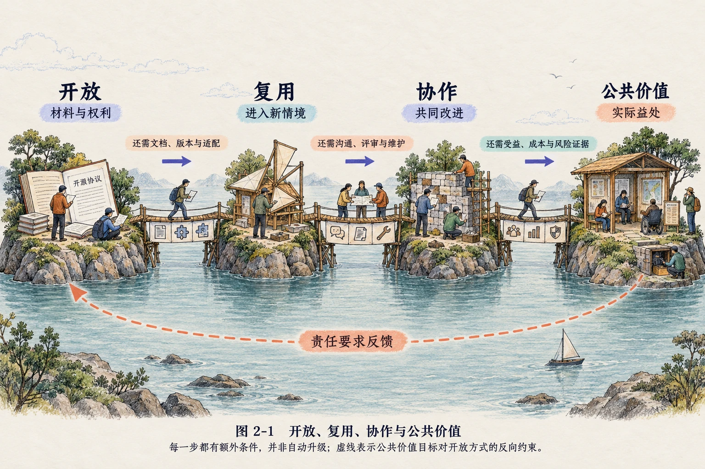
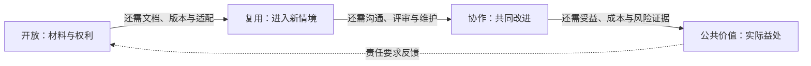
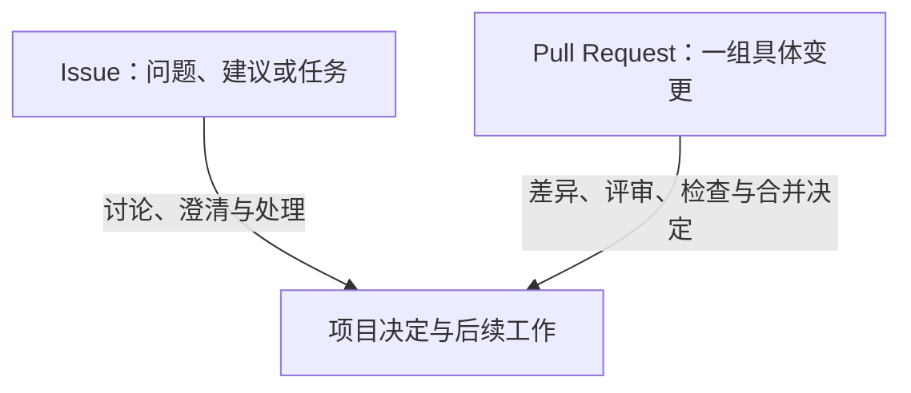
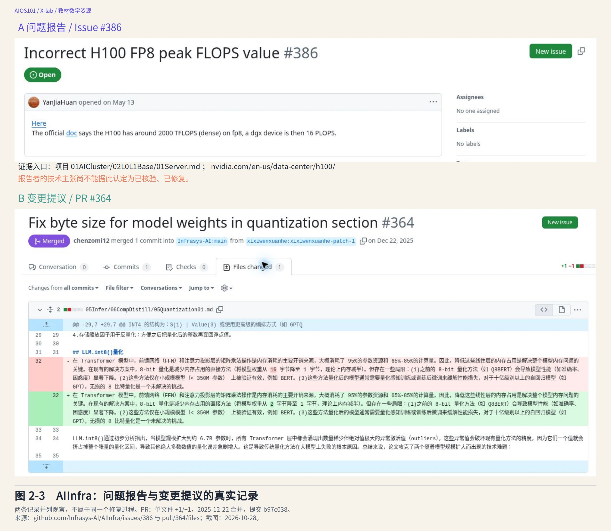
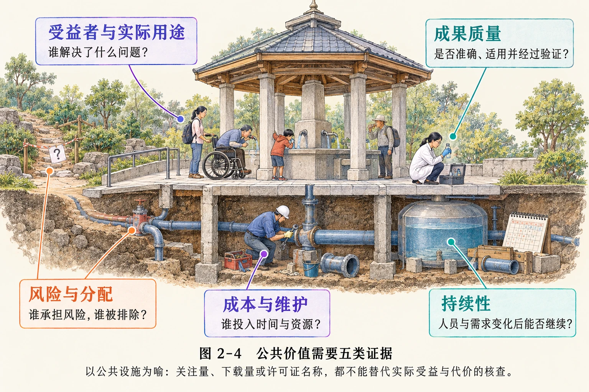

# 第 2 章　开源的本质：开放、复用、协作与公共价值

> 版本：v0.8
>
> 状态：自学教材评审版（2026-10-29）
>
> 对应规格：[CH02](../../specs/chapters/CH02-open-source-mechanisms-spec.md)

## 本章学习成果

完成本章学习后，你应能够：

1. 准确解释开放授权、复用、版本、开放式协作、贡献、评审、维护与公共价值；
2. 区分公开可见、开放授权、实际可复用与可持续协作所需的证据；
3. 解释仓库、Commit、Branch、Fork、Issue 和 Pull Request 的基本作用，并知道它们在 GitHub 与 AtomGit 中的落地场景；
4. 通过真实 Issue 与 PR 记录，说明贡献、项目决定和公共价值为什么不能相互替代。

第一章区分了“能够获得”与“有权修改和分享”。本章继续追问：即使有这些权利，别人为什么仍可能用不好一份成果？读者只需阅读本章展示的材料，不必注册协作平台，也不必懂 AI 基础设施的技术实现。

## 2.1　打开一个真实仓库，我们究竟看到了什么

**仓库**可以先理解为一个保存项目文件、同时记录修改历史的空间。它既能保存代码，也能保存教材这样的文字成果。GitHub 是承载这些仓库与协作记录的平台；项目首页的 README 通常是一份入门说明，LICENSE 则通常保存许可文本。

AIInfra 是一个在 GitHub 上公开维护的 AI 基础设施课程项目。“基础设施”在这里指支持 AI 开发与运行的计算、软件等基础条件；本章研究它如何组织公开资料与协作，不学习硬件工程。本章使用[本书固定的仓库版本](https://github.com/Infrasys-AI/AIInfra/tree/b97c0385ba07a62a717d82a0e7aed2927f12fc35)作为观察对象。`b97c038` 是提交号缩写，用来定位这份历史材料，并不是课程发布版本号；访问方法见[附录 A](../appendices/APP-A-repository-snapshots.md)。在这个版本中，README 提供课程背景、内容大纲、在线文章与相关资源入口，根目录提供 Apache License 2.0 文本。项目公开页面还保留 Issue 和 Pull Request 等协作记录。

项目中的 Issue 是记录问题或建议的地方；Pull Request（简称 PR）则是提出一组具体修改、请项目审阅的记录。先记住“提出问题”与“提出修改”的区别即可，2.4 节会展开。

对一个初次接触开源的大学生来说，这些材料很容易混成一件事：既然都能公开看到，似乎就都属于“开源”。实际上，它们分别回答不同问题。

| 真实材料 | 主要回答的问题 | 不能单独推出的结论 |
|---|---|---|
| 公开 README 与课程文件 | 项目是什么，有哪些内容，可以从哪里开始 | 已获得所有材料的使用、修改和再分发权利 |
| LICENSE | 对哪些成果授予哪些权利、需要履行哪些条件 | 新使用者一定能顺利理解和复用 |
| 版本、文件与发布说明 | 当前是哪一版，怎样取得适合自己的材料 | 所有环境下都能得到相同结果 |
| Issue 与 PR | 问题和变更怎样被提出、讨论与处理 | 项目协作一定高效，贡献一定被接纳 |
| 使用与维护证据 | 谁实际受益，谁承担成本，项目能否持续 | 下载量或关注量越高，公共价值必然越大 |

本章以“开放—复用—协作—公共价值”为分析框架。它不是给项目打分的固定等级，也不是完成前一步就自动到达后一步的流水线，而是帮助我们区分材料、权利、行动和结果。

读图 2-1 时，重点看岛屿之间的桥：每座桥都写着额外条件。试着说明其中一座桥缺少时会发生什么，就能理解为什么“公开了”不能直接推出“被有效复用”。

图 2-1　开放、复用、协作与公共价值。每个箭头都有额外条件，不能理解为自动升级；虚线表示公共价值目标对开放方式的反向约束。

结构关系与 Mermaid 源码

## 2.2　开放：从“我能看见”到“我可以做什么”

### 2.2.1　公开可见与开放授权

> **公开可见**：成果处于他人能够访问或获取的状态。
>
> **开放授权**：权利人或有权授权者针对明确对象，通过许可等方式授予他人使用、修改、复制、再分发等权利，并说明相应条件。

网页可以浏览，文件可以下载，代码可以复制，模型参数也可能有公开链接。这些现象首先说明“能够获得”，并没有完整回答“获得之后可以做什么”。

开放源代码定义不仅关注源代码是否可获得，也涉及自由再分发、衍生作品等条件。自由软件定义则围绕运行、研究修改、复制分享以及分享修改版本的自由展开。两者历史与价值表述不同，却都提醒我们：开源不是单纯把材料放在公众面前，而是让使用者在明确条件下拥有进一步行动的空间。

面对一个公开成果，至少需要分开问：

- **对象是什么**：网页展示、源代码、文档、数据、模型参数，还是完整系统？
- **权利是否明确**：能否使用、修改、再分发，需要履行哪些条件？
- **条件对应哪个版本**：当前页面上的说明是否适用于实际取得的材料？
- **是否包含第三方内容**：不同材料是否适用各自许可？

“免费”只描述价格的一种情况，“可下载”只描述获取方式，都不能自动回答这些问题。

### 2.2.2　开放不等于没有条件

开源允许使用、修改和分享，并不意味着作者放弃所有权利，也不意味着使用者没有责任。许可可能要求保留版权与许可信息、署名或说明修改，具体义务取决于实际许可和材料类型。

AIInfra 仓库中的 Apache License 2.0 包含复制、衍生作品与再分发等授权及相应条件。这里的关键不是记住许可证名称，而是理解：**公开页面让人看见成果，许可文本让人知道自己可以在什么条件下行动。**

开放授权也不等于作者承诺提供无限支持。许可可以允许修改资料，却不会因此保证作者必须回答每个问题、合并每项建议或长期维护成果。

### 2.2.3　常见项目文档分别回答什么

| 常见材料 | 主要作用 |
|---|---|
| README | 介绍项目用途、使用入口、文件结构和必要限制 |
| LICENSE 或许可说明 | 说明授权对象、权利和义务 |
| CONTRIBUTING 或贡献指南 | 说明项目需要哪些帮助、怎样提出变更、如何评审 |
| 版本与变更记录 | 帮助定位成果状态、比较变化和回溯问题 |
| 来源与风险说明 | 标明第三方材料、适用边界和已知风险 |

并非所有项目都采用这些文件名，小型成果也可能把说明集中在一个文档中。反过来，仅仅存在同名文件，也不能证明其内容完整或项目运行良好。

## 2.3　复用：从“复制一份”到“让成果在新情境中工作”

### 2.3.1　复制、使用与复用

> **复制**：制作原有材料的一份副本。
>
> **使用**：把成果用于某个任务，可能完全不改变成果本身。
>
> **复用**：在理解原有成果及其条件的基础上，把它用于新任务或作为新成果的组成部分，并完成必要的适配、验证与来源处理。

复用可以是不修改原文件的再次使用，也可以是改编、组合或扩展。关键不在于“必须改动”，而在于成果进入了新的工作过程。

一位教师若想从 AIInfra 选取一节内容用于课程，需要确认具体文件和版本，阅读许可与署名要求，判断材料是否适合自己的学生，并检查引用的图片、视频或其他第三方内容。仅把整个仓库下载到电脑，还没有完成这些工作。

复用通常包含一条实际工作链：**找到对象，取得材料，理解说明，核查条件，完成适配，验证结果，再按需要分享。**

### 2.3.2　可下载不等于容易复用

AIInfra 的 README 在固定版本中特别提醒，仓库已经很大，完整克隆可能较慢，建议优先从 Releases 下载需要的内容。这里的“克隆”是把仓库及其版本历史复制到本地，Releases 则是项目集中提供发布版本及附件的区域。这是一个很实际的复用问题：开放许可解决了权利问题，但文件体积、网络条件、格式、依赖与目标不清，仍可能影响实际使用。

这个细节说明，好的复用设计不只是“把全部材料放出来”。项目还需要帮助使用者找到合适入口，说明哪些文件必要、怎样选择版本、如何验证结果。对学习者而言，也不必把“完整下载整个仓库”当成阅读和使用公开材料的前提。

### 2.3.3　版本：为共同讨论固定参照

> **版本**：一项成果在特定时点的可识别状态。版本号、发布日期、提交号或其他标识，可以帮助人们区分不同状态。

如果两位读者讨论同一篇在线文章，却阅读了不同时间的版本，他们看到的文字、数据和链接可能已经不同。固定版本至少帮助完成三项工作：

1. **定位**：知道取得和讨论的是哪份材料；
2. **比较**：辨认新增、删除和修改，解释结果差异；
3. **回溯**：新版本出现问题时，找到此前状态和变更线索。

本章使用固定提交 `b97c038` 描述 AIInfra 仓库，正是为了让案例可以回查。版本号本身不保证质量，也不自动提供完整复现条件；对应文件、依赖和说明仍需保留。

### 2.3.4　复用不一定回到原项目

有人只在自己的课堂使用公开资料，有人形成改编版并再次发布，还有人发现问题后向原项目反馈。复用并不自动等于协作。

原项目可能不知道成果被怎样使用，改编者也可能没有条件或意愿参与原社区。是否必须回馈、以何种形式分享，需要依据具体许可和项目规则判断，不能凭“开源精神”替别人设定义务。

## 2.4　协作：从“各自修改”到“共同维护一个成果”

### 2.4.1　项目、社区与开放式协作

> **项目**：围绕特定成果及其目标组织起来的工作，包括材料、版本、规则、任务和发布等。
>
> **社区**：围绕项目或共同实践形成的人及其关系，包括使用者、贡献者、维护者和组织者等。
>
> **开放式协作**：参与者在相对开放的规则与信息基础上，围绕共同成果提出需要、贡献改进、接受评审、理解决定并持续维护的工作方式。

开放参与不等于任何人可以不受约束地直接改变正式成果。项目仍需确定谁能评审、怎样决定、由谁承担长期后果。开放式协作也不意味着没有领导、没有质量标准或所有决定都投票。

一个可观察的协作过程通常包含：

**发现需要 → 了解情境 → 提出贡献 → 讨论与评审 → 作出决定 → 发布变更 → 持续维护。**

不同项目的工具和规则并不相同，也不是每项小修改都经过同样长的流程。重要的不是按钮数量，而是信息能否被找到、变更能否被理解、决定是否可追踪。

### 2.4.2　Git 与协作平台不是一回事

几个人共同修改一篇说明时，容易出现“最终版”“最终版2”“最终版再改”等文件，却不知道谁改了哪里。**版本控制**就是系统地记录变化，让人能够比较与回溯。**Git** 是一种常用的版本控制工具；“分布式”表示协作者可以各自保有仓库历史并独立工作，再交换变更，不必始终依赖一份唯一在线文件。**GitHub** 与 **AtomGit** 则是承载仓库和协作过程的平台，在版本管理之外提供 Issue、Pull Request、评审等功能。

本书涉及国际项目和社区案例时使用 GitHub，涉及国内平台实践时使用 AtomGit。二者概念相近，但界面、权限和具体功能可能不同，实际操作应以项目指南和平台当期文档为准。

| 协作需要 | GitHub | AtomGit |
|---|---|---|
| 保存项目文件与版本历史 | Repository | 项目／仓库 |
| 记录问题、任务与讨论 | Issues | Issues |
| 提出并评审一组变更 | Pull Requests | Pull Requests |
| 查看变更、评论与处理状态 | PR 页面中的提交、文件变化、检查与评审等 | PR 页面中的变更、评审、检查与合并设置等 |

平台只是协作基础设施。使用同一个平台，不表示项目采用相同治理规则；把仓库从一个平台迁到另一个平台，也不自动解决许可、文档和维护问题。

### 2.4.3　初学者需要理解的协作术语

| 术语 | 基本含义 | 容易产生的误解 |
|---|---|---|
| 仓库（Repository） | 保存项目文件及其版本历史的空间 | 只是一个普通文件夹，没有历史与权限 |
| 提交（Commit） | 对项目变更形成的一次可识别记录 | 等同于已经正式发布或合并到主项目 |
| 分支（Branch） | 在同一版本历史中开展相对独立工作的线索 | 分支之间会自动保持一致 |
| Fork | 在自己的账号空间建立与原仓库关联的副本，常用于独立修改后向上游提出贡献 | 与分支完全相同，或复制后仍会自动同步 |
| Issue | 用于报告问题、提出建议、讨论需要或跟踪任务的记录 | 提出 Issue 就已经修改了项目 |
| Pull Request（PR） | 请求项目拉取并合并一组变更的协作记录，承载说明、差异、讨论、评审和检查 | 只是“下载代码”，或提交后一定会被合并 |
| 评审（Review） | 依据项目需要、质量、范围与规则检查贡献并反馈意见 | 只是表达个人喜好 |
| 合并（Merge） | 将一组变更纳入目标分支的项目操作 | 合并后不再需要维护或验证 |

把这些术语放进一个假想的文档纠错过程，就容易分清各自用途：小林发现教材中一个单位写错，先用 Issue 描述位置和理由；为了修改文件，他可以在自己账号下建立 Fork，再开一条分支处理这项修改。改好后形成 Commit，保留这次变更的记录；随后提出 PR，让原项目看见修改前后的差异。维护者评审后，才可能把变更合并到目标分支。

这不是必须照做的操作流程：有项目成员可以直接在原仓库开分支，小修订也未必需要先提 Issue。这里要理解的是，**记录修改、请求接纳与实际接纳是三个动作**；建立副本也不意味着取得任意使用所有材料的权利。

GitHub 官方文档把 PR 描述为提出、讨论、评审和合并更改的协作机制；AtomGit 文档也提供 Issue 跟踪、PR 评审和轻量级 PR 等功能。这些功能降低了小范围文档与代码贡献的操作成本，但是否接纳变更仍由项目规则和评审决定。

图 2-2 的两个入口并排进入项目处理过程，没有画成“Issue 必然变成 PR”的流水线。可以用刚才的纠错情境辨认：左边记录问题，右边给出实际修改；两边都需要人依据项目规则作出判断。

图 2-2　Issue 与 PR：两种独立的协作入口。两种记录可以独立存在；不表示每个 Issue 必然产生 PR，是否修改与合并取决于项目过程。

结构关系与 Mermaid 源码

## 2.5　真实社区记录：一个 Issue 与一个 PR

读这组案例时，先找四项信息：标题提出什么、证据指向哪里、是否有文件差异、项目作出了什么决定。H100、FP8 和量化是案例的技术背景，不需要先会计算这些指标，才能理解协作过程。

下面两条记录用于并列观察两种协作入口，**不是同一个问题从提出到修复的连续故事**，不能根据编号或主题把它们拼接成一条修复链。

### 2.5.1　Issue #386：提出问题不等于问题解决

2026 年 5 月，一位参与者在 AIInfra 的 [Issue #386](https://github.com/Infrasys-AI/AIInfra/issues/386) 中对文档中的 NVIDIA H100 FP8 峰值算力数值提出疑问，并在报告中附上项目原文位置和 NVIDIA 官方文档链接。H100 是 NVIDIA 的一款数据中心计算卡型号；FP8 是用 8 位浮点数表示数值的一类格式，可以减少存储和计算开销，但表示范围与精度也不同于位数更多的格式。“峰值算力”是特定条件下的理论计算能力指标，不等于任意模型实际运行时都能达到的速度。本书只阅读 Issue 的公开主张与证据入口，没有独立复算其数值。截至 2026 年 10 月 28 日读取时，该 Issue 处于开放状态。

这条记录展示了 Issue 的几个价值：指出具体位置，描述技术疑问，提供可回查材料，让问题进入公共跟踪过程。它也可能帮助维护者和其他读者集中讨论同一问题。

但必须保留两个边界：报告内容首先属于报告者的主张，本书不因 Issue 存在就认定其全部技术判断成立；开放状态也不能说明问题已经修复。问题报告、证据核验、修复变更和关闭问题，是协作过程中的不同状态。

### 2.5.2　PR #364：一个小范围技术纠错如何进入项目

AIInfra 的 [PR #364](https://github.com/Infrasys-AI/AIInfra/pull/364) 于 2025 年 12 月提出，标题为“Fix byte size for model weights in quantization section”。这里的**量化**是用较少位数表示模型数值的一类方法，常用于降低存储、传输或计算成本；表示一个数值需要多少字节，会直接影响模型权重体积等计算。贡献者说明希望修正量化章节中的字节数，公开差异显示修改集中在一个 Markdown 文件中。该 PR 后来由项目维护者合并，合并提交为 `b97c038`。

这个真实案例说明，贡献不一定是大规模代码开发。一处能够定位、差异清楚的技术文档修正，也可以减少后来读者的误解。PR 把“建议改什么”变成可检查的具体变更，合并则记录项目接受了这项变更。

这个案例同样不能被过度解读：一次合并不证明项目所有内容都准确，也不代表每次贡献都会得到同样处理。评审、测试、发布和后续维护仍然是项目持续工作的组成部分。

图 2-3 可分两次读：上半图找问题标题、Open 状态和证据链接；下半图找变更标题、红绿差异和 Merged 状态。最后再对照时间，不把两个编号接成一条修复链。无需先计算 H100 的性能，便能辨认这两类协作证据。

图 2-3　AIInfra：问题报告与变更提议的真实记录。保留标题、状态、证据入口、单文件差异与合并信息；两条记录独立，不属于同一修复过程。来源：[AIInfra Issue #386](https://github.com/Infrasys-AI/AIInfra/issues/386) 与 [PR #364 文件差异](https://github.com/Infrasys-AI/AIInfra/pull/364/files)（截图 2026-10-28；PR 合并于 2025-12-22）。

### 2.5.3　贡献与维护都不只等于代码数量

文档、数据、评测、翻译、设计、讨论、组织和代码都可以成为贡献。对 AI 项目而言，补充不同专业的评测样例、核对技术文档中的来源、整理失败案例和改进风险提示，都可能回应真实需要。

有效贡献应说明：对应哪个版本和位置，影响了谁，准备改变什么，交付物是什么，如何检查。范围适当的小贡献通常更容易评审。提交之后，维护者可能要求补充证据、缩小范围或调整格式，也可能不接纳。开放协作不意味着个人建议必须被接受。

维护者则承担分类问题、回应贡献、测试、发布、文档更新和长期照料等劳动。评价协作不能只看参与者数量、提交次数或讨论热度，还要看问题是否澄清、评审是否有依据、决定是否可理解、贡献是否得到回应、维护是否可持续。

## 2.6　公共价值：从“成果可用”到“谁真正受益”

> **公共价值**：成果在特定情境中对他人或共同体产生的实际益处，需要结合受益者、实际用途、成本、风险和持续性证据判断。

一个成果可以被开放授权、顺利复用并持续协作，但我们仍然需要问：它解决了什么问题，谁因此受益，谁没有受益，谁承担成本和风险？

AIInfra 公开课程材料并保留协作记录，为学习和共同改进提供了条件；但这些事实本身不能证明每位读者都获得了学习成效。实际公共价值还需要课程使用、学习反馈、错误修正、维护投入和不同学习者可及性等证据。

这里还要区分三个相近概念：

- **公共价值**关注实际益处及其代价，是本章的分析概念；
- **经济学中的公共产品**通常用非排他性和非竞争性刻画：前者关注能否排除他人使用，后者关注一人的使用是否减少他人可用的份额。它与“对公众有益”不是同一分类问题，不能仅凭“是数字文件”就完成判定；
- **数字公共品**在数字公共品联盟的标准中有特定含义与认定程序，涉及开放许可、文档、隐私、安全和防止伤害等多个维度。

数字公共品标准不能与开源定义混为一谈，也不能直接变成本书的评分表。开放是公共价值的重要基础，却不是全部证据。

| 观察维度 | 需要追问的问题 |
|---|---|
| 受益者与实际用途 | 谁在什么情境中使用，解决了什么问题，谁被排除？ |
| 成果质量 | 内容是否准确、适用、可理解并得到验证？ |
| 成本与维护 | 谁提供时间、设备、审核和长期支持？ |
| 风险与分配 | 是否暴露隐私、放大偏见或造成新的不平等？ |
| 持续性 | 作者离开或需求变化后，成果能否继续可用？ |

Star 是平台上的收藏或关注信号。Star、下载量、浏览量和贡献者数量可以提供关注或活动信号，却不能单独回答公共价值。第 9 章将专门学习怎样用数据研究生态，本章先保留这条证据边界。

设想一个社团发布了带开放许可的校园无障碍地图，这是一个教学假例。许可让其他人可以按条件改编；清晰的图例和可编辑文件有助于复用；有人报告电梯位置变动、维护者核对并更新，体现协作。要判断公共价值，还需了解行动不便的师生是否实际用它找到可达路线，以及错误信息与维护成本由谁承担。四个问题围绕同一成果展开，却需要不同证据。

图 2-4 借公共饮水设施把五类证据放在同一个场景中。试着把它换成校园无障碍地图：水质是否合格对应信息是否准确，管道维护对应持续更新，能否到达饮水点对应不同师生能否实际使用。类比帮助提出问题，并不表示所有公共成果都具有相同成本结构。

图 2-4　公共价值需要五类证据。关注量、下载量或许可证名称不能代替受益者、成果质量、风险分配、成本维护与持续性的证据。

结构关系与 Mermaid 源码

## 2.7　把四个环节连接起来

开放可能促进复用，也可能让未经检查的错误传播得更远；复用可能带来新贡献，也可能产生大量彼此分裂的版本；协作可能提高质量，也可能增加沟通和维护成本；公共价值目标则会影响项目开放哪些材料、优先服务哪些人，以及怎样处理风险。

因此：

- **开放为复用提供条件**，但实际可用还需要文档、格式、质量和理解成本；
- **复用为协作创造机会**，但共同工作还需要沟通、评审、决策和维护；
- **协作可能扩大公共价值**，但价值仍需通过实际受益、成本与风险证据判断；
- **公共价值反过来约束开放与协作**，促使项目考虑隐私、安全、公平和长期责任。

当这套框架进入 AI，观察对象还会扩展到模型参数、代码、数据信息、提示词、检索文档、评测和产品配置。公开其中一项，不能自动代表整个系统都能被研究和修改；公开评测不自动让结论成立，允许修改也不自动让修改安全。

开源因而不仅是一堆可以免费获取的文件，也不仅是一种软件开发技巧。它是一种把材料、权利、知识、劳动、规则与责任组织起来的知识生产方式。共同创造并不意味着没有分歧和成本，而是让分歧、修改、决定与责任能够以更可观察的方式被处理。

## 本章小结

公开可见只说明成果能够被接触，开放授权进一步回答别人可以怎样使用、修改和分享。复用把这些权利转化为新情境中的实际工作，需要版本、文档、格式、来源、验证和署名等条件。

开放式协作把个人修改组织为可讨论、可评审、可决定和可维护的过程。Git 记录版本变化，GitHub 与 AtomGit 等平台承载仓库、Issue 和 PR。AIInfra 的真实 Issue 与 PR 说明：提出问题、修改材料、接受贡献是不同状态；文档与技术纠错同样是重要贡献。

公共价值不能由开放许可、下载量或参与人数自动证明。开放、复用、协作与公共价值不是固定等级，也不是自动流水线。它们共同构成一种知识生产与共同创造方式：让别人不仅获得成果，还能够理解它、改进它、质疑它，并在适当条件下把它变成新的公共成果。

## 关键术语

- **开放授权**：针对明确对象和版本，以许可等方式授予使用、修改、再分发等权利，并说明相应条件。
- **复用**：在理解原有成果及使用条件的基础上，将其用于新任务或作为新成果的组成部分，并完成必要适配与验证。
- **版本**：一项成果在特定时点的可识别状态，为定位、比较和回溯提供参照。
- **项目**：围绕特定成果及其目标组织起来的工作，包括材料、规则、任务和发布等。
- **社区**：围绕项目或共同实践形成的人及其关系，不限于直接修改代码的人。
- **开放式协作**：参与者在相对开放的规则与信息基础上，围绕共同成果提出需要、贡献改进、接受评审、理解决定并持续维护的工作方式。
- **贡献**：向共同项目提出的改进或支持，包括文档、数据、评测、翻译、设计、讨论、组织和代码等形式。
- **维护者**：承担项目方向、贡献处理、发布和持续维护等责任的角色，不一定等同于最初作者。
- **Issue**：用于报告问题、讨论需要或协调任务的记录形式，具体用途由项目规定。
- **Pull Request**：向项目提出一组变更并围绕其开展讨论和评审的协作形式，不保证变更最终被接纳。
- **公共价值**：成果在特定情境中对他人或共同体产生的实际益处，需要结合受益、成本、风险和持续性证据判断。

## 自学核对

**1. 你能下载一份课程资料，但打不开其中的专用格式。它是没有开放授权，还是尚未实现有效复用？**

仅凭打不开文件，不能判断许可是否开放。应分别查许可与技术条件：即使已经获得修改权利，格式和缺少说明仍会阻碍复用。把文件转换为通用格式并补充说明，解决的是另一类障碍。

**2. 一个 Issue 已关闭，一个 PR 已合并，能否说明它们是同一问题的修复过程？**

不能。需要交叉引用、对应文件差异和处理说明等联系证据。Issue 也可能因为重复或不再处理而关闭。本文的 Issue #386 与 PR #364 就是独立案例，不能用相邻排版代替因果关系。

**3. 无障碍地图获得很多 Star，但长期无人更新，可以说它已持续创造公共价值吗？**

关注信号不足以支持“持续”这一结论。应补看真实用途、信息准确性、维护和风险证据。资料曾有帮助与现在仍可靠也需分别判断；这不是否定开放，而是把潜在价值与实际结果分开。

## 思考与探究

1. 为什么 AIInfra 仓库中的 README、LICENSE、Issue 和 PR 不能相互替代？
2. 仓库体积、文件格式和网络条件，会怎样影响“有权复用”向“实际复用”的转化？
3. Git、GitHub 与 AtomGit 分别处于什么层次？为什么平台功能相同并不意味着项目治理相同？
4. Issue #386 与 PR #364 分别处在协作过程的什么位置？从公开记录中还能提出哪些需要核验的问题？
5. 一个 AI 开放项目下载量很高但存在隐私风险，你会怎样分析它的公共价值？

## 延伸学习

- **希望理解协作平台之外的项目运行**：阅读 Karl Fogel 的《Producing Open Source Software》中[社会基础设施](https://producingoss.com/en/social-infrastructure.html)与[技术基础设施](https://producingoss.com/en/technical-infrastructure.html)两章。它们进一步讨论项目如何组织信息、选择协作工具并维持长期工作，可用来深化本章关于评审、维护与共同劳动的内容。
- **希望练习阅读真实社区记录**：对照浏览 AIInfra 的 [Issue #386](https://github.com/Infrasys-AI/AIInfra/issues/386) 与 [PR #364](https://github.com/Infrasys-AI/AIInfra/pull/364)，重点区分“问题报告”“变更提议”“公开差异”和“项目决定”。这些记录用于理解协作机制，不要求读者提交 Issue、PR 或账号信息。
- **希望进一步辨析公共价值与数字公共品**：阅读数字公共品联盟的[《数字公共品标准》](https://digitalpublicgoods.net/standard/)，重点查看开放许可、文档、隐私和防止伤害等要求。它提供的是一种多维标准，可帮助理解为什么“公开可用”不足以证明实际公共价值，而不是给本章案例打分或认证。
