# 第 3 章　AI 开源生态全景：数据、模型、代码、工具链与社区

> 版本：v0.4
>
> 状态：自学教材评审版（2026-10-29）
>
> 对应规格：[CH03](../../specs/chapters/CH03-ai-open-source-ecosystem-spec.md)

## 本章学习成果

完成本章学习后，你应能够：

1. 解释数据、数据信息、代码、模型参数、工具链、文档、评测、算力与社区在 AI 成果中的不同作用；
2. 区分供应链与生态，以及功能分层、依赖、派生、分发、协作与治理关系；
3. 围绕 DeepSeek-R1 的固定项目材料，说明模型、运行工具、上游模型、许可与外部平台如何相互连接；
4. 阅读技术全景和生态图时，主动核对观察对象、版本、样本、关系证据与未覆盖事项。

本章像一张地图：先找到有哪些东西，再分辨它们怎样连接。第一次阅读时，重点掌握资产、资源、关系和参与者；全景图中的项目名可在需要时查阅，不是记忆清单。训练、推理和智能体的具体机制将在第 4—6 章展开。

## 3.1　一个模型仓库，为什么还不是完整的生态

前两章已经看到，一个公开 AI 项目可以同时提供多种材料，却不能由“公开”直接推出“完整可复现”。现在进一步把视线放宽：如果希望理解一个 AI 成果怎样形成、运行、被修改并进入实际任务，只看一个模型名称或一个代码仓库，仍然不够。

例如，你已经取得一份模型文件，希望用它解释课程概念。接下来还要找能运行它的程序、足够的设备、合适的学习资料和检查回答的方法；出现错误时，还需要知道向谁反馈。这个假想任务解释了为什么我们要从“一个模型”走向“一个生态”。

本章继续以 [DeepSeek-R1 官方仓库的固定 README](https://github.com/deepseek-ai/DeepSeek-R1/blob/0cf78561f1d51c84a21b2190626b21116d5c68bb/README.md) 为观察对象。`0cf7856` 是定位该历史版本的提交号缩写，访问方法见[附录 A](../appendices/APP-A-repository-snapshots.md)。这份文档包含以下入口和线索。表中的 vLLM、SGLang 是帮助模型运行并提供服务的软件；Qwen、Llama 是模型系列的名称。当前只需区分它们扮演的角色，无需了解各自实现。

| 文档中的真实材料 | 它把我们引向哪里 | 需要继续追问什么 |
|---|---|---|
| 模型介绍与训练概述 | DeepSeek-R1、DeepSeek-R1-Zero 及其形成过程 | 哪些过程有详细材料，哪些只有概述 |
| 模型下载链接 | Hugging Face 上的模型文件页面 | 文件、版本和许可是什么，是否在 GitHub 仓库之外 |
| 本地运行说明 | DeepSeek-V3 仓库，以及 vLLM、SGLang 等运行示例 | 哪些工具是必需，哪些只是可选实现 |
| 蒸馏模型说明 | 基于 Qwen、Llama 的六个较小模型 | 上游模型、生成数据和新模型之间是什么关系 |
| 评测表与使用建议 | 特定任务、设置和模型表现 | 评测覆盖什么，不能推广到哪些情境 |
| 许可说明 | 代码仓库、模型权重及部分上游模型的许可线索 | 不同资产是否适用不同条件 |
| 聊天网站与 API | 面向用户的产品和服务 | 在线服务与可下载模型是否为同一交付对象 |

一张网页因而成为许多对象的交汇点：仓库内的文档，仓库外的模型文件，上游模型，下游蒸馏模型，运行工具，评测材料，产品入口和许可条件。仓库是观察生态的重要窗口，却不是生态的全部边界。

> **AI 开源生态**：本书用来观察整体的工作概念，指围绕 AI 成果的形成、开放、复用、协作、交付与维护，由多类资产、参与者、资源和规则共同构成的关系网络。

这个定义并不要求生态中的每一项材料都开放，也不表示所有参与者都属于同一个社区。它强调：一个模型不是一个孤立点，一项 AI 能力也不是凭空出现的。理解 AI，需要看见成果背后的材料组合、劳动分工、技术关系和持续维护。

本章用四个维度组织这幅全景：

- **资产**：哪些成果和材料能够被识别、保存、分发与复用；
- **关系**：这些资产怎样形成、组合、交付和继续演化；
- **参与者**：谁开发、发布、维护、评估、使用和支持这些成果；
- **规则**：许可、版本、文档、贡献流程、评测与风险说明怎样约束行动。

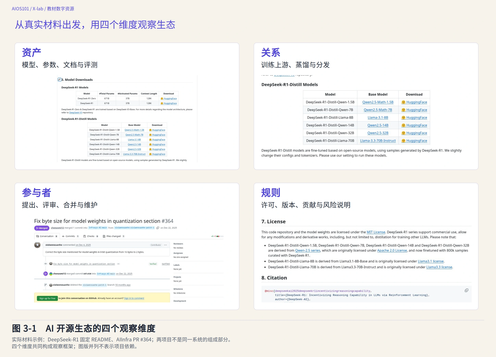

图 3-1　AI 开源生态的四个观察维度。资产、关系、参与者与规则构成观察框架；材料并列不表示两个项目存在依赖。材料来源与固定版本见[附图来源记录](../assets/figures/README.md)。

结构关系与 Mermaid 源码

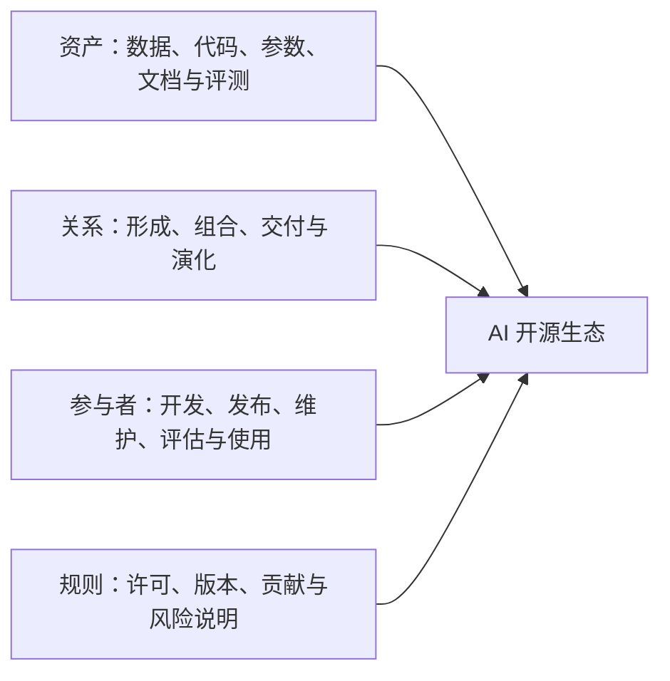

## 3.2　生态中有哪些资产与资源

### 3.2.1　资产不只是一个模型文件

本书所说的**生态资产**，是能够在 AI 工作中被识别、保存、分发和复用的成果或材料。这个学习性概念用于整理观察对象，不等于法律上的财产分类，也不表示每项资产都已经开放授权。

读下面的表时，可以反复问：“缺了这项材料，我会少知道什么，或少做成哪一步？”例如，模型卡是介绍模型用途、训练与评测信息及局限的说明文件；它能帮助选择模型，却不能代替模型文件本身。表中的微调指在已有模型基础上继续训练，检索指从资料中查找相关内容；此处先理解用途，后续章节再说明过程。

AI 资产既包括数据、代码和模型参数，也包括文档、评测、配置、版本记录与协作知识。它们分别回答不同问题，缺少任何一类，都可能限制某种后续行动。

| 资产类型 | 基本含义与例子 | 主要支持的行动 | 仅有它时仍可能缺少什么 |
|---|---|---|---|
| 数据 | 用于训练、微调、检索、测试或评估的具体材料集合 | 学习、适配、检索和验证 | 数据说明、处理代码、使用权利与代表性证据 |
| 数据信息 | 关于数据来源、范围、选择、处理、标注和限制的说明 | 理解数据如何影响模型，判断适用边界 | 具体数据、模型参数与完整训练过程 |
| 代码 | 数据处理、训练、推理、评测、接口或应用程序 | 执行流程、修改实现、组合系统 | 数据、参数、依赖、算力和运行说明 |
| 模型参数 | 学习过程形成的数值状态，权重是常见形式 | 在合适代码和环境中运行或继续适配模型 | 参数形成过程、数据信息、代码与评估证据 |
| 工具链材料 | 连接不同工作环节的工具、接口、配置和文档 | 把分散资产组织为可工作的流程 | 具体版本兼容、任务适配与维护责任 |
| 文档与版本 | README、模型卡、变更记录、配置说明和已知限制 | 定位对象、理解用途、减少误用 | 实际运行结果和文档之外的长期表现 |
| 评测材料 | 任务、数据集、指标、设置、结果和比较基线 | 检查特定能力、比较不同方案 | 未覆盖任务、真实使用效果和独立复核 |
| 许可与规则文本 | 针对具体材料的授权、条件和项目规则 | 判断可以怎样使用、修改、分享和参与 | 材料是否齐全、技术是否可行、风险是否可控 |
| 协作记录 | Issue、PR、评审、决策与发布记录 | 追踪问题、理解决定、继续贡献 | 全部线下讨论和未公开知识 |

“数据”与“数据信息”尤其需要区分。一份评测题集是数据；说明它怎样收集、筛选和标注，是数据信息。只有数据而没有说明，使用者可能不知道它适合回答什么问题；只有说明而无法取得必要材料，又可能无法完成特定验证。对训练数据而言，公开程度还会受到隐私、版权、安全与平台条件的约束，不能简单以“全部公开原始数据”作为唯一目标。

“模型参数”也不等于完整模型系统。参数是许多数值的集合，通常需要与模型结构、配置和运行代码配合，才能接收输入并产生输出。第一章已经区分模型、产品与 AI 系统；在生态视角下，还要看到它们分别由哪些资产支撑。

### 3.2.2　工具链：让分散成果连接成工作过程

**工具链**是完成一组相互衔接任务所使用的工具、接口、配置与流程的组合。AI 工作中的“链”不是指所有项目都使用同一套软件，而是指一个环节的输出会成为另一个环节的输入。

例如，数据处理工具把原始材料转换为可用数据，训练框架执行学习过程，推理工具在模型形成后处理新输入，评测工具检查结果，应用与协作工具再把能力接入具体任务。不同项目可以替代、组合或只覆盖其中一个环节。

《全球开源发展报告 2026》（下文简称 GOSD 2026）的 4.1 节提供了一种真实的功能分类材料。这里使用的是 2026 年 10 月 22 日完整评审版。报告把支撑智能体任务、编排与运行的项目归为 **Agent Infra（智能体基础设施）**，把支撑模型服务、训练、数据和计算的项目归为 **Model Infra（模型基础设施）**。这两个名称是报告观察技术分工的分区，不是所有行业都必须采用的统一架构。

可以先把两类基础设施理解为两个问题：Model Infra 主要帮助“模型怎样训练和运行”，Agent Infra 主要帮助“怎样组织模型及其他程序完成任务”。智能体是围绕任务、根据反馈推进下一步的系统；它仍需要模型等底层能力。两类分区有联系，并非两套互不相干的世界。

读图 3-2 和图 3-3 时，先读三个大组的标题，再各选一个类别理解其用途，最后才看具体项目名。例如，“编排”是安排多个步骤或程序如何配合，“可观测”是留下便于检查运行过程的记录，“沙箱”是限制程序活动范围的执行环境。图中训练算法和加速技术的名称可留待后续阅读，不作为本章考查要求。

这组全景包含 145 个精选项目。固定分类来自 `antgroup/agentic-ai-landscape` 的提交 `e330d75ea4ca314bc81f6868df63425c8acca5e3`；报告按仓库标识 `repo_id` 对项目去重（同一项目不重复计数），每个项目只计入一个主要类别。Agent Infra 有 86 个项目、12 个类别，Model Infra 有 59 个项目、13 个类别。完整一级分类如下。

| 功能分区 | 观察重点 | 报告中的一级分类 |
|---|---|---|
| Agent Infra：任务入口 | 使用者从什么入口进入智能体任务 | 编码代理、编码工作流与工具链、个人助手、聊天工作区 |
| Agent Infra：构建与编排 | 怎样组织代理、工作流、协议和工具调用 | 多代理编排、工作流与代理构建、代码优先框架、协议与互操作、工具与计算机使用 |
| Agent Infra：运行支撑 | 怎样保留上下文、观察运行并提供执行环境 | 记忆知识与上下文、可观测与评估、开发沙箱 |
| Model Infra：模型服务与后训练 | 怎样提供模型服务、推理和进一步适配 | 模型 API 网关、服务部署、推理引擎、强化学习与环境、监督微调 |
| Model Infra：预训练与加速 | 怎样执行训练、观察和加速计算 | 训练框架与并行、训练评估与观测、机器人基础设施、编译器与加速 |
| Model Infra：数据与计算 | 怎样准备、管理数据并调度计算 | 数据标注、数据集成、数据治理、计算与调度 |

这些类别帮助读者发现一项 AI 工作可能涉及的能力。例如，构建知识助手不能只寻找聊天界面，还要考虑检索或上下文、工具连接、运行环境与评估；让模型提供服务，也不能只看模型文件，还要检查推理、数据和计算条件。至于一个真实项目究竟选用了哪些组件，仍需另外核查文档与配置。

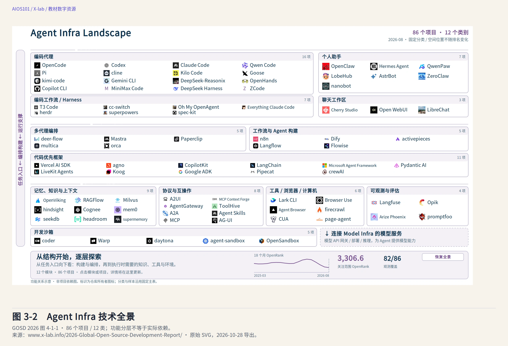

图 3-2　Agent Infra 技术全景。任务入口、构建与编排、运行支撑三组，共 86 个精选项目；分类布局不表示依赖。来源：[GOSD 2026 图 4-1-1](https://www.x-lab.info/2026-Global-Open-Source-Development-Report/2026/zh/chapters/04/)（2026-10-28 导出）。

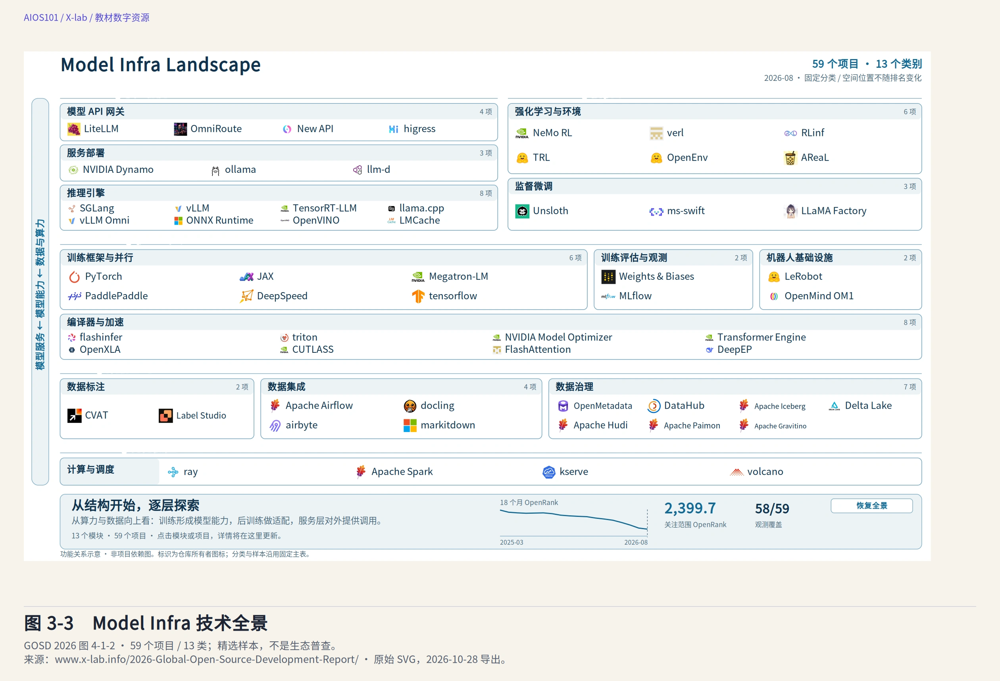

图 3-3　Model Infra 技术全景。模型服务与后训练、预训练与加速、数据与计算三组，共 59 个精选项目；不是生态普查。来源：[GOSD 2026 图 4-1-2](https://www.x-lab.info/2026-Global-Open-Source-Development-Report/2026/zh/chapters/04/)（2026-10-28 导出）。

这里有三个边界必须随图一起阅读：145 个项目是精选样本，不是全球项目普查；图中的位置表示功能分层，不表示项目之间已经存在依赖关系；项目数量也不自动代表该类能力更完整、采用更广或质量更高。报告中的技术分类观察窗口为 2025 年 3 月至 2026 年 8 月，该时间范围不代表每个项目在整个期间都有观测值。

### 3.2.3　算力、平台和运行环境不自动成为开放资产

**算力**是执行计算任务的能力，通常由处理器、内存、互连和相应系统共同提供。训练大模型、运行推理和处理大规模数据都可能需要算力，但需求因模型、任务和配置而异。

算力是重要资源，却不因为某个项目开源就自动变成人人可获得的开放资产。公开模型参数，不等于发布者同时提供训练所需设备；公开代码，也不等于任何个人电脑都能运行完整系统。分析生态时，应分别记录：

- 可以取得和复用的**资产**，如代码、参数、文档和评测；
- 实际运行所需的**资源与环境**，如设备、存储、网络和软件依赖；
- 由外部主体提供的**平台与服务**，如模型托管、API、计算和协作平台。

平台可能同时承担多种角色。DeepSeek-R1 的 GitHub 仓库保存项目文档与协作入口，README 又把模型下载引向 Hugging Face 页面。GitHub 仓库的固定提交不会同时冻结外部模型页面；一个平台上的许可和版本说明，也不能未经验证就套用到另一个平台的材料。

## 3.3　从供应链到生态：观察范围有什么不同

### 3.3.1　供应链追踪成果怎样形成与交付

**供应链**在本书中指围绕一个成果，追踪其上游材料、加工过程、组成部分和下游交付关系的观察方式。它帮助我们回答：这个成果从哪里来，由什么组成，经过哪些环节，最终交付给谁。

传统软件供应链常关注源码、依赖库、构建和发布。AI 供应链还需要关注数据、基座模型、参数、训练或适配过程、评测以及运行环境。一个模型可能以另一个模型为基础，一个应用又可能组合模型、检索数据、推理工具和界面。供应链分析因而不能只追踪代码。

例如，在假想的课程问答系统中，已有模型为系统提供生成能力，课程资料为回答提供内容依据；这个系统又把服务交给学生。如果有人据此制作另一个应用，原系统也可能成为新应用的上游。同一个对象的位置会随问题改变。

**上游**是为当前成果提供材料、能力或支持的一方，**下游**是接收、使用、修改或继续交付该成果的一方。它们是相对于观察对象的位置，不是价值等级。基础模型提供重要起点，下游开发者完成领域适配、评测和文档同样可能创造关键价值。随着观察对象改变，同一项目也可能从上游变成下游。

### 3.3.2　生态包含多条供应链及其共同演化

**生态**的观察范围更广。它不仅关心一个成果怎样交付，还关心多个项目和主体之间的竞争、互补、替代、复用、反馈、维护与共同演化。

| 观察方式 | 主要对象 | 典型问题 | 容易忽略的内容 |
|---|---|---|---|
| 供应链 | 一个成果及其形成、组合和交付过程 | 上游是什么，依赖是否完整，版本能否追踪 | 同类项目的互补、社区反馈和长期演化 |
| 生态 | 多类资产、参与者、资源和规则的关系网络 | 谁与谁连接，哪些能力互补，怎样持续维护 | 某一交付流程中的精确版本与全部技术细节 |

两者不是相互替代的概念。研究一个具体成果时，需要缩小到可核查的供应链；理解它的外部环境时，又要扩展到生态。把生态画成一条从“数据”直达“应用”的单线，会掩盖多个上游、可选工具、反馈回路和并行分工。

## 3.4　生态关系不能都用一种连线表示

生态图最容易造成的误解，是用同一种箭头表示所有关系。两个项目相邻、名称相似、由同一账号发布，或者出现在同一张全景图上，都不足以证明它们存在技术依赖。下面几类关系需要分别辨认。

### 3.4.1　功能分层：它们可以承担不同工作

功能分层按任务或能力组织项目，例如数据处理、训练、推理、评测和应用。它回答“什么项目可能承担什么工作”，是寻找组件和理解分工的起点。

功能相邻不等于实际连接。两个推理工具在分类图中并列，可能是替代关系；一个训练框架和一个推理引擎先后出现，也不表示某个具体系统一定同时安装并使用它们。真实组合仍需项目文档、配置或运行记录支持。

### 3.4.2　依赖：当前成果运行或构建需要什么

**依赖关系**指一个成果在构建、运行或实现某项功能时，需要另一个组件、材料或条件。依赖可能有版本范围、可选功能和环境限制，不应只写项目名称。

DeepSeek-R1 的固定 README 给出使用 vLLM 或 SGLang 启动部分蒸馏模型服务的示例。这些材料证明项目提供了相应运行路径，却不能据此说每个使用者都必须同时依赖这两个工具，更不能推出所有 DeepSeek 产品都采用同一配置。示例、可选依赖和必需依赖需要分别表达。

### 3.4.3　派生：新成果基于哪些上游形成

**派生关系**指新成果基于已有成果，通过修改、训练、适配或其他加工形成，并保留可追溯的来源联系。派生不等于简单复制，也不自动意味着两个项目的维护者存在正式合作。

GOSD 2026 的 5.2 节用模型卡中明确声明的“基座—派生”关系追踪模型谱系。这种方法保留了复用线索，但声明不等于研究者已经独立验证训练过程；没有声明，也不能反向证明模型没有上游。阅读派生图时，应把“发布者声明了什么”和“他人独立核验了什么”分开。

DeepSeek-R1 README 说明，六个蒸馏模型使用 DeepSeek-R1 生成的样本，对 Qwen2.5 或 Llama3 系列模型进行微调。**蒸馏**在这里可以初步理解为把大模型产生的行为或数据用于帮助训练较小模型，具体机制留待后续技术章节。这个案例至少包含两类上游线索：提供生成样本的 DeepSeek-R1，以及作为微调基础的 Qwen 或 Llama 模型。把它压缩成“DeepSeek-R1 复制出六个小模型”，会遗漏真正的资产关系。

许可说明也随关系延伸。README 在说明代码仓库和模型权重的 MIT License 之外，又分别提示 Qwen 与 Llama 上游许可。这提醒我们：下游成果的名称和当前许可说明，不能抹去上游材料及其条件。具体合规判断不在本章展开，但资产清单必须保留这些线索。

### 3.4.4　分发：成果怎样到达使用者

**分发关系**关注成果从发布者、平台或镜像到达使用者的过程。下载一个未修改的模型文件，通常首先是分发；基于该文件继续训练并发布新版本，才涉及派生。二者可能连续发生，却不是同一个动作。

聊天网站、API 和模型下载也是不同交付方式。使用在线产品，不等于取得了模型文件；取得模型文件，也不等于获得在线产品的全部检索、界面和运营配置。分析交付对象时，应写清“谁把什么，以何种形式，交给谁”。

### 3.4.5　协作：谁围绕共同成果提出和处理变更

**协作关系**发生在参与者围绕共同成果讨论问题、提出贡献、评审变更和维护版本的过程中。第二章的 Issue 与 PR 是可观察记录，但协作不局限于代码托管平台，也包括评测、翻译、文档、组织和长期维护。

两个人共同参与过同一个仓库，可以构成协作网络中的一条记录；这并不证明他们参与的两个软件互相依赖。同样，下游模型复用了上游成果，也不表示改进已经回到上游。复用、合作和贡献回流需要各自证据。

### 3.4.6　治理：谁决定规则并承担后果

**治理关系**关注项目方向、贡献接纳、发布、风险处理和维护责任由谁决定与承担。它不是“是否有一个管理员”的简单问题，也不等于参与者数量或讨论热度。

一个项目可以采用开放许可，同时由较小团队决定正式版本；也可以有多类组织参与，但对不同组件采用不同规则。本章只要求把决策和责任关系与依赖、派生关系分开，具体治理模式将在第 10 章讨论。

| 关系类型 | 主要问题 | 可支持的证据举例 | 不能仅凭什么判断 |
|---|---|---|---|
| 功能分层 | 项目承担什么能力 | 分类说明、项目功能文档 | 图中相邻或同一类别 |
| 依赖 | 构建或运行需要什么 | 依赖文件、配置、安装与运行文档 | 两个项目都很流行或经常一起出现 |
| 派生 | 新成果基于什么形成 | 模型卡、上游声明、训练或修改说明 | 名称相似、文件格式相同 |
| 分发 | 什么对象怎样被交付 | 下载页、发布记录、API 与产品说明 | 能访问网页或能够调用服务 |
| 协作 | 谁提出、评审和维护了什么 | Issue、PR、评审和发布记录 | 派生关系或共同关注者 |
| 治理 | 谁决定规则并承担责任 | 治理文档、维护者记录、发布与决策过程 | 参与者多或许可证相同 |

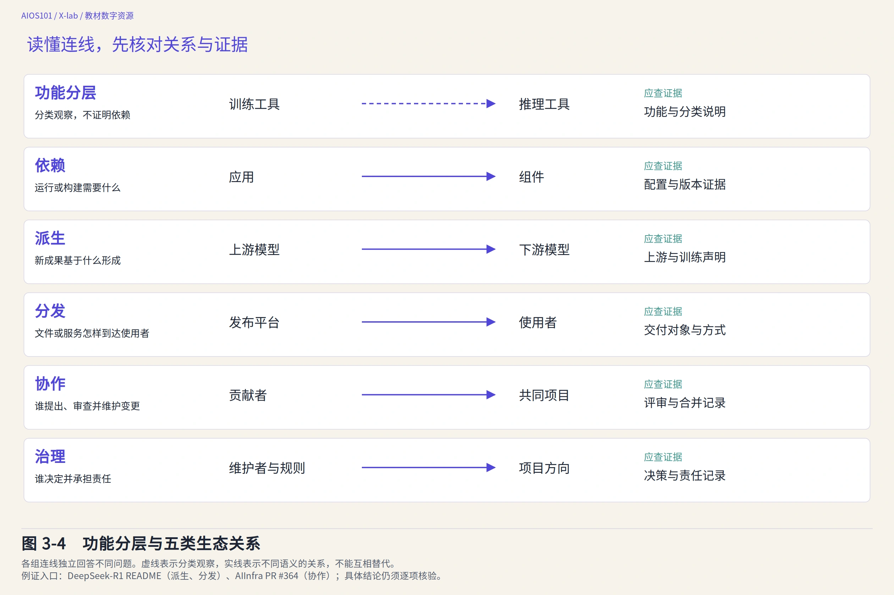

图 3-4　区分生态关系与证据。各组连线回答不同问题，需要不同证据；虚线表示功能分类，不表示实际依赖。

结构关系与 Mermaid 源码

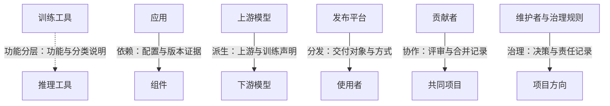

## 3.5　参与者与规则：生态为什么能够持续

### 3.5.1　一个主体可以承担多种角色

AI 开源生态中的参与者不只是模型作者和程序员。常见角色包括：

| 参与者 | 可能承担的工作 | 需要被看见的贡献或责任 |
|---|---|---|
| 数据与知识贡献者 | 收集、整理、标注、翻译和说明材料 | 数据质量、来源、代表性与权利边界 |
| 模型与工具开发者 | 形成模型、实现训练或推理工具、修复问题 | 技术实现、兼容、测试与维护 |
| 发布组织与维护者 | 决定版本、文档、许可说明和贡献处理 | 交付完整性、决策与长期责任 |
| 平台与基础设施提供者 | 托管资产、提供计算、协作和分发服务 | 可及性、稳定性、记录和服务条件 |
| 评测者与研究者 | 设计任务、复核结果、分析局限 | 评价方法、证据和独立检查 |
| 使用者与下游创作者 | 选择、适配、组合并反馈实际表现 | 新场景知识、问题报告与再创造 |
| 高校、公共机构与教育者 | 组织学习、研究和公共支持 | 降低参与门槛、培养能力和支持公共价值 |

这些角色可以重叠。一所高校可能同时开展研究、发布模型、制作课程和维护数据；一个企业可能既提供上游模型，也是其他项目的下游使用者；一名学生也可能从使用者变成文档或评测贡献者。生态图不应把主体永久固定在单一框格中。

### 3.5.2　规则把技术连接变成可预期的合作

资产能够连接，不表示合作自然顺畅。许可说明允许什么行动，版本记录帮助人们讨论同一对象，贡献指南说明怎样提出修改，评测规则说明结果怎样比较，风险说明提示哪些用途需要额外谨慎。它们共同降低误解，却不会消除全部分歧和成本。

规则也可能分层出现。一个下游项目有自己的发布规则，同时保留上游许可；一个托管平台有服务条件，具体项目又有自己的贡献规则；模型、数据集和文档可能分别授权。因此，“采用 MIT License”这样的简短标签不能替代对具体对象和版本的核查。

### 3.5.3　生态演化依赖反馈与维护

发布不是关系的终点。下游使用者发现兼容问题，评测者揭示未覆盖任务，文档贡献者降低理解难度，维护者修复缺陷并发布新版本，这些行动会改变后续使用者的条件。与此同时，项目也可能停止维护、平台可能改变接口、依赖可能产生安全风险，旧结论需要重新核验。

生态因此不是静态目录。观察一个时点可以帮助我们理解结构，但“目前有多少项目”“哪条关系仍然存在”“谁正在维护”都必须绑定日期和证据。第 9 章将系统学习如何处理这类动态数据，本章先建立不过度推断的阅读习惯。

## 3.6　回到 DeepSeek-R1：一份真实项目资产清单

现在把前面的框架重新用于 DeepSeek-R1。先读“模型权重—推理工具—聊天网站与 API”三行，辨认文件、软件与服务的区别；再读上游模型和生成样本两行，分辨模型的起点与学习材料的来源。表中的上下文长度指模型一次处理的内容范围限制，第 5 章会作解释。下表不是对该模型作完整开放程度认证，而是根据固定 README 登记“看到了什么、它与谁连接、还不能推出什么”。

| 观察对象 | 固定材料中的线索 | 在生态中的作用 | 结论边界 |
|---|---|---|---|
| DeepSeek-R1 与 R1-Zero | 模型介绍、参数规模、上下文长度和下载入口 | 核心模型资产及研究对象 | 下载入口不证明训练数据和全部过程材料齐全 |
| 模型权重 | README 链接到 Hugging Face 模型页面 | 支持在适当代码和资源环境中运行、研究和适配 | GitHub 固定提交没有冻结外部模型文件及其页面 |
| 代码与运行说明 | 指向 DeepSeek-V3 仓库，提供部分蒸馏模型的运行示例 | 连接模型资产与推理工具 | 不据此推断仓库包含完整训练代码或所有运行路径 |
| 推理工具 | vLLM、SGLang 示例 | 展示模型服务的一种实现选择 | 示例不等于唯一依赖，也不证明任意版本兼容 |
| 上游模型 | R1 基于 DeepSeek-V3-Base；蒸馏模型基于 Qwen2.5 或 Llama3 系列 | 显示模型形成和适配的上游关系 | 不由名称推定未提供的训练细节或许可结论 |
| 生成样本与蒸馏过程 | README 说明使用 R1 生成样本微调相关模型 | 连接教师模型、基础模型与下游蒸馏模型 | 过程概述不等于完整数据、配置和复现材料 |
| 评测与使用建议 | 任务、指标、生成设置和对比表 | 提供特定条件下的表现证据 | 项目自报结果不自动等于独立复核，也不覆盖全部真实任务 |
| 许可与上游许可提示 | 代码仓库和模型权重的 MIT License；Qwen、Llama 相关提示 | 规定部分资产的使用条件，保留上游线索 | 不据此把在线产品和所有第三方材料归为同一许可 |
| 聊天网站与 API | 官方产品和平台入口 | 面向使用者的服务交付 | 产品可用不等于完整产品系统开放 |
| 协作入口 | README 提供 Issue 等联系入口 | 为问题反馈提供可能路径 | 入口存在不证明响应质量、治理方式或贡献已经回流 |

这份清单呈现出一种比“模型—用户”更真实的结构：一个模型有上游基础，也可能成为其他模型的知识和数据来源；模型文件需要运行工具，评测需要任务和配置，分发可能跨越多个平台，许可需要沿资产和上游关系分别阅读。

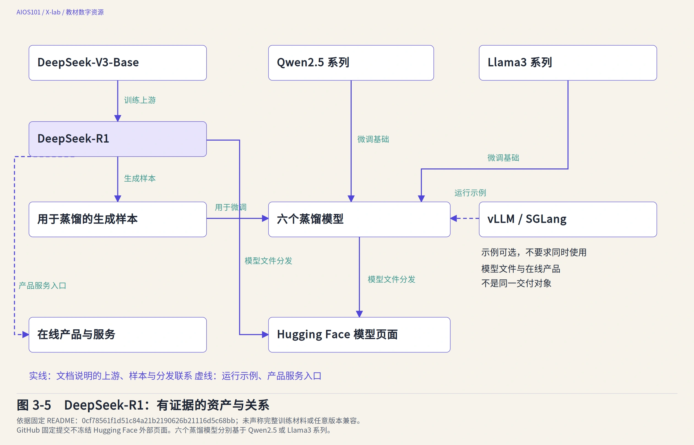

图 3-5　DeepSeek-R1 的资产与关系。实线表示文档说明的上游、样本与分发联系，虚线表示运行示例和产品入口；不要求同时使用 vLLM 与 SGLang。在线产品与可下载模型不是同一交付对象。依据：[DeepSeek-R1 README](https://github.com/deepseek-ai/DeepSeek-R1/blob/0cf78561f1d51c84a21b2190626b21116d5c68bb/README.md)（0cf7856）；文档说明不等于完整复现证据。

结构关系与 Mermaid 源码

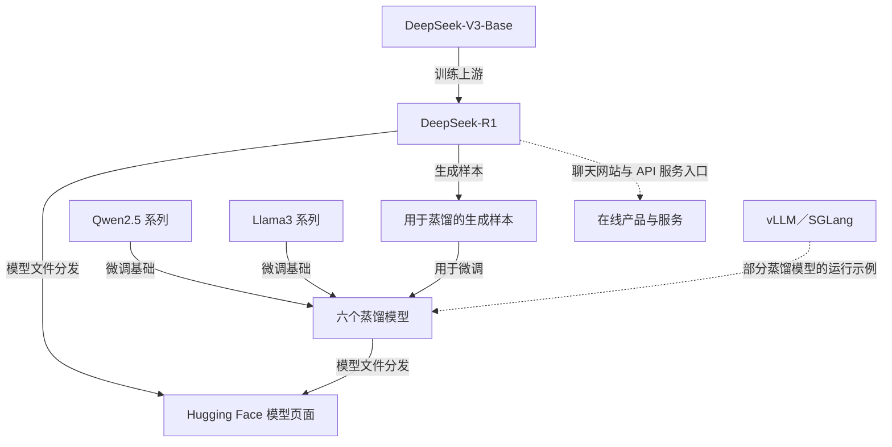

资产清单还有一项重要功能：让“未知”变得可见。与其用一句“资料不全”概括，不如具体写出哪项材料未提供、哪个版本未固定、哪种关系未核实、哪个外部页面需要另行核查。这样的清单不是开放评级，也不替代合规审计或技术复现；它是后续第 7 章开放判断和第 8 章复现分析的起点。

## 3.7　怎样阅读技术全景与生态图

### 3.7.1　先问分类和取样，再看数量与位置

这些全景图名称很多，但本节只要求学会两件事：看清一张图怎样挑选对象，以及不把图中位置或数量读成未经证明的结论。

GOSD 2026 的 4.2 节把视线从软件项目转向模型任务。它使用 2026 年 10 月 2 日快照，选取 96 个公开模型，分为六类任务；每一类都按当时近 30 天下载量选取前 16 个，因此总数为 96 个。为便于理解，本书把这六类按所处理的信息与行动归为三组：

| 理解分组 | 报告中的任务类别 | 可以帮助初学者提出的问题 |
|---|---|---|
| 语言与检索 | 文本生成、嵌入与检索 | 模型怎样生成语言，或把内容转换为便于检索的表示？ |
| 视觉与融合 | 图像与视频、多模态 | 模型怎样处理视觉内容，或联合理解文字、图像等信息？ |
| 声音与行动 | 语音与音频、机器人 | 模型怎样处理声音，或进入感知与行动任务？ |

“嵌入”是把文字等内容转换成一组可计算的数值，用于比较或检索；“多模态”是联合处理文字、图像、声音等不同形式的信息。第 6 章将用检索示例说明嵌入的用途。此处不需要掌握向量计算。

这张全景首先帮助读者发现“模型不只有聊天模型”，再进一步思考不同任务需要哪些数据、工具与评价方法。但每类数量相同是取样规则的结果，不能推出六类领域供给相同；图内序号是特定窗口内的下载量次序，不是通用能力排名；下载量也不等于独立用户数。公开可下载只是获取现象，不等于每个模型都已满足开源资格。

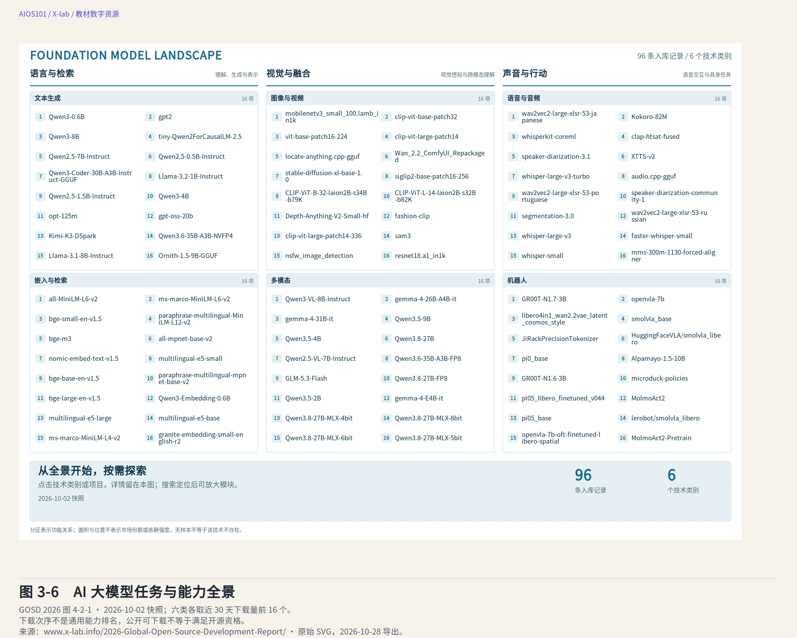

图 3-6　AI 大模型任务与能力全景。六类任务各取 16 个模型，2026-10-02 取样；下载次序不等于能力排名。来源：[GOSD 2026 图 4-2-1](https://www.x-lab.info/2026-Global-Open-Source-Development-Report/2026/zh/chapters/04/)（2026-10-28 导出）。

4.6 节的 PyTorch 生态全景采用另一种组织方式。**PyTorch** 是常用的机器学习框架，但围绕它形成的不只是一个核心代码库，还有模型任务、训练执行、工程支撑和社区协作材料。报告把 83 条相关项目记录组织为 13 个技术类别及一个待核区：计算机视觉、音频、强化学习、领域应用、数据、隐私、训练、分布式训练、编译器与运行时、优化、MLOps、核心基础设施、文档与社区。MLOps 指支持机器学习开发、部署、监测和维护的工程实践。另有一条记录的分类或样本适用性待核，报告没有把它强行归入确定类别。

读图 3-7，可以沿“准备数据—执行训练—让程序运行—维护文档与社区”找四类工作。分布式训练指多台设备分工训练；编译器与运行时帮助程序转换和执行；强化学习利用反馈改进策略。知道这些名称对应哪类工作即可，不必在本章追究算法。完整类别保留作查阅目录。

这里的“生态样本”不自动代表 PyTorch 基金会正式托管或成员项目，也不表示所有项目互相依赖。相同项目在不同观察框架中可能承担不同角色，分类服务研究问题，而不是给项目贴上永久唯一的标签。

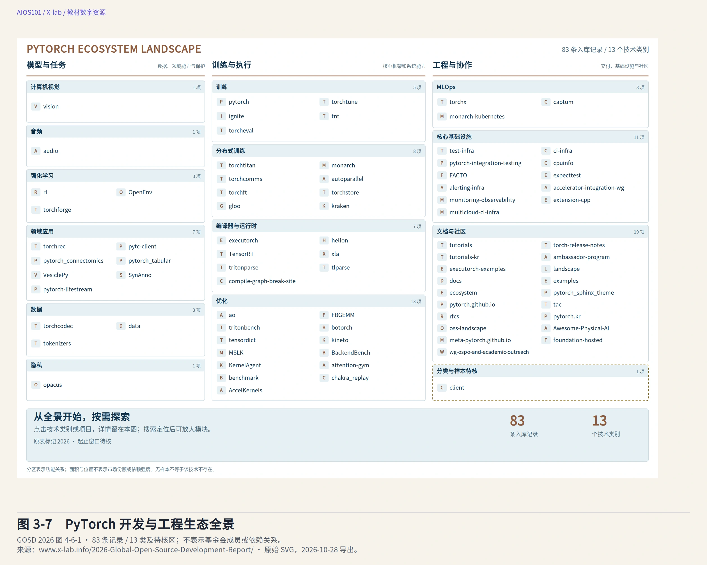

图 3-7　PyTorch 开发与工程生态全景。13 个技术类别、待核区及 83 条项目记录；分类不表示基金会成员或软件依赖。来源：[GOSD 2026 图 4-6-1](https://www.x-lab.info/2026-Global-Open-Source-Development-Report/2026/zh/chapters/04/)（2026-10-28 导出）。

### 3.7.2　图上的一条边，必须说明是什么边

**OpenDipper（开源北斗）**是 X-lab 建设的开源生态观测与探索工具，包含全球观测、AI 雷达、开源星系和情报整理等模块。本章使用其中的 **Open Galaxy（开源星系）**说明关系证据。图谱用**节点**表示对象，用**边**表示对象之间按某种规则记录的关系；一个节点的邻域就是与它直接相连的对象。数据快照指某一时点保存的一份数据状态；元数据则是关于对象的信息，例如名称、发布者或类别。

它不是把互联网上的所有对象连成一张“全网真相图”，而是在固定数据快照中帮助使用者发现候选、查看邻域、追踪记录路径并整理有来源的研究材料。以下说明以本书固定的[项目说明](https://github.com/X-lab2017/open-dipper/blob/8fa36b5d19f9bdc01fe1505f153c19b3c499c712/README.zh-CN.md)和 [Open Galaxy 契约](https://github.com/X-lab2017/open-dipper/blob/8fa36b5d19f9bdc01fe1505f153c19b3c499c712/docs/OPEN_GALAXY.md)为准。

| 网络 | 固定样本 | 观察期与关系口径 |
|---|---|---|
| 代码网络 | 19,771 个精选且连通的 GitHub 仓库，106,650 条共同贡献者关联边 | 2025 年 8 月至 2026 年 7 月；共同贡献者形成的是协作关联，不是软件依赖链 |
| 模型网络 | 12,000 个模型、7,000 个数据集、5,000 个 Spaces；19,305 条记录边和 23,958 条推断边 | 2026 年 8 月 5 日 Hugging Face 元数据快照；记录关系与推断关系分别控制 |

这里的 **Space** 是 Hugging Face 上承载交互演示或应用的一种对象，不能与模型或数据集混为一类。两个网络分别整理和规范化，不用虚构连线把代码与模型强行接成同一网络；刷新网页也不会推进数据日期。因此，比较两个节点时必须先确认它们是否来自同一网络、同一对象类型和同一观察期。

Open Galaxy 把**记录关系**与**模型推断关系**分开：前者来自数据中已有的记录，默认显示；后者是辅助发现的推断，默认关闭，并用不同样式呈现。共同贡献者或同一发布者形成的路径不是软件依赖链，推断的任务或分类关系也不证明模型祖先或直接合作。记录路径搜索最多经过三条边，且不混入推断边；没有找到路径，只表示当前快照中没有找到符合条件的路径，不代表现实中绝无关系。

用一个假想例子检验读法：小陈给仓库甲和仓库乙都修改过文档，两个仓库便可能因共同贡献者而相连。这条边能说明存在共同参与的记录，却不能说明甲运行时调用乙。后一个判断需要依赖文件或运行说明。这正是先读图例、再读连线的理由。

这种设计提醒我们，图谱的视觉吸引力不能替代关系证据。节点距离近，不表示技术更相似；节点大小或边线强弱也不是通用质量分数；一条路径存在，不表示因果或正式合作。

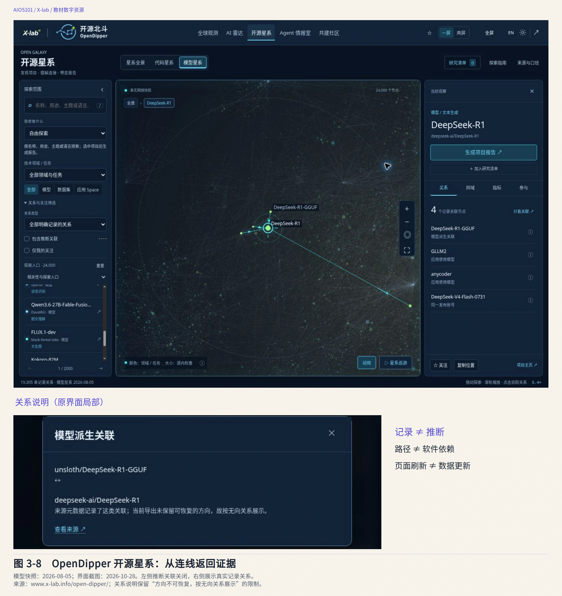

图 3-8　OpenDipper 开源星系界面。保留记录／推断关系控制与局部关系说明；当前界面不冒充教材引用的旧提交界面，页面刷新不代表数据更新。来源：[OpenDipper](https://www.x-lab.info/open-dipper/)（界面截图 2026-10-28；模型数据 2026-08-05）。

一张负责任的生态图至少应让读者看见：

- **对象与版本**：节点是模型、模型版本、仓库、组织、平台还是服务；
- **观察边界**：为什么收录这些对象，使用哪个日期或快照；
- **关系类型**：连线表示依赖、派生、分发、协作、治理还是推断；
- **方向与证据**：关系从谁指向谁，依据哪份文档或记录；
- **未知与缺失**：哪些字段未提供，哪些对象未覆盖，哪些判断尚待核验。

如果一幅图无法回答这些问题，可以先把它当作发现线索的目录，而不要把它直接当成供应链证明或影响力结论。

## 3.8　从全景走向理解与创造

生态全景的价值，不是让初学者记住尽可能多的项目名称，而是帮助我们提出更准确的问题。面对一个 AI 成果，可以逐渐形成以下思考顺序：

**我正在观察哪个对象和版本？它包含哪些资产？还需要哪些资源？它与上游和下游是什么关系？谁参与并维护？哪些规则适用？哪些结论仍缺证据？**

这些问题会随学习目标继续深化。第 4 章将进入数据、算法、算力与训练过程，解释模型能力怎样形成；第 5 章将观察模型运行与评估；第 6 章会把模型接入检索、工具和智能体。届时，本章的“资产—关系—参与者—规则”框架仍然适用，但每个环节会获得更具体的技术解释。

对创造者而言，全景意识同样重要。一个作品不仅要能运行，还应让他人知道使用了哪些开放成果、怎样组合、哪些部分经过修改、结果如何验证、哪些条件需要保留。理解生态，最终是为了更有根据复用、更负责任地创造，并让自己的成果能够进入下一轮共同建设。

## 本章小结

一个 AI 成果不是孤立模型，而是由数据、数据信息、代码、模型参数、工具链、文档、评测、许可和协作记录等多种资产共同支撑。算力、平台和运行环境是重要条件，却不因项目开放就自动成为开放资产。

供应链追踪一个成果怎样形成、组合和交付；生态进一步观察多项目、多主体之间的互补、复用、协作、维护与共同演化。上游和下游是相对位置，不是价值等级。功能分层、依赖、派生、分发、协作与治理分别需要不同证据，不能用同一种箭头替代。

DeepSeek-R1 的固定 README 展示了模型权重、外部下载平台、运行工具、上游模型、蒸馏模型、评测、许可和产品入口如何连接，也显示一个仓库不能冻结或代表整个系统。GOSD 技术全景和 OpenDipper 则提醒我们：分类不是依赖，样本不是普查，推断不是事实，未覆盖不是零。

因此，理解 AI 开源生态的关键不是收集名词，而是能够围绕具体对象说明：有哪些资产，它们怎样连接，谁在其中工作，哪些规则生效，以及现有证据还不能说明什么。

## 关键术语

- **生态资产**：能够在 AI 工作中被识别、保存、分发和复用的成果或材料；该学习性概念不表示其已经开放授权。
- **数据信息**：关于数据来源、范围、选择、处理、标注和限制的说明，与具体数据本身相互关联但不相同。
- **模型参数**：模型通过学习过程形成的数值状态，权重是常见形式，通常需要结构和运行代码配合。
- **工具链**：完成相互衔接任务所使用的工具、接口、配置与流程组合。
- **算力**：执行计算任务的能力，是运行资源，不自动等同于开放资产。
- **供应链**：围绕一个成果追踪上游材料、形成过程、组成部分与下游交付的观察方式。
- **生态**：围绕成果形成、开放、复用、协作、交付与维护，由资产、参与者、资源和规则共同构成的关系网络。
- **上游／下游**：相对于当前观察对象提供输入或接收、使用、继续加工成果的位置，不代表价值高低。
- **依赖关系**：一个成果在构建、运行或实现功能时需要另一组件、材料或条件的关系。
- **派生关系**：新成果基于已有成果，通过修改、训练、适配或其他加工形成的可追溯关系。
- **分发关系**：成果以文件、服务或其他形式从发布者、平台到达使用者的交付关系。
- **协作关系**：参与者围绕共同成果提出需要、贡献改进、评审和维护的关系。
- **治理关系**：围绕项目方向、贡献接纳、发布、风险与维护责任形成的决策和责任关系。
- **功能分层**：按任务或能力组织项目的分类方式，本身不证明项目之间存在依赖。

## 自学核对

**1. 一张图从六类模型中各选 16 个，能否得出“六类模型同样丰富”？**

不能。每类 16 个是取样规则规定的数量。要比较实际供给，还需要各类总体数量、收录范围和时间口径；下载量也不能替代能力评价。

**2. 从 README 的链接下载了模型，是否已固定整个系统版本？**

没有。固定提交只固定该仓库当时的内容；外部下载页、模型文件和运行工具需要各自的版本记录。先列出对象，再逐个固定，才能知道比较时哪些条件变了。

**3. 为什么图 3-5 中的蒸馏模型不能只画成“R1 变小了”？**

固定 README 描述了两类不同来源：R1 提供生成样本，Qwen 或 Llama 模型提供继续训练的基础。忽略任何一类，都会丢失过程和上游条件。这个解释基于文档说明，并非本书独立重做了训练。

## 思考与探究

1. 为什么“下载了模型权重”仍然不足以说明你已经理解并能够复现一个 AI 成果？
2. DeepSeek-R1 的六个蒸馏模型同时涉及哪些上游资产？只用一条“R1 → 小模型”的箭头会遗漏什么？
3. 一个模型文件从 Hugging Face 页面被下载，与基于该模型继续训练并发布新版本，分别属于什么关系？
4. 为什么 GOSD 的六类模型各 16 个，不能说明六类任务的实际供给规模相同？
5. 如果一张生态图把“共同贡献者”“模型派生”和“软件依赖”都画成相同箭头，可能产生哪些错误判断？
6. 选择一个你熟悉的 AI 工具，哪些观察结论来自产品使用，哪些必须进一步核查公开项目材料？

## 延伸学习

- **希望理解 AI 工具链怎样分工**：阅读《全球开源发展报告 2026》4.1.1 的 Agent Infra 与 Model Infra 技术结构、4.2 的模型任务分类和 4.6 的 PyTorch 生态全景。重点比较三种分类分别回答什么问题，并保留精选样本、功能分层和待核记录的边界，而不是记忆项目排位。
- **希望练习阅读真实项目资产清单**：对照 [DeepSeek-R1 固定 README](https://github.com/deepseek-ai/DeepSeek-R1/blob/0cf78561f1d51c84a21b2190626b21116d5c68bb/README.md)的 Model Summary、Model Downloads、How to Run Locally、Evaluation Results 与 License 部分，区分模型、上游、运行示例、评测和许可线索。阅读不要求下载模型或运行代码。
- **希望进一步辨析生态图中的关系**：阅读 OpenDipper 的 [Open Galaxy 契约](https://github.com/X-lab2017/open-dipper/blob/8fa36b5d19f9bdc01fe1505f153c19b3c499c712/docs/OPEN_GALAXY.md)中 Discovery and research 与 Data contract 两部分，重点理解记录关系、推断关系、共同贡献者路径和软件依赖链的区别，以及为什么“未找到路径”只能限定在当前快照中解释。
