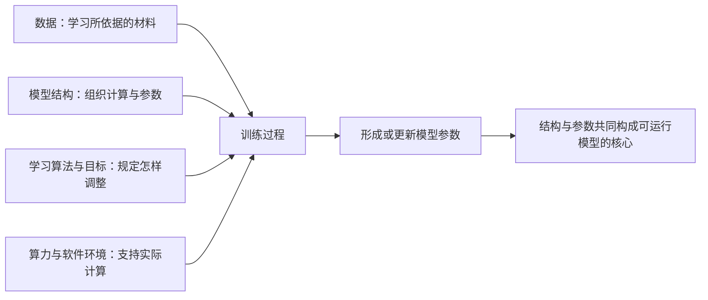
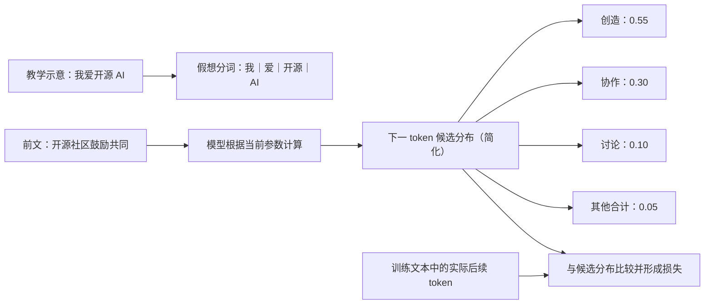
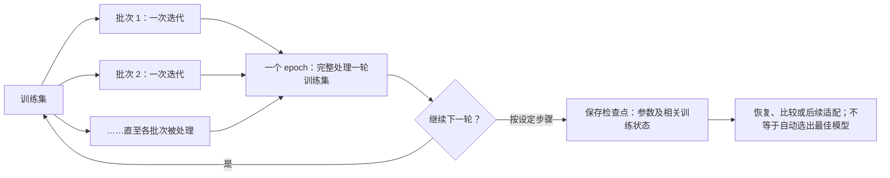
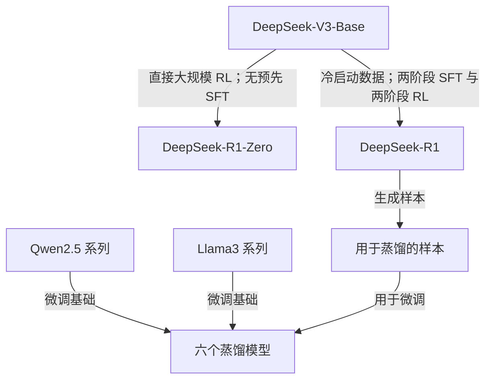
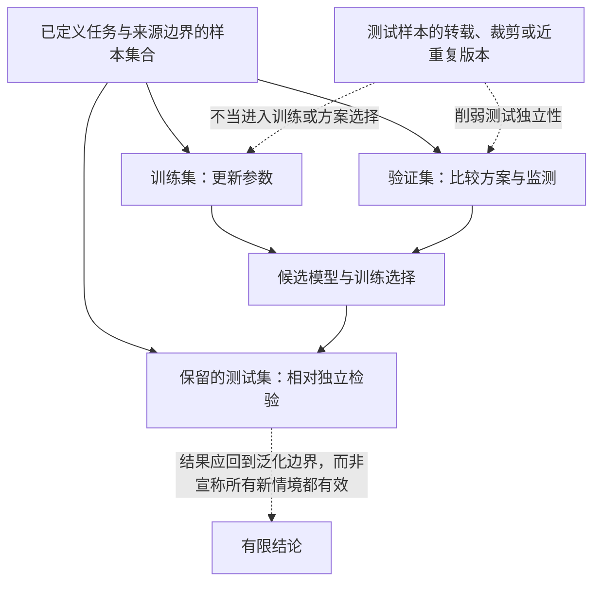

# 第 4 章　从数据到模型：智能如何形成

> 版本：v0.2
>
> 状态：打印教材草稿
>
> 对应规格：[CH04](../../specs/chapters/CH04-data-to-models-spec.md)

## 本章学习成果

完成本章学习后，你应能够：

1. 解释数据、模型结构、学习算法、参数与算力在模型形成中的不同作用；
2. 用预测、误差和参数更新说明模型怎样从数据中学习，而不把训练理解成原样存储资料；
3. 区分预训练、后训练、监督微调、强化学习与蒸馏，并说明它们在真实模型形成链中的位置；
4. 区分训练集、验证集与测试集，解释过拟合和数据泄漏会怎样影响判断；
5. 阅读真实数据与模型材料时，识别变量、控制条件、实验现象和结论边界；
6. 说明公开数据、代码、参数与训练说明分别支持哪些理解、比较和复现行动。

## 一、一次回答之前，模型经历了什么

使用 DeepSeek 等 AI 工具时，我们看到的是输入问题与得到回答。第三章已经把视野扩展到模型之外的数据、代码、工具链、平台与社区。本章再沿时间向前追溯：在第一次回答你的问题之前，一个模型怎样获得处理语言、图像或其他信息的能力？

一个常见回答是：“它读过很多资料。”这句话提供了直觉，却还没有解释机制。人读完一本书，可以复述、联想和判断；计算机处理大量文本，是否也把每一页原样收进一个可以翻阅的数据库？如果不是，资料与最终模型之间究竟发生了什么？

另一个常见回答是：“它靠数据和算力训练出来。”这句话同样正确得不充分。相同数据采用不同过滤方法，可能形成不同训练材料；相同材料采用不同模型结构或训练目标，也可能得到不同结果；增加计算资源，并不自动纠正数据中的错误和偏差。要理解模型形成，必须把这些要素放在同一个过程中观察。

本书所说的大模型**训练**，是让模型根据训练目标和数据反复调整内部数值，使其在相应任务上的表现逐步改变的计算过程。训练的结果之一，是形成一组可在后续计算中使用的**模型参数**。第三章已经指出，权重是模型参数的常见形式。本章将进一步说明：参数不是开发者逐条写入的知识，也不是对训练资料的简单压缩，而是学习过程留下的数值状态。

因此，本章的核心问题不是“模型读过什么”这么简单，而是：

**数据被怎样选择和处理？模型依据什么目标学习？计算怎样改变参数？不同训练阶段分别塑造什么？公开材料又让我们能够核查到哪里？**

## 二、模型形成需要哪些要素

### 1. 数据：学习所依据的材料

在机器学习中，**数据**是以某种形式记录、可供计算处理的信息集合。文本、图像、声音、传感器记录、程序代码、人工标注和模型生成内容都可能成为数据。一个**样本**是数据集中用于学习或评价的一个基本单位，可以是一段文本、一张图片、一组问答，也可以是其他经过定义的输入与目标。

这里需要区分四个容易混用的词。**原始材料**是尚未按任务整理的记录，例如一张校园鸟类照片或一篇网页；**样本**是按学习任务组织后的基本单位；**标注**是附加在样本上的类别、答案或其他目标信息；**目标输出**则是训练时希望模型学习产生的结果。假设任务是“看照片识别鸟种”，原始照片经过选取和格式处理后成为一个样本的输入，经过核验的鸟种名称是它的标注，也是本次训练的目标输出。若任务变成“为照片写一句说明”，同一张照片仍在，目标输出却会变成一段文字。可见，样本怎样组织取决于任务，而不是材料天然只有一种用途。

数据不只是“原始素材”的同义词。网页经过正文提取、语言识别、过滤和去重之后，形成的训练数据已经包含了许多人的设计决策。哪些来源被纳入，哪些内容被删除，不同领域占多大比例，错误怎样处理，都会影响模型最终接触到什么。

数据也不只用于预训练。示范问答可用于监督微调，偏好或奖励相关材料可用于后续优化，测试题可用于评价，文档还可能在运行时作为检索材料出现。同一种内容在不同阶段承担不同作用，不能把所有“给 AI 的资料”都称为训练数据。本章主要讨论用于形成或继续调整模型参数的数据；运行时检索将在第六章展开。

### 2. 模型结构：计算怎样被组织

**模型结构**也常称模型架构，指模型由哪些计算组件构成、这些组件怎样连接、参数如何组织，以及输入怎样经过计算得到输出。它像是一种可学习的计算形式，但结构本身还不等于训练完成的模型。

可以用“空白乐谱与演奏规则”作一个有限类比：结构规定有哪些位置、信息按什么路径流动，学习过程则逐步决定其中的数值。这个类比只帮助区分结构与参数，并不表示模型真的使用纸张、音符或人类演奏规则。

不同结构适合处理的问题、计算成本和训练方式可能不同。本书不需要初学者立即掌握 Transformer、注意力机制或各种网络层，只需先建立一个判断：**模型结构提供计算的骨架，训练不会自动替所有结构选择唯一正确答案。**

### 3. 学习算法：参数依据什么规则更新

**学习算法**是模型根据数据和训练目标调整参数的方法与规则。它要回答：怎样计算当前结果与目标之间的差距，怎样估计各参数对差距的影响，又怎样据此更新参数。

日常语言中的“算法”范围很广。排序、搜索和推荐系统都可以使用算法；本章的“学习算法”特指支持参数学习的那部分方法。模型结构规定计算怎样组织，学习算法规定数值怎样调整，两者不能混为一谈。

训练目标也不等于产品的全部目标。一个语言模型可以以“更准确地预测后续文本单位”为基本训练目标，而人们最终希望它帮助写作、编程或回答问题。后续训练与系统配置还会继续影响它怎样表现出这些能力。

### 4. 参数：学习过程留下的数值状态

**参数**是模型计算中通过学习调整的数值。许多现代模型包含大量参数，它们共同影响输入怎样被转换、哪些特征被加强或减弱，以及最终输出如何形成。参数文件通常需要与模型结构、配置和运行代码配合，不能脱离这些条件独立回答问题。

模型名称中的 **B** 常用来标记参数规模的数量级，来自英文 billion，即十亿。例如 7B 通常表示约 70 亿个参数，32B 通常表示约 320 亿个参数。具体项目可能采用近似命名，应以模型配置说明为准。这个标记不是文件大小的直接数值：实际文件还受数值精度、存储格式和其他资产影响，更不能仅凭 B 推断运行速度、回答质量或设备要求。

把参数想象成许多旋钮可以帮助入门：每训练一次，某些旋钮按照学习规则发生微小变化，大量变化逐步累积。可是，这个类比也有边界。真实模型并不是每个旋钮对应一条明确知识或一条人工规则，单个数值通常不能独立解释成“北京是首都”或“用户喜欢简短回答”。能力分布在大量参数及其组合计算之中。

因此，“增加参数”不是向模型里逐条增加事实，“修改参数”也不等同于精确编辑一条知识。怎样可靠地编辑模型知识，是另外一类研究问题。

### 5. 算力：让学习过程实际发生

**算力**是执行计算任务的能力。数据清洗、样本读取、模型计算、梯度计算、参数更新和中间结果保存，都需要处理器、内存、存储、互连及相应软件共同支持。大模型训练往往需要大量计算，但具体需求取决于模型规模、结构、数据量、训练步数、精度、并行方式和工程实现，不能只根据一个参数数字推算。

算力不是学习能力本身。设备增加可以缩短某些计算时间，或使更大规模实验成为可能，却不能保证数据合适、目标合理或结果可靠。正如第三章所强调的，公开参数也不意味着发布者同时向公众提供重新训练所需的全部计算资源。

图 4-1　模型形成的基本要素。数据、结构、学习算法与算力共同进入训练过程；参数是学习结果，不是第四份原样输入材料。

这张图也提示我们避免单因解释。问“模型能力来自数据、算法还是算力”，就像问一顿饭来自食材、菜谱还是厨房设备，答案必然是相互作用。更重要的是，开源让我们不必停在“相互作用”这句概括上：数据说明、处理代码、训练配置和实验记录能够帮助我们继续追问每一部分具体做了什么。

## 三、数据不是原料堆：FineWeb 的处理链与对照实验

### 1. 从公开网页到训练数据，需要作出哪些选择

网页公开可访问，不等于把它直接交给模型就是合适的训练方案。一个网页可能同时包含正文、导航栏、广告、脚本和重复链接；同一文章可能被多个网站转载；不同网页的语言、质量、主题和发布日期不同。若把所有内容无差别混合，模型接触到的分布就会受到这些因素影响。

这里出现两个重要概念。**数据分布**可以先理解为不同内容在数据集中的组成与出现情况，例如语言、主题、来源、长度和质量各占怎样的比例。**数据配方**则是对数据来源、筛选、清洗、去重、混合与处理顺序的一组具体决策。配方不是简单列出“用了哪些网站”，还包括哪些内容被保留、哪些被排除，以及为什么这样选择。

常见的数据处理工作包括：

- **正文提取**：从网页等原始格式中分离希望学习的内容；
- **过滤**：依据语言、格式、内容规则或其他标准保留和排除样本；
- **去重**：识别并处理完全重复或高度相似的内容；
- **配比与采样**：决定不同来源或类别在训练中的相对出现方式；
- **隐私与安全处理**：根据目标、法律与伦理要求处理特定信息；
- **记录与检查**：保存来源、处理版本和结果，检查处理是否产生了意外偏差。

这些步骤不存在脱离任务的万能最佳组合。过滤太少，可能保留大量噪声；过滤太激进，也可能删掉有价值的长尾内容。去重可以减少无意义重复，但怎样定义“重复”、在什么范围内去重，也会影响保留材料的组成。数据处理因此既是工程问题，也是研究问题和责任问题。

### 2. FineWeb：把数据决策变成可观察对象

FineWeb 是 Hugging Face 团队公开的大规模英文预训练数据集及研究项目。这里使用论文 [The FineWeb Datasets 的 v2 版本](https://arxiv.org/html/2406.17557v2)，发布于 2024 年 10 月 31 日。论文报告，FineWeb 由 96 个 Common Crawl 网页快照处理形成，约含 15 万亿个 token。**Common Crawl** 是持续收集公开网页快照的项目；**token** 是模型处理文本时使用的单位，下一节会详细解释。这里的 15 万亿是按论文所用 GPT-2 分词方式统计的文本单位数量，不是 15 万亿篇文章，也不能直接换算成汉字数。

FineWeb 的教学价值不只在“大”，更在团队把数据设计过程和处理选择公开出来。论文描述的完整处理链可以概括为以下五步，公开发布时还进行了电子邮件地址和公开 IP 地址的匿名化处理。表中 **WARC（Web ARChive）** 是保存网页内容及相关元数据的存档格式；**MinHash** 是可用于估计文档相似度、帮助识别近似重复内容的一类方法；**C4** 是较早公开的英文网页文本数据集，FineWeb 研究者比较并选用了其中部分过滤规则。这里的 IP 地址是网络设备的数字标识，公开可见不等于适合在数据集中原样保留。

| 处理环节 | 论文中的做法概述 | 这一步试图解决什么 | 仍需谨慎理解什么 |
|---|---|---|---|
| 文本提取 | 从 WARC 网页存档中提取正文，而不是直接采用现成文本版本 | 减少导航、菜单等模板内容混入 | 提取方法会决定哪些正文和格式被保留 |
| 基础过滤 | 进行 URL、语言、质量和重复内容等基础筛选 | 排除不符合研究目标的页面和低质量文本 | 阈值和规则体现选择，不是天然中立的界限 |
| 逐快照去重 | 在每个 Common Crawl 快照内部使用 MinHash 方法处理相似文档 | 减少大量重复或近似重复内容 | 去重范围变化会改变最终保留的数据 |
| 选择性采用已有过滤规则 | 比较后采用部分 C4 过滤规则，未全部采用 | 在保留数据量与改善文本之间权衡 | 某种规则有效不代表越多越好 |
| 自定义过滤 | 根据统计特征和实验结果选择额外过滤条件 | 进一步处理短行、重复行等问题 | 指标与阈值来自特定研究和目标 |

图 4-2　FineWeb 论文报告的主要数据处理链。图中规模来自论文 v2；它描述 FineWeb 的形成，不表示 DeepSeek 或其他模型使用了这套数据。

FineWeb 还提供了一个很好的“不要凭直觉下结论”的案例。研究者最初尝试跨全部快照进行全局去重，但实验结果没有支持“全局去重一定更好”的预期。进一步检查显示，在某些旧快照中，全局去重后保留的内容反而包含较多广告、混乱关键词列表和格式不佳文本。团队随后比较并采用逐快照去重。这说明一个听起来更彻底的处理动作，未必带来更好的训练材料；真正的判断需要检查数据和实验证据。

图 4-3　FineWeb 论文 v2 图 9 原图占位。需呈现从基础过滤、逐快照去重、部分 C4 过滤到自定义过滤的累计对照结果及任务指标含义；用于把处理链与真实实验现象对应。复用时保留作者、论文版本和 CC BY 4.0 署名，出版前复核图片呈现条件。

### 3. 消融实验：怎样把数据决策与结果联系起来

既然处理步骤很多，怎样知道某一步带来了什么变化？FineWeb 使用了**消融实验**：在保持若干关键条件相同的情况下，有目的地改变一个处理环节，再比较结果。它像“去掉或替换一个部件，观察差异”，但需要严格控制条件，不能只看两个任意模型的分数。

论文中的数据消融模型采用相同的 17.1 亿参数规模、Llama 结构和相同训练步数，并从不同版本数据中随机选取等量 token 训练，再在相同任务上评价。部分实验为每种数据版本训练两个模型，使用不同的等量随机数据子样本和初始化种子，以观察随机选择带来的变化。这里的**随机种子**是控制伪随机过程的一种设置，可用于参数初始化、随机抽样等环节；相同种子可帮助复现某些随机过程，不同种子则可用于检查结果是否只对一次随机起点或抽样成立。

可以把这种证据整理成四列：

| 要素 | 在 FineWeb 数据消融中的含义 | 阅读时要问什么 |
|---|---|---|
| 改变的变量 | 文本提取、过滤或去重方法等数据决策 | 是否只改变了声称研究的那一项 |
| 控制的条件 | 模型规模、结构、训练步数、训练 token 量和评价任务等 | 还有哪些条件没有或无法保持一致 |
| 观察的现象 | 特定任务上的结果差异及不同随机样本间的变化 | 差异是否稳定，是否只在一项任务出现 |
| 结论边界 | 结论适用于相应模型规模、数据范围、训练设置与评价任务 | 能否推广到更大模型、其他语言或真实产品 |

这套方法让“数据质量很重要”从一句口号变成可检验的问题。不过，论文报告的结果不等于本书已经重新训练并独立复算。论文也明确保留了边界：许多实验在较小规模上进行，评价主要使用学术基准，未包含完整指令微调与实际使用情境。因此，我们可以说这些材料为特定数据处理选择提供了实验依据，却不能据此断言某种过滤器会让所有模型在所有真实任务中更好。

对开源学习而言，这里还有一层重要启示：开放数据、处理代码、实验模型和评价设置放在一起，使后来者能够检查决策、复现实验的一部分，或替换条件继续研究。开源不只是交付最后的数据文件，也可以开放“为什么形成这个数据文件”的过程。

## 四、模型怎样从数据中学习

### 1. 先把文本变成模型能够处理的单位

计算机不能直接按照人类的书页和段落概念进行学习。文本需要被转换为数字表示，其中一个基础步骤是**分词**：按照特定规则把文本切分成 token。一个 token 可能是一个词、词的一部分、一个汉字、标点或其他文本片段，具体取决于分词器和语言，不能固定理解为“一个英文单词”或“一个汉字”。

例如，“我爱开源 AI”在一种假想分词器中可能被表示为“我｜爱｜开源｜AI”，在另一种分词器中也可能把“开源”继续拆开，或把 AI 前的空格纳入相邻片段。**这只是说明切分方式的教学示意，不是某个真实模型的分词结果。** 要观察具体模型怎样切分，必须使用与之配套的分词器。分词使模型能够在有限词表上处理大量新组合，但也会带来不同语言切分效率不同、数字或专业术语被拆分等现象。

对许多大语言模型而言，一个基础学习任务是**下一 token 预测**：给定前面一段 token，模型为词表中可能的下一个 token 给出概率，再根据训练目标调整参数。这里的“概率”是模型在当前计算状态下对不同候选的输出分配，不等于模型像人一样有意识地估计未来。

一个**概率分布**可以直观理解为一组候选及其相对可能性的完整分配，各候选概率相加为 1，也就是 100%。下面仍用简化数字示意：在“开源社区鼓励共同”之后，模型给出“创造”0.55、“协作”0.30、“讨论”0.10，其他所有候选合计 0.05。这里不是说“创造”有 55% 的事实正确率，而是说在当前参数与输入下，模型把较多预测质量分配给了这个候选。训练文本中实际出现的后续 token 才是这一步学习所对照的目标。

图 4-4　分词、下一 token 候选分布与训练目标的简化关系。分词示例不对应特定真实分词器，概率数字不来自真实模型，也不表示事实正确率。

假设一段训练文本表达“水在标准大气压下达到沸点时会沸腾”。训练过程会把前面的文本作为输入，把后续 token 作为预测目标。模型并不需要预先理解人类关于沸点的全部物理知识，才能执行这一计算任务；它先根据当前参数给出候选分布，再由误差信号推动参数变化。经过大量不同文本和反复迭代，参数会逐渐携带有助于预测的语言与世界统计规律。

下一 token 预测是一个简洁的训练目标，却不表示模型只会机械接一句话。翻译、摘要、问答和代码生成等任务，都可以被组织成“给定前文，继续产生后续 token”的形式。不过，能够从文本中学习统计规律，也不自动保证输出事实正确、理解任务意图或适合高风险场景。

### 2. 损失：当前预测与训练目标差多少

模型作出预测后，需要一个数值来衡量它与训练目标之间的差距，这就是**损失**。在下一 token 预测中，如果模型把很高概率分给训练文本中实际出现的后续 token，损失通常较低；如果它把概率集中分给其他候选，损失通常较高。

损失不是人类老师写下的评语，也不是对“智能程度”的完整评分。它只是特定训练目标下的误差信号。一个模型可以在预测文本方面损失较低，仍然不适合回答最新事实、执行医疗判断或完成一项实际工作任务。

### 3. 梯度与反向传播：怎样确定参数调整方向

知道损失之后，还要知道众多参数应当怎样改变。**梯度**可以初步理解为损失对参数变化的局部敏感程度：它提供了一种依据，用于判断参数沿什么方向、以多大幅度变化可能降低当前训练目标下的损失。

**反向传播**是高效计算这些梯度的一类方法。它沿模型计算过程的相反方向，把输出端的误差信息逐层传回，估计不同参数与损失之间的关系。随后，**优化器**根据梯度及其他设置执行具体的参数更新规则。优化器不是一位人工“优化专家”，而是训练程序中的算法组件。初学者不必在这里推导公式，但要理解一个关键事实：参数调整来自可执行的计算规则，而不是开发者逐条告诉模型“记住这句话”。

每次更新通常只依据一批样本。**批次**是一次共同参与梯度估计和参数更新的一组样本；**迭代**是训练过程中一次次读取批次、计算和更新的循环。若训练集被依次分成若干批次并完整处理一遍，通常称为一个 **epoch（训练轮次）**。同一训练集可以进行多个轮次，轮次与迭代不是同一个计数单位：一轮通常包含多次迭代，具体次数取决于样本数和批次大小等设置。

实际训练还会设置学习率等**超参数**，即在学习开始前或训练过程中由人选择、而不是直接由同一学习过程自动形成的配置。**学习率**影响更新步幅，过大可能使过程不稳定，过小则可能进展缓慢，但不存在适合所有模型和数据的一个固定数值。训练中还可能在指定步骤保存**检查点**，即某一时刻的参数及相关训练状态。检查点可用于恢复训练、比较不同阶段或后续适配，但“保存下来”不自动表示这一版表现最好。

图 4-5　一次训练迭代的基本循环。实际系统还包含数据调度、并行计算和监测等环节；图中保留的是理解参数形成所需的最小闭环。

图 4-6　批次、迭代、训练轮次与检查点的关系。轮次按数据处理遍数计数，迭代按批次更新循环计数，检查点按训练设置保存。

### 4. 训练不是把资料原样装进去

现在可以回到本章开头的问题。训练文本确实影响了参数，但通常不是把每篇文章作为一个可翻阅文件存进参数。模型通过大量预测与更新，学习哪些模式有助于降低训练损失。最终参数能够支持对新输入进行计算，甚至生成训练时未以同样组合出现过的内容。

这也解释了为什么“模型知道某事”只是一种方便说法。人们说模型“知道”一个事实，往往是指它在某些提示下能够给出相应回答；这不代表其中存在一个与人相同、随时可调用的知识条目。相同事实可能换一种问法就回答失败，模型也可能把不同模式组合成看似合理但错误的文本。第五章将讨论怎样通过评价识别这些表现，第六章将讨论怎样用外部检索补充运行时证据。

“不是原样存储”也不能推向另一个极端：模型绝不可能复现训练文本。若某些内容在数据中大量重复，或模型对特定样本形成了很强的记忆，生成中可能出现近似甚至较长原文。记忆、版权和隐私风险需要专门研究，不能用“模型只是统计工具”一句话抹去。

## 五、从预训练到后训练：能力不是一次形成的

### 1. 预训练：形成广泛的基础能力

**预训练**通常指在较大规模和较广泛的数据上，先让模型学习通用模式与表示。对大语言模型而言，下一 token 预测是常见的预训练目标之一。经过预训练的模型常被称为**基座模型**或基础模型，它是后续适配的起点，却不一定已经适合直接按照人的指令完成任务。

例如，基座模型可能很擅长续写文本，但面对“请用三点概括这段材料，每点不超过 30 字”时，未必稳定遵循点数和篇幅要求。经过指令示范等后续适配的模型，通常更适合按照人的指令组织回答。这里所说的是功能侧重，不表示所有基座模型都不能回答问题，也不表示指令适配模型必然更真实或更安全。

预训练能够塑造语言模式、知识关联和多种任务所需的统计基础，但数据来源、覆盖、配比、结构与训练计算都会影响结果。预训练也不是一个绝对统一的阶段边界，不同项目可能组织不同的数据与训练步骤，需要阅读具体说明。

### 2. 后训练：让模型进一步适应指令、偏好与任务

**后训练**是对已经具有基础能力的模型进行进一步训练或优化的阶段总称。它可能改善指令跟随、对话表达、推理行为、特定领域能力或安全边界，也可能引入新的限制。后训练不是一种单一算法，监督微调和强化学习都是常见方法。

**监督微调（SFT）**使用带有目标输出的示范数据继续训练模型。例如，一条样本可以包含用户指令和期望回答，模型学习在类似输入下产生更符合示范的输出。“监督”在这里指训练数据提供了目标答案，不表示每一步都有人在线监督。

下面是一条用于解释结构的教学样本，不是从某个真实训练集中摘录的数据：

> **输入指令**：把 AIInfra 的项目定位改写成一句新生能懂的话。
>
> **目标输出**：AIInfra 是一套帮助学习者理解 AI 基础设施与大模型系统的开放课程资源。

训练时，模型根据输入逐步产生候选，输出与目标输出之间的差距形成学习信号。大量此类示范可以帮助模型学习“接到指令后应该怎样回应”的模式，但示范本身可能有错误或偏见，也不能覆盖未来所有表达方式。

**强化学习（RL）**则通过奖励信号调整模型行为。模型产生候选行为，奖励机制根据正确性、规则、偏好或其他标准给出信号，训练过程据此增加或减少相应行为的出现倾向。奖励可以来自可自动检查的规则、程序、人工反馈或训练得到的偏好模型，不能一概理解为“人逐条给答案打分”。例如，数学答案是否满足预定判分规则、代码是否通过指定测试，都可能被转化为自动信号；人工或偏好模型也可以比较不同回答。具体采用哪一种，必须查阅项目材料。

监督微调更接近“参考示范答案学习”，强化学习更接近“根据行为结果获得反馈并调整”。这个对比有助入门，但具体实现可能组合多种数据、目标和算法。奖励较高也不等于回答在一切意义上更好：自动规则可能只检查格式或部分正确性，偏好信号也可能带有局限。公开项目使用这些术语时，还需要继续阅读它的实际训练说明。

### 3. DeepSeek-R1：公开说明中的两条形成路径

DeepSeek-R1 官方固定 README 为理解后训练提供了真实案例。它介绍了 R1-Zero 和 R1 两条相关但不同的路径，并明确说明二者都以 DeepSeek-V3-Base 为基础。

- **DeepSeek-R1-Zero**：直接在基座模型上进行大规模强化学习，不把监督微调作为前置步骤。项目报告这一过程中出现了自我验证、反思和较长推理文本等行为，同时也出现无尽重复、可读性较差和语言混合等问题。
- **DeepSeek-R1**：在强化学习之前加入冷启动数据，并采用包含两个强化学习阶段和两个监督微调阶段的流程。README 说明，这些阶段分别服务于推理模式、非推理能力和人类偏好等目标。

**冷启动数据**在这里指为后续训练提供初始示范或起点的数据。这个案例很重要，因为它说明：强化学习可以独立推动某些能力变化，也可以与监督微调组合，解决不同问题。不能把“后训练”简化成唯一固定流水线，更不能把 R1-Zero 的路径和 R1 的路径混写。

README 提供的是流程概述，而不是全部训练数据、逐步配置和计算环境。我们可以依据它解释公开的形成链，却不能自行补写每个阶段的样本数量、奖励设计、训练时长或超参数。

### 4. 蒸馏：用已有模型产生的信号帮助训练另一个模型

**蒸馏**是用一个已有模型产生的输出、行为或其他信号，帮助训练另一个模型的方法。常见目标之一，是让较小模型学习较大模型的某些能力或行为。蒸馏不是简单复制参数，也不等于无损压缩文件。

DeepSeek-R1 README 说明，六个蒸馏模型使用 DeepSeek-R1 生成的样本，对 Qwen2.5 或 Llama3 系列的若干模型进行微调。这条路径同时有两个上游：DeepSeek-R1 提供生成样本，Qwen 或 Llama 模型提供被继续训练的参数基础。蒸馏后的模型既不只是 R1 的缩小副本，也不是与上游无关的新模型。

图 4-7　DeepSeek-R1 固定 README 公开的形成路径。R1-Zero 与 R1 的训练路线不同；蒸馏模型同时具有生成样本来源和微调基础两类上游。图中不包含 README 未提供的阶段细节。

图 4-8　DeepSeek-R1 固定 README 的 Model Summary 与 Model Downloads 局部截图占位。需同时呈现 R1-Zero 的直接 RL、R1 的两阶段 RL／两阶段 SFT、蒸馏说明及“基于 DeepSeek-V3-Base”文字；用于让读者核对图 4-7 的原始证据。截图需标明固定提交 0cf7856，出版前确认呈现方式。

把预训练、后训练与蒸馏放在一起，可以看到“模型智能如何形成”不是一次单向灌输，而是一系列可能相互衔接的学习过程。每一步使用什么数据、目标、算法和基础模型，都会影响最终成果。开放这些过程说明，即使还不足以完整复现，也比只看到一个模型名称多提供了重要的理解入口。

## 六、训练数据还要怎样划分，结论才可靠

### 1. 训练集、验证集与测试集承担不同工作

如果所有数据都用于训练，再用同一批数据检查模型，我们很难知道它是学会了可推广的规律，还是仅仅适应了见过的样本。这里追求的**泛化**，是模型把从训练样本中学到的模式适当用于未参与训练的新样本或新情境的能力。它不要求新数据与旧数据毫无共同特征，也不保证换一个地区、时间或任务后仍然有效。

设想一项“根据校园植物照片识别植物种类”的教学任务。研究者可以把照片按用途分成三组：大部分用于调整参数，一部分用于比较训练方案，最后保留一组用于检验。真正重要的不只是每组有多少张，还包括照片是否来自相同连拍、相同植株或相同转载来源。若同一张照片的裁剪版同时进入训练组和测试组，所谓“新样本”可能并不新。

| 数据集合 | 主要用途 | 类比的学习环节 | 不应怎样使用 |
|---|---|---|---|
| 训练集 | 计算损失并更新参数 | 日常练习 | 不能因模型在其中的表现就断定能处理新任务 |
| 验证集 | 比较方案、选择模型或超参数、监测训练过程 | 阶段测验与调整学习方法 | 不应被当作从未影响决策的最终独立测试 |
| 测试集 | 在方案和训练选择完成后提供相对独立的表现证据 | 尽量保留下来的最终检验 | 不应反复用来调参后仍宣称完全未见 |

这个“练习—阶段测验—最终检验”的类比只帮助区分用途，并不表示模型像学生一样理解试题。实际划分还要考虑样本来源、群体、时间和任务目标；有些研究还会采用交叉验证等更复杂安排，本章不要求掌握其实现。

测试集的“未见”不是指其中每个词或知识点从未在训练语料出现，而是指相应样本及其结果不应参与参数更新或方案选择。若测试结果被反复用于修改模型、筛选数据或调整提示，它已经影响了研究决策，独立性就会减弱。

本章只讨论数据划分怎样影响训练证据。怎样设计任务、指标和综合评价，将在第五章继续展开。

### 2. 过拟合：在已有样本上很好，在新样本上未必好

**过拟合**指模型过度适应训练样本中的具体细节或噪声，以致在训练数据上表现较好，却难以在具有相同任务目标的新数据上保持表现。它不等于“模型训练太久”这一个原因，也可能与模型容量、数据规模、样本重复、任务难度和训练设置有关。

继续看植物照片的例子：如果训练照片中的某种植物总在同一个花盆前拍摄，模型可能把花盆当成识别线索，而没有学到足够稳定的植物特征。它在原照片上表现很好，换成自然环境中拍摄的同种植物却可能失败。这是帮助理解过拟合的一种假想情境，具体模型是否真的使用了背景线索，还需要通过新样本和对照实验检查，不能只凭一次错误断言。

验证集能够帮助观察训练表现与新样本表现之间的差距，但不能自动保证模型不过拟合。若验证集与训练集非常相似，或者研究者反复挑选只在验证集上碰巧有效的方案，验证结果也可能过于乐观。判断过拟合需要看数据、训练过程和对照结果，而不是只背一个定义。

### 3. 数据泄漏：不应出现的信息进入了学习或选择过程

**数据泄漏**泛指模型训练或方案选择过程中，以不当方式利用了本应只在评价时可见的信息。例如，测试题被混入训练集；同一文章的近重复版本分别进入训练集和测试集；先使用全部数据统计特征设计预处理，再划分训练和测试；或者按照测试成绩反复筛选模型。这些情形都可能使评价结果高估模型处理真正新样本的能力。

泄漏不一定出于故意。网页数据规模很大，测试题可能被其他网页转载，近重复内容也不易识别。数据处理时需要记录来源、去重范围、划分规则和时间窗口，并根据任务检查可能的污染。所谓**数据污染**，在评价语境中通常指评价材料或其变体进入训练或优化过程；它与泄漏密切相关，但具体研究可能采用不同术语口径。

时间也是一种容易忽略的边界。若目标是预测未来事件，却把事件发生后的报道同时放进训练或特征中，即使样本名称不同，也可能让模型获得不应提前知道的信息。真实评价因此不仅是“随机切分一份数据”那么简单。

图 4-9　训练、验证、测试及近重复泄漏的边界。三类数据用途不同；近重复版本进入训练或选择过程，可能使测试结果过于乐观。

## 七、开放材料能把模型形成解释到哪一步

### 1. 形成结果与形成过程不是同一种开放

下载到模型参数，意味着取得了学习过程的一项重要结果。它可能支持运行、研究、微调或其他适配，但不能自动回答参数是怎样形成的。要理解形成过程，还需要数据信息、处理代码、训练代码、模型结构、配置、资源环境、实验记录和评价材料。

下表按行动而不是按单一“开放／不开放”标签整理材料作用：

| 希望开展的行动 | 需要重点检查的材料 | 仅凭模型权重通常不能回答什么 |
|---|---|---|
| 理解基本形成机制 | 模型结构、训练目标、阶段与数据信息说明 | 训练数据怎样选择，经历哪些优化阶段 |
| 比较数据设计 | 数据版本、处理规则、消融设置与对照结果 | 某个处理步骤是否真正带来所声称的差异 |
| 继续适配模型 | 参数、结构、配置、适配代码、许可与资源要求 | 哪些数据和配置适合新任务，会产生什么副作用 |
| 重复某项局部实验 | 固定代码、数据样本、环境、配置、随机设置和结果 | 差异来自实现、环境、随机性还是研究变量 |
| 尝试复现完整训练 | 更完整的数据、代码、流程、配置、资源与过程记录 | 能否从相同起点得到可比较的最终模型 |

“更完整”不等于任何项目都必须无条件公开所有原始数据。数据可能包含个人信息、受版权保护内容或安全风险，开放方式需要与权利和责任一起设计。但即使无法公开全部原始数据，较详细的数据信息、处理规则、统计特征和限制说明，仍能帮助他人理解模型形成及其边界。

### 2. 两组案例提供了不同颗粒度的证据

FineWeb 和 DeepSeek-R1 在本章回答的问题不同。FineWeb 重点展示一个预训练数据集怎样经过提取、过滤和去重形成，以及研究者怎样用消融实验比较数据设计；DeepSeek-R1 的固定 README 重点展示基座模型、后训练阶段和蒸馏模型之间的公开路径。

FineWeb 论文及其关联材料公开了数据集、处理代码和消融模型等成果，使数据配方成为可进一步研究的对象。DeepSeek-R1 固定 README 公开了模型权重入口、训练流程概述和蒸馏关系，但不能由这些材料推断其全部预训练数据、详细奖励设计或完整训练配置均已公开。本书没有下载 FineWeb 全量数据，也没有重新训练 DeepSeek-R1；正文中的案例结论是对公开材料的阅读与解释，不是课程独立复现声明。

还要避免把两个案例拼成一条不存在的供应链：本章没有说 DeepSeek-R1 使用 FineWeb 训练。前者用于解释数据处理与实验方法，后者用于解释后训练和蒸馏。真实项目之间是否有数据或依赖关系，必须另有直接证据。

### 3. 模型能力不能归因于一个数字或一个阶段

面对真实模型，人们很容易寻找单一解释：参数更多、数据更大、强化学习更强、算力更高，或者某次训练“突然产生了智能”。本章给出的框架要求更谨慎：

- **能力来自组合**：数据覆盖、结构、训练目标、算法、计算和后训练共同作用；
- **表现依赖任务**：某种训练改善一类任务，不一定改善所有任务；
- **证据依赖条件**：实验结果绑定模型规模、样本、配置与评价方式；
- **开放程度影响可见性**：材料越具体，越能检查某些环节，但仍可能存在未公开或难以理解的部分；
- **技术行为不等于人类意识**：自我验证、反思等术语可以描述输出或行为模式，不能仅凭名称推出模型具有与人相同的自我体验。

这种谨慎不会削弱理解 AI 的热情，反而让问题更有研究价值。我们不再满足于“它很厉害”，而会继续问：在哪项任务上，基于什么数据，经过什么过程，以什么证据，在哪些边界内成立？

## 八、从模型形成走向模型运行

经过训练，模型参数已经形成。下一章将把注意力转向另一个过程：当参数不再因每次普通提问而自动更新时，模型怎样接收输入、计算候选并逐步生成输出？为什么同一模型在不同上下文和生成设置下会产生不同回答？推理引擎、硬件和服务条件又会怎样影响我们观察到的速度与稳定性？

本章的训练循环与下一章的推理过程必须区分。训练强调根据数据和目标更新参数，推理强调使用已有参数处理输入并生成输出。两者都涉及模型计算，却具有不同目的和证据要求。一个模型训练得好，不表示任何部署和任何提示下都表现好；一次回答成功，也不能反向证明整个训练过程合理或能力全面。

当模型还需要查阅新资料、调用计算器、搜索代码仓库或执行真实任务时，仅有模型本身又不够。第六章将进一步加入检索、工具和智能体循环。届时，本章的数据与参数概念仍然有用：它会帮助我们分清哪些能力已经在参数中形成，哪些信息是在运行时由外部系统提供。

## 九、本章小结

模型不是训练资料的原样数据库，也不是由某一个要素单独塑造的成果。数据提供学习材料，模型结构组织计算，学习算法和目标指导参数调整，算力与软件环境支持训练实际发生。训练形成的参数与结构共同构成可运行模型的核心。

在常见的大语言模型训练中，文本被切分为 token，模型根据前文预测后续 token，通过损失衡量预测与目标的差距，再利用梯度和反向传播更新参数。批次、迭代与训练轮次组织反复学习，优化器、学习率和检查点分别承担更新规则、步幅配置与阶段状态保存。训练目标不等于产品的全部目标，模型生成能力也不等于人类式理解或全面可靠性。

FineWeb 展示了从网页快照到训练数据需要经过文本提取、过滤、去重和其他处理，也展示了消融实验怎样在控制条件后比较数据决策。DeepSeek-R1 的固定说明则展示了预训练之后的多条形成路径：R1-Zero 直接进行大规模强化学习，R1 组合冷启动数据、监督微调与强化学习，蒸馏模型则利用 R1 生成样本在 Qwen 或 Llama 基础上继续微调。

训练集、验证集和测试集分别服务于参数更新、方案选择与相对独立检验。泛化、过拟合和数据泄漏提醒我们，已有样本上的好结果不一定能推广到新任务。公开权重、公开数据、公开处理过程与完整训练可复现是不同证据层次，必须按具体行动核查。

因此，理解“智能如何形成”的关键，是在真实材料和明确边界内解释：**什么数据经过怎样的处理，模型依据什么目标，通过怎样的计算形成参数，又经过哪些后续过程被继续塑造。**

## 关键术语

- **数据**：以某种形式记录、可供计算处理的信息集合；不同训练与运行阶段可以使用不同数据。
- **原始材料／样本**：前者是尚未按任务整理的记录，后者是按学习或评价任务组织的基本单位。
- **标注／目标输出**：标注是附加在样本上的类别、答案等信息；目标输出是训练时希望模型学习产生的结果。
- **模型结构**：组织模型计算组件、连接方式与参数的形式，也常称模型架构。
- **学习算法**：根据数据和训练目标调整模型参数的方法与规则。
- **参数**：模型计算中通过学习调整的数值，权重是常见形式；模型名中的 B 常表示十亿参数的数量级。
- **算力**：执行数据处理、模型计算、参数更新等任务的计算能力及相关资源条件。
- **数据配方**：关于数据来源、筛选、清洗、去重、混合与处理顺序的一组决策。
- **token**：模型处理文本时使用的基本单位，可以是词、词的一部分、汉字、标点或其他片段。
- **概率分布**：对一组候选及其相对可能性的分配；语言模型下一 token 分布不是事实正确率。
- **下一 token 预测**：根据前面的 token 序列，为可能的后续 token 分配概率并据此开展学习或生成的任务形式。
- **损失**：衡量模型当前预测与训练目标之间差距的数值信号，不等于完整的智能或质量评分。
- **梯度**：描述损失对参数变化局部敏感程度的信息，为参数更新提供依据。
- **反向传播**：沿模型计算过程反向高效计算梯度的一类方法。
- **批次／迭代／训练轮次**：批次是一次共同参与更新计算的一组样本，迭代是一次次批次训练循环，一个训练轮次通常指完整处理一遍训练集。
- **优化器／学习率**：优化器是执行参数更新规则的算法组件；学习率是影响更新步幅的常见超参数。
- **检查点**：训练过程中保存的参数及相关状态，可用于恢复、比较或后续适配，不自动等于最佳模型。
- **超参数**：由训练者选择、用于控制学习过程的配置，如学习率，不等同于模型通过训练形成的参数。
- **消融实验**：在控制若干条件时改变或移除一个环节，以比较该环节与结果之间关系的研究方法。
- **预训练**：通常在较大规模、较广泛数据上形成通用基础能力的训练阶段。
- **后训练**：在预训练基础上进一步适配指令、偏好、任务或行为目标的训练阶段总称。
- **监督微调（SFT）**：使用带有目标输出的示范数据继续训练模型的方法。
- **强化学习（RL）**：根据行为所获得的奖励信号调整模型行为的方法，奖励不一定来自真人逐条评分。
- **蒸馏**：利用已有模型产生的输出、行为或其他信号帮助训练另一个模型的方法。
- **泛化**：把从训练样本中学到的模式适当用于未参与训练的新样本或新情境的能力。
- **训练集／验证集／测试集**：分别主要用于更新参数、选择方案与监测、提供相对独立表现证据的数据集合。
- **过拟合**：模型过度适应训练样本细节或噪声，导致新样本表现难以保持的现象。
- **数据泄漏**：训练或方案选择不当利用本应只在评价时可见的信息，从而削弱评价独立性的情况。

## 思考与探究

1. 为什么“模型读过很多资料”还不能解释模型能力怎样形成？需要补充哪些机制？
2. 如果两个模型使用相同网页来源，但过滤和去重方式不同，能否称它们使用了相同训练数据？为什么？
3. FineWeb 的消融实验为什么要控制模型结构、训练步数、token 量和评价任务？如果这些因素同时变化，会带来什么解释困难？
4. 为什么下一 token 预测能够支持多种语言任务，却又不能保证所有输出真实可靠？
5. DeepSeek-R1-Zero 与 DeepSeek-R1 的公开训练路径有什么不同？蒸馏模型又涉及哪两类上游？
6. 同一篇文章及其近重复版本分别进入训练集和测试集，会怎样影响我们对模型能力的判断？
7. 一个项目公开了模型权重和训练流程概述，但公开材料中没有完整训练数据与详细配置。你可以据此开展哪些学习或适配行动，又不能宣称完成了什么？
8. 选择一个你熟悉的 AI 产品，哪些能力可能来自模型训练，哪些可能来自产品中的检索、工具或运行配置？现有证据能区分多少？

## 延伸学习

- **希望深入理解数据处理决策怎样被比较**：阅读 [FineWeb 论文 v2](https://arxiv.org/html/2406.17557v2)的第 3 节，重点看文本提取、全局与逐快照去重、过滤规则的消融设计。阅读时保留“变量—控制条件—现象—边界”四列表，不必先掌握公式。
- **希望核对真实模型的后训练与蒸馏路径**：阅读 [DeepSeek-R1 固定 README](https://github.com/deepseek-ai/DeepSeek-R1/blob/0cf78561f1d51c84a21b2190626b21116d5c68bb/README.md)的 Model Summary、Model Downloads 与 License 部分，分别记录 R1-Zero、R1 和蒸馏模型的基础、数据或样本来源，以及文档没有提供的训练细节。
- **希望练习把训练说明转化为证据清单**：选择一个带有数据卡或模型卡的开放项目，只阅读其数据来源、处理过程、训练阶段和评价限制说明，区分“文档明确陈述”“可以根据材料比较”“仍无法判断”三类内容。该阅读用于核查证据，不要求下载模型或训练模型。
