# 第 5 章　从训练到推理：AI 系统如何运行与评估

> 版本：v0.3
>
> 状态：打印教材草稿
>
> 对应规格：[CH05](../../specs/chapters/CH05-training-to-inference-spec.md)

## 本章学习成果

完成本章学习后，你应能够：

1. 区分训练与推理，解释输入处理、模型计算、逐 token 生成和输出返回的基本过程；
2. 解释上下文、采样、温度、top-p 与长度限制为何可能改变输出；
3. 区分模型、推理引擎、服务、硬件和网络对运行表现的影响；
4. 设计一个包含任务、样本、指标、基线、配置、重复与失败记录的最小评价；
5. 阅读公开评测时，识别模型版本、生成设置、任务覆盖、数据污染和自报结果的边界；
6. 不把一次回答、一个分数或一次服务测速直接推广为对 AI 系统的全面判断。

**阅读提示。** 本章会解释一些工程名词，但目标不是让每位读者学会部署大模型。你只需要先抓住三个问题：AI 怎样把输入变成回答，回答为什么随条件变化，我们怎样用证据判断它是否适合自己的任务。涉及硬件和引擎的进阶细节可以第一遍略读，不影响理解主线。

## 一、同一个模型，为什么会给出不同回答

设想一个常见的学习情境。一位中文系学生请 AI 把一段课程说明改写成新生导言，一位经济学学生用相似问题询问另一门课。两人都可能遇到：第二次生成的措辞与第一次不同，手机与电脑上的等待时间不同，AI 的回答很流畅却漏掉了重要要求。这些是帮助本章提出问题的假想情境，不是一次已经执行的模型实验。

第四章解释了参数怎样通过训练形成。参数形成之后，模型才可以接受新输入并产生输出。可是，许多使用者都有过这样的经验：同一个问题问两次，回答并不完全一样；在网页、API 和本地工具中使用同名模型，速度与表达也可能不同；一张公开评测表上的分数，又未必能预测它在自己任务上的表现。

这些现象并不必然意味着模型“不稳定”或评测“不真实”。它们首先提醒我们，一次回答由多个条件共同塑造：

- 使用的是否确实为同一个模型及版本；
- 输入文字、历史对话和系统指令是否相同；
- 每次生成是选择最高概率候选，还是进行随机采样；
- 温度、输出长度等配置是否一致；
- 模型由什么推理引擎、硬件和服务环境承载；
- 评价的是一次输出、某个任务上的平均表现，还是整个产品的使用体验。

本章把这些问题分成三层：**生成过程**解释模型怎样产生输出，**运行系统**解释输出在什么工程条件下产生，**评价证据**解释我们凭什么判断表现好坏。三者相互关联，却不能互相替代。

## 二、推理：使用参数，而不是更新参数

### 1. “推理”在这里首先是一个技术运行概念

在 AI 工程中，**推理（inference）**指使用已经形成的模型处理输入并得到输出的计算过程。对语言模型而言，输入通常是一段文本，输出是逐步生成的 token 序列。第四章已经介绍过，token 是模型处理文本时使用的基本单位，可能是词、词的一部分、汉字、标点或其他片段。它既不是固定的“一个单词”，也不是固定的“一个字”。

日常语言中的“推理”也常指根据前提进行逻辑思考。一些模型会展示分析、验证或解题过程，这些可以称为回答中的推理行为，但本章首先讨论的是模型运行。一次推理可以产生缺乏逻辑的回答，一段看似严密的推理文本也不能单独证明计算过程与人的思考相同。

可以把训练与推理先类比为“备考”与“作答”：备考会改变学习者的知识与能力，作答则运用已经形成的能力解决新题。这个类比只用于区分“形成参数”和“使用参数”，并不表示模型的训练等同于人的学习，或生成过程等同于人的思考。

训练与推理都使用模型结构和参数，却有不同目的：

| 比较维度 | 训练 | 推理 |
|---|---|---|
| 主要目的 | 根据数据和训练目标调整参数 | 使用已有参数处理新输入 |
| 参数是否因该过程更新 | 通常会 | 普通生成请求中通常不会 |
| 主要输入 | 训练样本、目标与训练配置 | 提示、上下文与生成配置 |
| 主要输出 | 更新后的参数、检查点和训练记录 | 回答、预测、表示或其他生成结果 |
| 典型证据 | 数据、损失、配置、迭代与验证记录 | 输入、输出、生成配置、运行环境与评价结果 |

“普通生成请求中通常不会更新参数”是一个重要边界。某些系统会另外开展在线学习、微调或记忆写入，但这些是额外机制，不能因为模型在不同时间表现不同，就直接推断它已经从你的对话中完成训练。第六章所说的外部记忆，也不等于参数已经改变。

### 2. 提示与上下文：模型实际看到什么

**提示（prompt）**是提供给模型的指令或输入内容。**上下文（context）**是模型在一次生成时能够利用的输入范围，可能包含系统指令、用户问题、历史对话、工具返回或其他文本。

例如，你只输入“再简短一些”，这句话单独看并不完整；模型需要看到上一轮的文章和要求，才能知道把什么改短。可以把上下文理解为本次作答时摊在工作台上的材料：没有放上桌的旧信息，通常不能指望模型自动看到。但这个类比也有边界：上下文不是永久档案，新开对话、产品另外保存的记忆和模型参数中的学习能力是不同机制。

一些产品把开发者或产品设置的**系统提示**与用户输入分开。系统提示可以规定回答语言、格式或角色，用户提示则提出具体任务。不同平台对这些字段的处理方式并不完全相同，而且提示词不是绝对安全边界。分析一次输出时，不能只记录用户看到的最后一句话，还要尽可能记录模型实际接收的完整上下文。

把本章开头的新生导言情境展开，一次请求可能包含以下几部分：

> **系统提示**：使用中文，面向第一次接触该项目的新生，不添加原材料没有的信息。
>
> **用户提供的材料**：AIInfra 固定 README 中“课程背景”“备注”等指定段落。
>
> **用户任务**：把材料改写成一段项目导言，说明项目关注什么、与 AISystem 有何不同、怎样获取内容。
>
> **上一轮补充要求**：控制在 200 字以内，保留 Releases 一词并解释它的用途。

模型生成的导言是**输出**，不属于它此前看到的输入；如果继续要求“再亲切一些”，上一轮输出又可能成为新请求的上下文。这个情境是教学示例，不是已经执行的模型记录。它说明“只把最后一句提示保存下来”会丢失任务所需的大部分条件。

模型还有**上下文长度**限制，即一次计算能够处理的 token 范围。上下文通常需要同时容纳输入和后续输出，而不是“输入可以无限长，只要输出短一些”。具体计算方式与模型和运行工具配置有关。

这与**最大生成长度**不同：后者限制本次最多新生成多少 token。一个模型标称支持 128K 上下文，不表示每次一定输出 128K token；评测把最大生成长度设为 32,768，也不表示每个回答都会生成这么长。这里的 128K 通常是约 128,000 个 token 的数量级表达，精确数值与产品约定有关。可以把它粗略理解为工作台容量与本次作答上限的区别：工作台容量还包括题目和已有材料，作答上限只限制新写的内容。输入长度、已有上下文、剩余可用空间和实际输出长度需要分别记录，不能直接把 token 数当成汉字数。

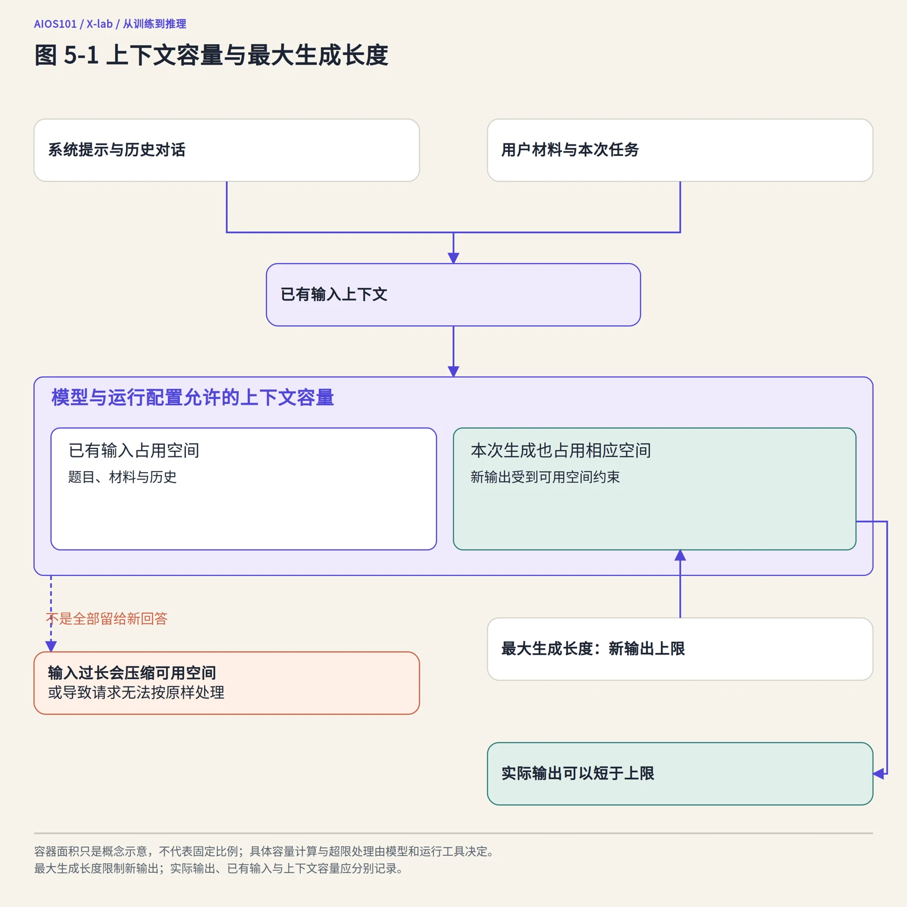

图 5-1　上下文容量与最大生成长度的区别。具体容量计算和超限处理取决于模型与运行工具；图中不代表各产品采用相同分配方式。

<details>
<summary>结构关系与 Mermaid 源码</summary>

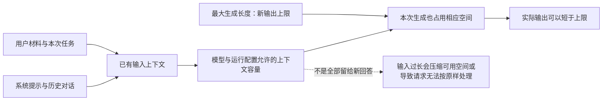

</details>

### 3. 从输入到输出：预填充与解码

文本进入模型前，仍需经过第四章介绍的分词过程。随后，模型根据参数处理输入，并计算可能的下一个 token。语言模型服务常把运行过程概括为两类计算：

- **预填充（prefill）**：处理已有输入上下文，为后续生成建立计算状态；
- **解码（decode）**：根据当前上下文生成新的 token，并把新 token 加入后续计算的上下文。

“解码”在这里不是把一段密文翻译回原文，而是把模型计算得到的候选逐步变成输出序列。可以有限地类比为“先读完题目和材料，再开始逐句作答”：预填充更接近前一段处理，解码更接近后一段生成。真实计算并不是人的阅读与写作，而且预填充也会进行大量模型计算，不只是把文件打开。

输入较长时，预填充可能需要处理大量已有 token；回答较长时，解码需要反复执行。二者都可能影响等待时间，却不能用同一个“模型速度”数字完全概括。

在简化的自回归生成中，模型每次关注当前序列并预测下一个 token。选定一个 token 后，它成为序列的一部分，模型再继续预测下一个，直到遇到结束标记、达到长度限制或被系统停止。**自回归**在这里指新输出会作为下一步生成的输入之一，而不是模型在普通请求中重新训练自己。

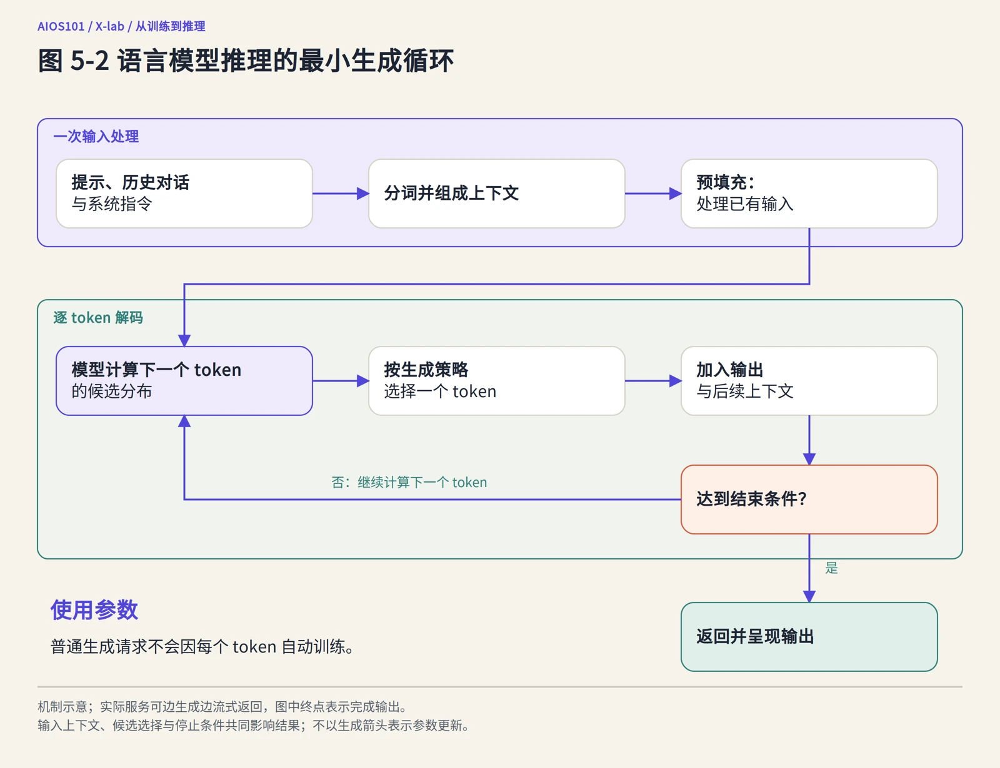

图 5-2　语言模型推理的最小生成循环。参数在普通推理中被使用，而不是因每一次 token 生成就自动完成一次训练。

<details>
<summary>结构关系与 Mermaid 源码</summary>

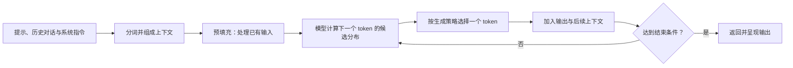

</details>

实际系统还可能进行流式返回，即生成一部分就先向用户显示一部分，而不是等全部结束后才出现。**流式输出**改善的是呈现与等待体验，不表示模型一次性想好了全部回答，也不必然缩短总生成时间。

## 三、从候选分布到具体文字：生成策略怎样影响输出

### 1. 模型给出的是候选分布，不是唯一固定句子

第四章已经说明，模型可以为下一个 token 分配概率。推理时需要一种策略，把候选分布变成实际输出。这里的**候选分布**可以暂时理解成一张“下一个片段可以选什么、各自被选中的相对机会有多大”的清单；概率来自当前模型与上下文计算，不是对事实真伪的保证。

下面用一组**简化示意数字**帮助理解，它不是任何真实模型的运行结果。假设在“今天的天气很”之后，模型给出的候选包括“晴朗”0.55、“寒冷”0.25、“温暖”0.12、“潮湿”0.05、“安静”0.03，其他候选合计 0。小数可以分别读作 55%、25% 等相对机会。无论“晴朗”的概率多高，它都可能与真实天气不符，因为模型此刻并未据此连接气象观测。

**贪心解码**是每一步选择当前概率最高的候选。在上面的示意中，它会选择“晴朗”。这种方法简单直接，但不保证最终整段回答在全局上最优，也不保证事实正确。一个局部概率最高的词，可能把后续文本引向重复或不够合适的方向。

**采样**则按照一定规则从多个候选中随机选择。仍看这组示意数字，采样并不是五个候选平均各占五分之一，而是概率大的通常更有机会被选中。它使相同输入有机会产生不同表达，也可能增加多样性，但同时可能选到不合适的候选。采样不是“模型随意发挥”，而是受候选分布和生成参数约束的随机过程。

即使采用看似确定的策略，也不要轻易承诺不同硬件、引擎和版本之间逐 token 完全一致。并行计算、数值精度和实现差异都可能影响结果。复现研究需要记录这些条件，而不能只写“使用默认设置”。

### 2. 温度：调整候选分布的集中程度

**温度（temperature）**是影响采样随机性的一类常见参数。直观地说，较低温度通常让高概率候选更加突出，输出趋于保守和集中；较高温度通常让更多低概率候选获得机会，输出可能更加多样。仍用上一节的示意，低温会让“晴朗”相对其他候选更占优势，高温则可能让“寒冷”“温暖”等候选有更多机会；这不是在调节教室温度，也不是直接调节事实正确率。

温度不是“创造力”或“真实性”的直接开关。降低温度不会自动把错误变成正确，升高温度也不等于必然产生更有价值的新意。不同模型和任务适合的范围不同，某些接口对温度为 0 的处理也有特定实现约定，应查阅相应文档，而不是把一个经验值当成普遍定律。

### 3. top-k 与 top-p：用不同方式缩小候选范围

**top-k 采样**先按概率从高到低排列候选，只保留前 k 个，再从中进行后续选择。仍用前面的简化示意，若 k＝2，就保留“晴朗”和“寒冷”，其余候选不参与本次选择。这里的 k 是一个数量，不是正确率。第六章还会遇到检索结果的 top-k：那里保留的是前 k 个文档片段，而这里保留的是前 k 个候选 token，使用场景不同。

**top-p 采样**也常称核采样。它同样先按概率从高到低排列候选，但取的是累计概率达到设定阈值的最小候选集合，再在这个集合内进行后续选择。“累计概率”就是把候选按概率从高到低逐项相加；“最小候选集合”则意味着刚达到阈值就停止加入，而不是固定选前几个。

仍使用前面的简化示意：若 top-p 为 0.90，前两项累计为 0.55＋0.25＝0.80，还没有达到 0.90；加入第三项后累计为 0.92，达到阈值，于是保留前三项作为候选集合。若 top-p 为 0.95，则还要继续加入第四项，使累计值达到 0.97。真实模型通常有大量候选，实际计算还会按相应实现处理保留下来的概率。

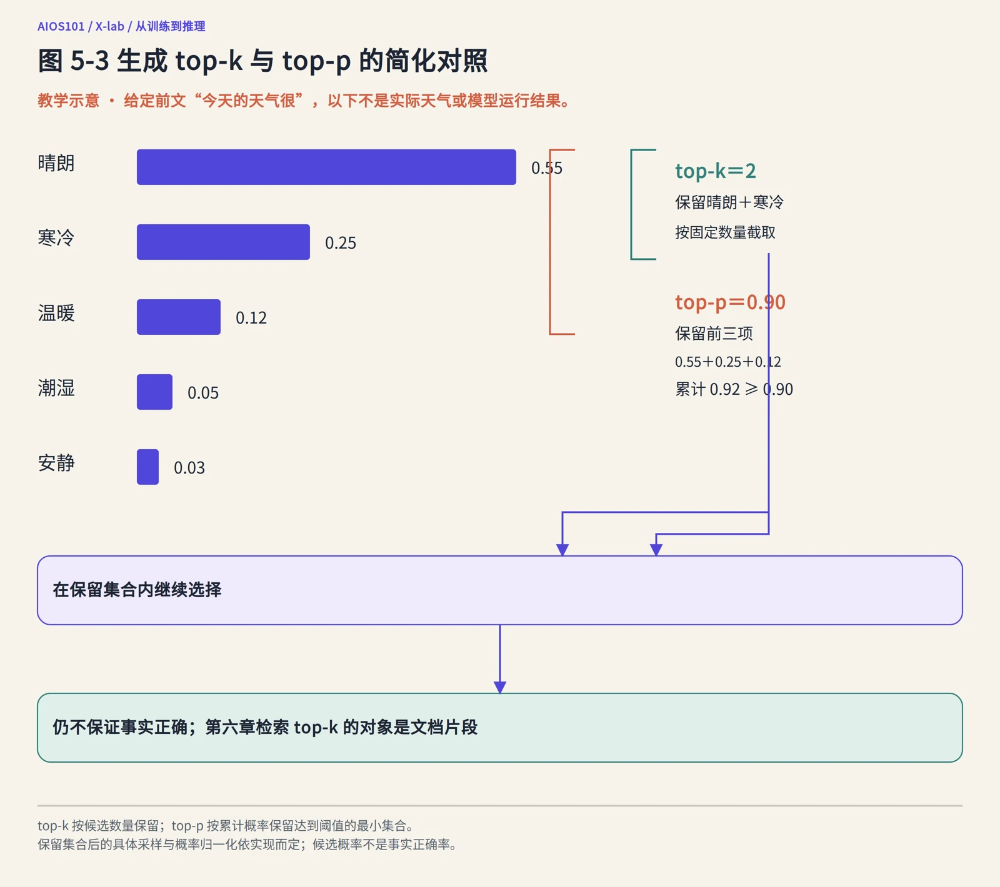

图 5-3　生成 top-k 与 top-p 的简化对照。一个按候选数量截取，一个按累计概率截取；数字是教学示意，不是实际天气或模型结果。

<details>
<summary>结构关系与 Mermaid 源码</summary>

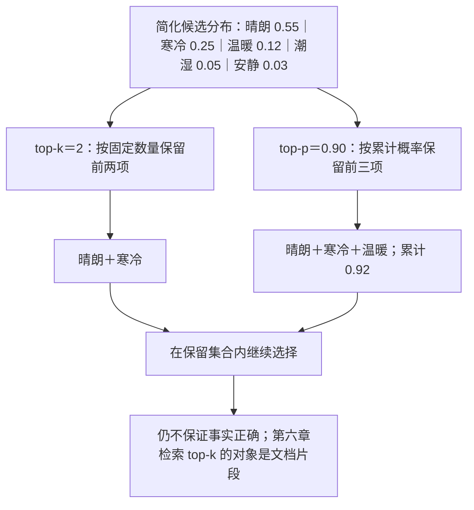

</details>

所以，top-p 为 0.95 表示候选集合的累计概率覆盖到 95%，并不表示“答案有 95% 的正确率”，也不表示“每次只选择概率 95% 的那个词”。

top-k、top-p 与温度可以共同作用。温度影响分布形状，top-k 和 top-p 影响保留哪些候选，具体顺序和实现由推理工具决定。记录实验时，应写出实际启用的设置及其他相关条件，而不是只说“使用了核采样”。

### 4. 最大生成长度与停止条件：输出在哪里结束

最大生成长度限制本次输出规模，达到上限时，回答可能在句子、推理步骤或代码中间结束。评价一道需要较长推理的题时，如果输出被截断，结果反映的不仅是模型解题能力，也包含长度设置的影响。

停止条件还可能包括结束标记、特定字符串、使用者取消或服务超时。**超时**是系统在规定时间内没有完成请求而停止等待，它与模型主动生成结束标记不是一回事。分析失败样例时，应区分“答错”“没有答完”“服务没有返回”和“答案被后续程序过滤”。

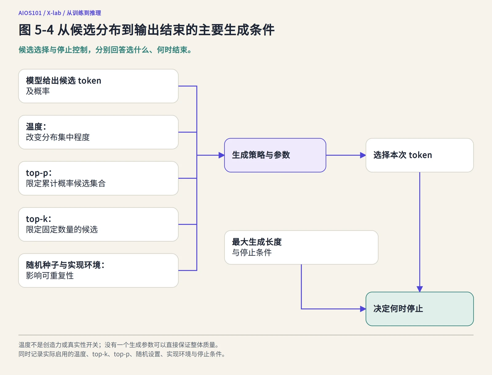

图 5-4　从候选分布到输出结束的主要生成条件。各参数影响生成过程，却没有一个参数能够直接保证真实性或整体质量。

<details>
<summary>结构关系与 Mermaid 源码</summary>

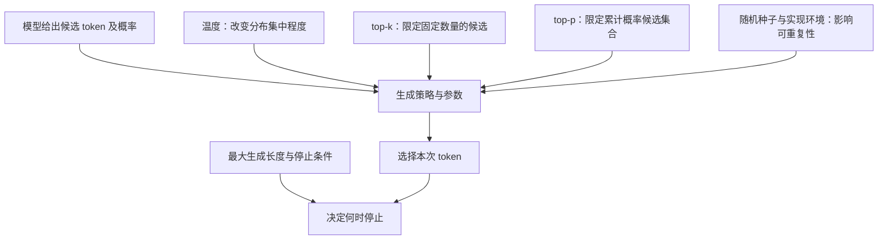

</details>

## 四、怎样做一场公平的生成对照

### 1. 一次只改变一个主要变量

如果第一次提问使用短提示、低温度，第二次改成长提示、高温度，还换了一个模型，那么输出差异无法归因于其中任何一项。公平的生成对照与第四章的数据消融共享同一原则：明确研究变量，控制其他条件，记录观察现象，保留结论边界。

一个基本对照记录至少应包含：

| 记录项 | 需要写清的内容 | 常见遗漏 |
|---|---|---|
| 研究问题 | 要比较温度、提示、模型版本还是运行环境 | 只写“看看哪个更好” |
| 固定对象 | 模型版本、分词器、权重或 API 的具体标识 | 只写产品名称或“最新版” |
| 输入材料 | 完整提示、系统提示、历史上下文与输入文件版本 | 只记录用户最后一句 |
| 生成配置 | 温度、top-p、最大生成长度、停止条件及随机设置 | 使用默认值但不记录默认值是什么 |
| 运行环境 | 推理引擎、版本、硬件、精度、服务日期与负载条件 | 把本地结果与在线服务直接比较 |
| 输出与失败 | 完整输出、截断、重试、超时和异常情况 | 只保存最成功的回答 |
| 判断方法 | 由谁依据什么指标评价，是否知道对照条件 | 看完结果再临时选择有利标准 |

例如研究温度时，两个方案应尽量保持模型、输入、top-p、长度限制和运行环境相同，只改变预先声明的温度值。不能看到输出后，再挑选一个最符合预期的温度值，声称它本来就是实验设计。

### 2. 随机性需要重复，而不是用一个例子掩盖

一次采样只能展示一种可能输出。要理解某配置下的表现，通常需要在相同条件下重复生成，并观察成功率、输出差异和失败类型。重复次数越多不一定就越好，还要考虑任务成本、样本独立性和评价方法，但“每个条件只试一次”显然难以支持稳定结论。

随机种子可以帮助某些环境下的重复，但不是跨平台一致性的万能保证。更换模型权重、分词器、引擎或硬件后，即使种子相同，也不能预设输出完全相同。公开结果时，应写清实际运行主体、日期和配置；没有运行的对照只能称为实验方案，不能写成实验发现。

### 3. DeepSeek-R1 的公开生成建议提供了真实参照

[DeepSeek-R1 固定 README](https://github.com/deepseek-ai/DeepSeek-R1/blob/0cf78561f1d51c84a21b2190626b21116d5c68bb/README.md)在 Usage Recommendations 中给出了一组项目建议：温度设置在 0.5—0.7，推荐 0.6，以减少无尽重复或不连贯输出；数学问题可在提示中要求逐步推理并把最终答案放入指定格式；评价模型时建议进行多次测试并取平均。

README 还建议该系列模型不要额外添加系统提示，而把指令放在用户提示中，并提示模型在某些查询中可能跳过预期的思考格式。这里最重要的学习点不是背下“0.6”，而是看到：**同一模型也有适合自身行为和评价方式的生成条件，提示格式与输出模式同样属于实验条件。**

这些建议来自固定版本的项目文档，不等于所有模型都应使用 0.6，也不保证在线产品今后始终采用相同设置。本书没有据此重新运行模型；这里只是把公开建议作为阅读真实生成配置的样本。

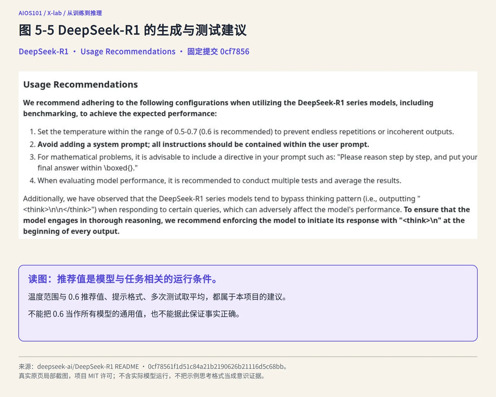

图 5-5　DeepSeek-R1 固定 README 的 Usage Recommendations。保留温度、提示格式与多次测试建议；0.6 是该项目推荐值，不是所有模型的通用设置。来源：DeepSeek-AI，提交 0cf7856；MIT License。

## 五、模型之外：推理系统怎样运行

### 1. 一个回答经过多个系统层

在本地程序中，模型可能由代码库直接加载；在网络产品中，用户请求通常还会经过界面、网关、推理服务、引擎和硬件。不同部署方式差异很大，但可以用下面的层次进行分析。

先用餐厅作一个有限类比：菜单和厨师的能力有点像模型与参数，厨房的设备与组织方式有点像引擎和硬件，点餐与传菜流程有点像服务与网络。一道菜上得慢，未必只是厨师能力问题，也可能是排队、设备或传菜造成的。但 AI 并不是餐厅，模型计算与软件调度也没有真正的人；遇到技术判断时，仍要回到可检查的系统组件和记录。

| 系统层 | 主要职责 | 可能影响的现象 | 不能单独由该层证明什么 |
|---|---|---|---|
| 模型与配置 | 提供结构、参数、分词与生成能力 | 输出内容、上下文能力、资源需求 | 整个产品一定具有相同行为 |
| 推理引擎 | 执行模型计算、管理中间状态、调度请求 | 计算效率、显存占用、批处理与兼容 | 输出事实一定正确 |
| 服务与接口 | 接收请求、鉴权、排队、路由、限流并返回结果 | 可用性、等待、超时、费用与并发 | 使用了哪个模型版本的全部细节 |
| 硬件与运行环境 | 提供处理器、内存、存储、互连和软件依赖 | 计算速度、可装载规模、稳定性 | 模型能力本身更强或更弱 |
| 网络与客户端 | 传输请求与响应，呈现内容 | 网络延迟、流式体验、显示差异 | 模型生成所花费的实际时间 |
| 使用情境与评价者 | 提供任务、约束和判断标准 | 对“好不好”的实际判断 | 所有用户都有相同需求 |

**推理引擎**是执行模型推理并管理相关计算与资源的软件系统。它不是新的模型，也通常不改变训练形成的参数，却可能决定模型能否在特定硬件上运行、能处理多少并发请求，以及内存怎样使用。**并发请求**指相近时间内需要系统处理的多个请求，例如许多学生同时使用同一项校园 AI 服务。请求同时到达，不代表它们都能立即开始计算；系统可能把暂时无法处理的请求放入**队列**，也就是等待处理的任务序列。**路由**则是把请求分配到某个服务实例或运行环境。

**服务**则把推理能力以本地或网络接口的方式提供给其他程序。**API（应用程序编程接口）**是程序之间按约定格式提出请求和接收结果的入口。第三章曾把 API 比作服务窗口：窗口规定怎样递交材料，但不等于后台全部工作流程。调用 API 只说明程序通过约定格式请求服务，不能据此知道模型、引擎或硬件的全部配置。

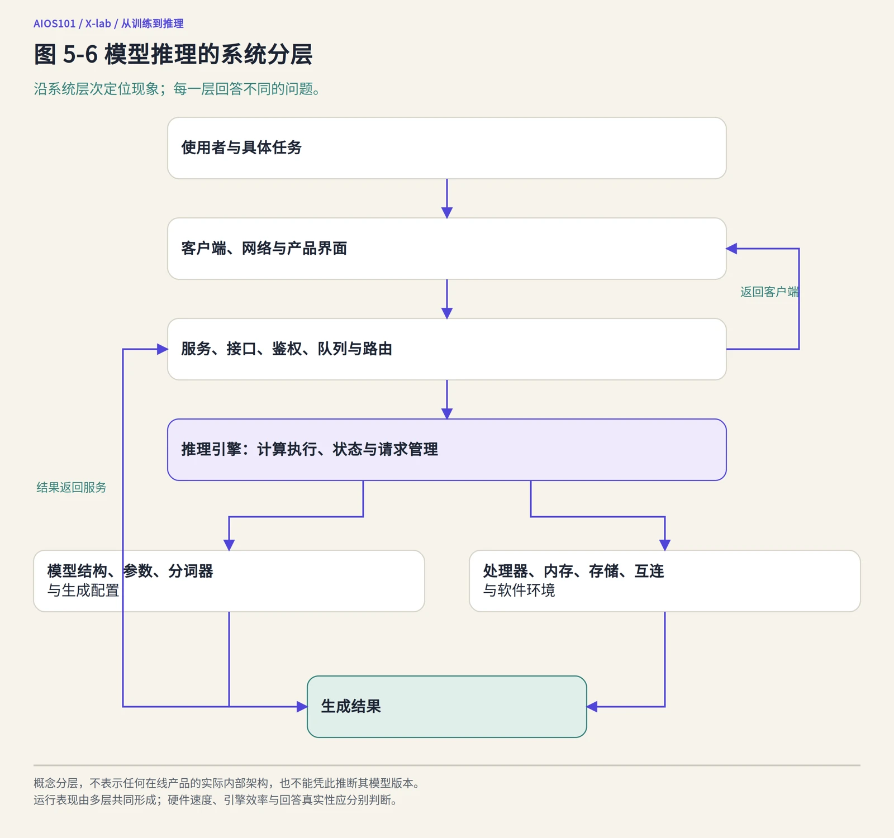

图 5-6　模型推理的系统分层。输出和运行表现由多层共同形成；图中服务与产品的具体组件因部署方式而异。

<details>
<summary>结构关系与 Mermaid 源码</summary>

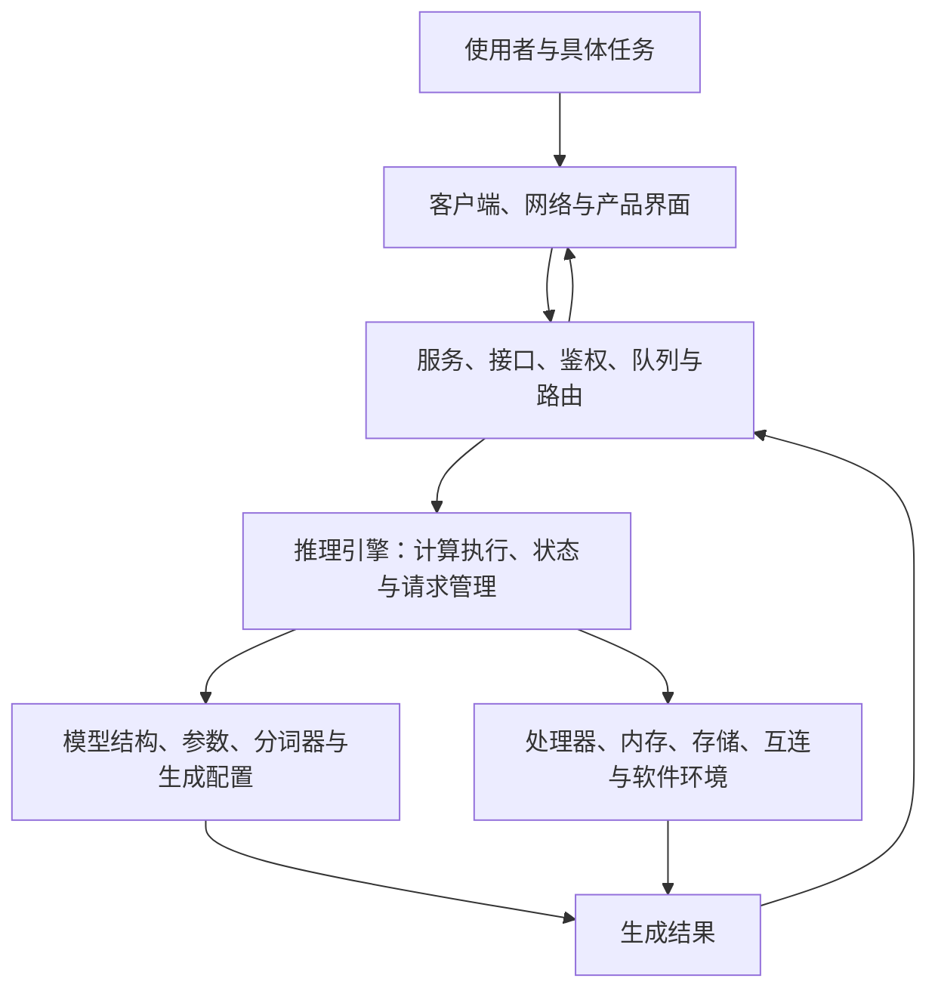

</details>

### 2. 延迟与吞吐回答不同问题

**延迟**是完成某项操作所经历的时间。对生成任务，至少可以区分两个口径：**首 token 延迟**是从发出请求到第一段可呈现输出出现所经历的时间，可能包含网络、服务排队和预填充等环节；**完整响应时间**是从发出请求到整段回答完成的时间，还包括后续解码与传输。首字出现得快，不等于整篇回答很快完成；流式输出可以让前者更早被看见，却不会自动消除后续生成时间。

**吞吐**是单位时间内完成的处理量，可以用每秒生成 token 数、每秒完成请求数等指标表示，但必须说明采用哪一种口径。对单个回答统计的“每秒 token 数”和对整个服务统计的“每秒完成请求数”也不是同一个指标。

两者的区别可以用食堂窗口理解：你这一份饭用了多久，是个人的等待与办理时间；一个窗口一小时能服务多少人，是整体处理量。窗口通过同时准备多份餐提高总处理量，不代表排队中的每个人都更快。同理，单个请求更快，不一定意味着系统每秒能服务更多请求；吞吐提高，也不保证每个用户的等待都缩短。这个类比只解释“个人时间”与“整体处理量”的不同，不能代替真实测速。

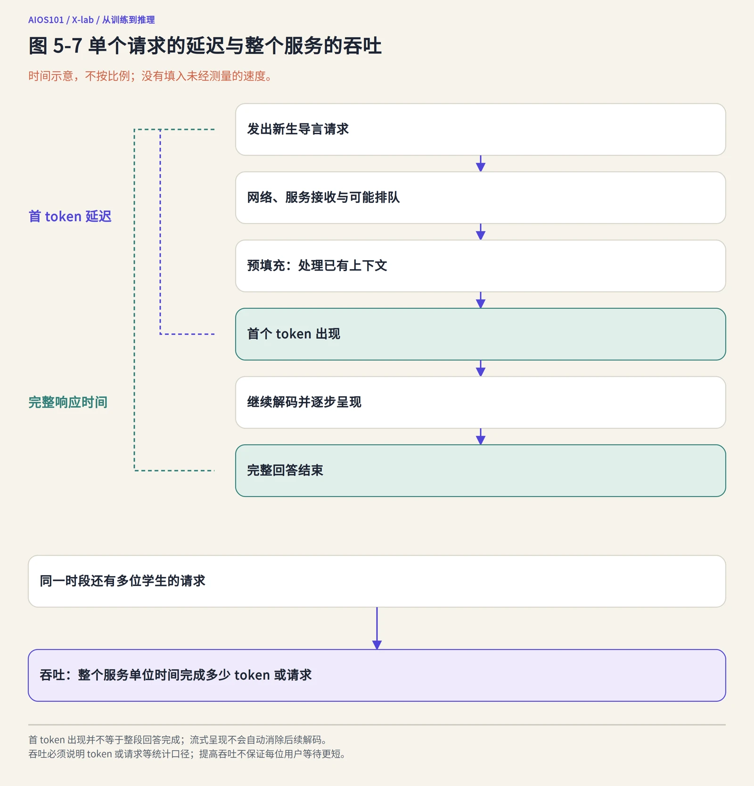

图 5-7　单个请求的延迟与整个服务的吞吐。首 token 延迟、完整响应时间和吞吐采用不同观察口径，流式呈现不等于全部生成已结束。

<details>
<summary>结构关系与 Mermaid 源码</summary>

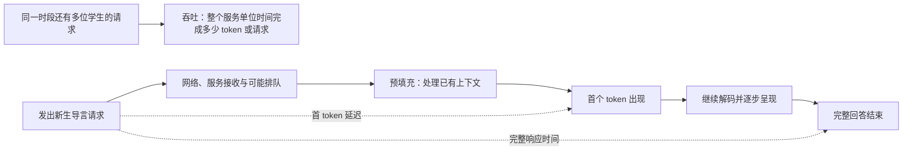

</details>

系统可能通过同时处理多个请求提高设备利用率，也可能在负载过高时增加排队。**负载**是系统当前需要承担的工作量。负载增加时，用户可能遇到等待变长、请求被限制或**超时**；超时是请求未在规定时间或系统约定条件下完成而停止等待，不能简单归类为“模型答错”。比较性能时，需要固定输入长度、输出长度、并发量、硬件和统计方法，不能把一个演示中的“秒出答案”当成普遍速度。

**连续批处理**是把多个请求的生成计算动态组织在一起的一种调度方式。“批处理”是把多个任务组织起来处理，“连续”强调请求可以在生成过程中动态加入或离开，而不是等一整批全部结束后再处理下一批。它可以提高资源利用效率，可是批处理大小、请求长度和到达时间不同，延迟与吞吐也会随之变化。

### 3. 中间状态与内存：长上下文为什么会带来资源压力

生成过程中，系统可能保存与已有上下文有关的中间计算状态，避免每一步都从头重复计算。**缓存**就是为后续复用而保存的中间信息，生活中缓存也常被称为暂存。语言模型注意力机制中常见的一类状态称为 **KV 缓存**，其中保存键（key）和值（value）相关信息。这里的 K 和 V 是注意力计算的术语，初学者不需要推导公式，只需知道它保存的不是一份供人阅读的“答案草稿”。

可以把它有限地类比为做题时保留已经整理的中间笔记：继续作答时不必把所有前期工作从头再做，但笔记会占用桌面空间。KV 缓存有助于继续生成，却会占用内存，并随模型、上下文和并发情况变化。这个类比只说明“复用中间状态与占用空间”的关系，不表示缓存内容等同于人的笔记。

因此，支持较长上下文不仅是“允许输入更多文字”的设置问题，也涉及内存容量、访问效率和调度。vLLM 固定 README 所提到的 PagedAttention，就是一种面向注意力键值内存管理的方法。这里不需要掌握其分页算法，只需理解：**推理引擎会处理模型之外的内存与调度问题，这些问题足以影响系统能否运行及其表现。**

## 六、真实运行解剖：DeepSeek-R1 与 vLLM

### 1. 进阶阅读｜一条启动命令包含了哪些系统条件

下面是一段真实项目命令，目的是练习从公开材料中识别系统条件，不要求读者复制或运行。即使看不懂命令格式，也可以继续阅读后面的逐项解释。

DeepSeek-R1 固定 README 给出了使用 vLLM 启动一个蒸馏模型服务的示例：

```bash
vllm serve deepseek-ai/DeepSeek-R1-Distill-Qwen-32B --tensor-parallel-size 2 --max-model-len 32768 --enforce-eager
```

本书没有执行这条命令，但可以从文档中读出它明确指定的对象和配置：

- `deepseek-ai/DeepSeek-R1-Distill-Qwen-32B`：指定具体的模型标识，而不是笼统的“DeepSeek”；
- `vllm serve`：使用 vLLM 提供服务，说明模型需要推理工具承载；
- `--tensor-parallel-size 2`：使用张量并行把模型计算分布到两个计算设备上，反映模型运行与硬件布局有关；
- `--max-model-len 32768`：设置服务允许的模型上下文长度，不等于公开评测设置中的“最多新生成 32,768 个 token”；
- `--enforce-eager`：指定一种执行模式选项，属于引擎配置的一部分。

这里的计算设备通常是 **GPU（图形处理器）**等适合并行计算的硬件。GPU 最初与图形处理密切相关，如今也广泛用于 AI 计算；它所配备的高速内存常称显存。**张量并行**是把模型中的部分计算拆分到多个设备协同完成的方法。它可以帮助运行单个设备难以承载的模型，但也会带来设备间通信和软件配置要求。两个设备不是简单把回答速度必然提高两倍，并行规模与性能需要实际测量。

同一段 README 还给出 SGLang 运行示例。这进一步说明，公开模型可以选择不同推理工具；示例证明项目提供了相应路径，不证明两种工具必须同时使用，也不证明任意版本、硬件和模型组合都兼容。

### 2. vLLM 的项目说明展示了引擎承担的工作

[vLLM 固定 README](https://github.com/vllm-project/vllm/blob/ab0e5ef7954190de2a74a6715d1382b08f5accc4/README.md)把项目定位为用于大语言模型推理与服务的软件库。该版本列出的功能包括 PagedAttention、连续批处理、分块预填充、前缀缓存、流式输出、多种并行方式以及多类硬件支持。

其中，**分块预填充**是把较长的输入处理划分为较小块进行调度；**前缀缓存**是复用具有相同前缀的计算状态。它们分别对应前面所说的输入处理与中间状态复用问题。项目同时提供 OpenAI 兼容 API 服务等能力，说明“推理引擎”和“模型服务”在同一工具中可能紧密集成。

这些功能清单帮助我们理解系统组成，却不能直接推出某个部署一定更快、更省或完全兼容。本书只阅读了固定 README 和许可，没有安装该版本，也没有进行模型与硬件组合测试。真实选型需要另外检查版本文档、支持矩阵、配置和实测结果。

### 3. 输出差异与性能差异要分别诊断

当回答不同或速度变慢时，可以按层提出问题：

1. 模型、权重、分词器和生成配置是否变化；
2. 完整上下文是否相同，是否加入了其他产品指令；
3. 引擎与执行配置是否变化；
4. 服务是否排队、限流、重试或路由到不同环境；
5. 硬件、精度、内存和互连是否变化；
6. 网络与客户端呈现是否影响了观察；
7. 评价标准是否把表达、正确性和速度混在了一起。

开源引擎和公开配置让这些问题更有可能被检查，但“看得见组件”仍不等于“知道实际生产系统怎样配置”。对在线产品尤其如此：公开模型仓库中的运行示例，不应被写成在线服务实际架构的证明。

## 七、从一次回答走向最小评价

### 1. 先定义任务，再讨论模型好坏

**评价**是依据明确任务、样本、标准和证据，对输出或系统表现作出判断的过程。评价不是给模型一个抽象的“聪明程度”，而是回答：在哪些条件下，对哪些任务，以什么标准，表现如何。

一个可进入的最小评价至少包含七个部分：

| 部分 | 核心问题 | 形成的最小证据 |
|---|---|---|
| 任务 | 希望模型完成什么，给谁使用 | 可执行的任务说明与输入输出要求 |
| 样本 | 用哪些有代表性的输入检查 | 固定样本、来源、覆盖范围与未知领域 |
| 基线 | 与什么现有做法或简单方案比较 | 基线名称、版本、配置或人工流程 |
| 指标 | 什么叫正确、完整、清晰、快速或可用 | 指标定义、计算方式或人工评分规则 |
| 配置 | 模型和系统在哪些条件下运行 | 模型、提示、生成参数、引擎与日期 |
| 重复与失败 | 结果是否稳定，哪些情形会失败 | 重复输出、失败类型、截断与异常记录 |
| 边界 | 结果可以推广到哪里，不能说明什么 | 适用范围、未覆盖任务与不确定事项 |

**基线**是比较的起点，可以是一个简单规则、现有工作流程、另一模型或人工结果。没有基线，一个分数常常难以解释。例如摘要达到某个长度，只说明符合形式要求；与“直接复制原文首段”的简单方案相比，才能进一步讨论压缩是否真正带来价值。

**指标**是用于衡量某一方面表现的规则。准确率、完全匹配率、人工偏好、延迟和吞吐分别测量不同对象，不能不加说明地合成一个“综合智能分”。指标越方便自动计算，越要检查它是否遗漏了任务中真正重要的质量。

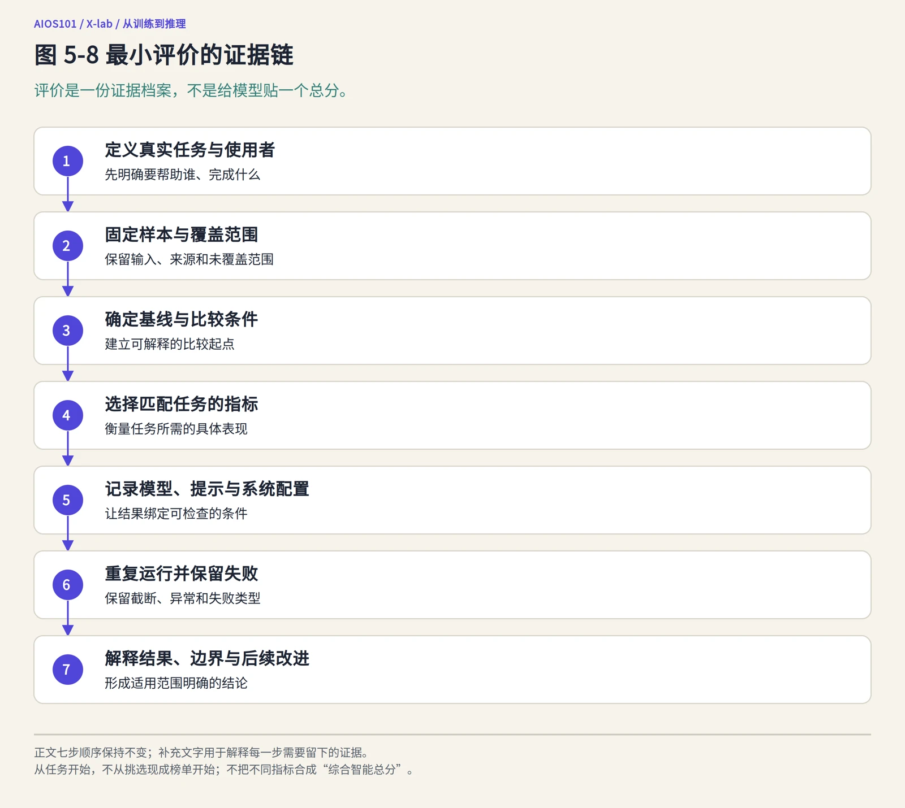

图 5-8　最小评价的证据链。评价从任务开始，而不是从挑选一个现成榜单或分数开始。

<details>
<summary>结构关系与 Mermaid 源码</summary>


</details>

### 2. 自动指标与人工判断各有作用

**自动指标**由程序按照明确规则计算，例如答案是否完全匹配、代码测试是否通过、输出是否超过长度限制、请求耗时多少。它们适合重复检查，却依赖规则和测试本身。

**人工评价**由人依据评分规则判断事实性、完整性、可读性、适用性或其他难以完全自动化的方面。人工评价也会受到主观偏好、疲劳、顺序和背景知识影响。较严谨的做法包括预先写出评分标准、隐藏模型名称、随机化输出顺序、保留分歧和失败样例，而不是让评价者凭整体印象给“感觉分”。

代码测试通过可以证明特定测试下可运行，不自动证明代码安全、可维护或覆盖所有边界；人工觉得回答流畅，也不自动证明内容真实。指标与任务必须匹配，并尽可能由多种证据相互补充。

还要区分**平均结果**与**失败分布**。假设一个模型在 10 道导言题上有 7 次合格，平均分或合格率提供了总体概览，却不会告诉我们剩下 3 次究竟是漏掉来源、混淆项目，还是输出被截断。对于高风险任务，少数严重失败可能比平均提升更重要。因此，评价报告应同时保留汇总数字和分类失败样例，而不是只展示平均数或一次最佳输出。

### 3. 一个真实材料上的评价方案：AIInfra 新生导言摘要

下面给出一个可以实际实施的评价设计，但不虚构模型输出和得分。输入采用第二章已经出现过的 [AIInfra 固定 README](https://github.com/Infrasys-AI/AIInfra/blob/b97c0385ba07a62a717d82a0e7aed2927f12fc35/README.md)。任务是让模型把“课程背景”和“备注”等指定段落改写为一段面向新生的项目导言。

这个任务可以作出如下约定：

- **目标读者**：第一次接触 AIInfra、尚未了解 AI 系统课程结构的大学生；
- **必要信息**：项目聚焦 AI 基础设施与大模型系统，与 AISystem 的侧重点不同；仓库体积较大，项目建议优先从 Releases 获取所需内容；
- **形式要求**：一段中文新生导言，长度上限在任务发布前固定；
- **基线**：直接选取原文相关段落，或保留项目原始简介，作为未压缩方案；
- **自动检查**：是否超过长度上限，是否包含要求的项目标识与 Releases 信息；
- **人工核查**：是否准确保留原文含义，是否遗漏必要信息，是否增加原文没有的性能或质量承诺，是否适合新生阅读；
- **失败记录**：混淆 AIInfra 与 AISystem、把仓库体积描述为模型大小、遗漏获取建议、加入未提供事实或输出被截断；
- **结论边界**：这只评价固定材料上的导言摘要，不评价模型对 AI 基础设施的全部理解，也不证明它能在其他仓库上稳定完成同样任务。

这个例子没有提供“某模型得了 92 分”之类结果，因为本书没有运行该评价。它展示的是评价设计本身：真实输入、目标读者、必要信息、基线、检查规则和边界都在运行前明确，才能避免看到输出后临时改变标准。

## 八、怎样阅读 DeepSeek-R1 的公开评测

### 1. 先看设置，再看数字

DeepSeek-R1 固定 README 的 Evaluation Results 说明：对其模型，最大生成长度设为 32,768 token；需要采样的基准使用温度 0.6、top-p 0.95；每道题生成 64 个回答来估计 pass@1。

**pass@1**关注单次回答通过任务要求的比例。README 通过每题多次生成来估计相关指标，说明采样条件下的单次表现需要统计估计，而不是挑选一次成功回答。这里要分清三件事：**一次成功**只描述某次输出；**多次采样后取一次能成功**是在问“若干次机会中是否至少成功一次”；**pass@1**关注的仍是单次回答表现，只是可以用多次独立生成来估计。三者的任务含义和成本不同。

不同基准还可能使用 EM、Correct、Acc、F1、评分或排名等不同口径。名称不能代替定义，本书只需先建立以下阅读基础：

- **EM（Exact Match，完全匹配）**：输出是否按照基准规定与参考答案一致。它便于自动检查，但“答案是 42”与“42”是否算一致，要看是否做大小写、空格、单位或其他归一化处理。
- **Correct**：通常表示答案是否被该基准判为正确，可能由规则、测试、模型或其他评价程序判断；表中数值常是相应样本上的汇总结果，具体口径必须看原基准。
- **Acc（Accuracy，准确率）**：通常指正确样本数占全部被评价样本数的比例。例如 100 道题答对 80 道，对应 80%。但不同任务可能对“答对”有不同定义，也不能把准确率与 EM 天然视为相同。
- **F1**：综合**精确率**与**召回率**的一类指标。精确率回答“系统给出的相关结果中，有多少确实相关”，召回率回答“所有真正相关的结果中，系统找回了多少”。

用一个检索式例子理解后两者：资料库中有 10 段真正与任务相关的材料，系统返回 8 段，其中 6 段确实相关，则精确率为 6／8＝75%，召回率为 6／10＝60%。常见 F1 是两者的调和平均，即 2×精确率×召回率／（精确率＋召回率），此例约为 66.7%；它不是两者的普通算术平均，也不要求初学者背公式。不同问答基准还可能把 F1 用于答案词语重叠等特定计算，因此仍应阅读各自定义。

这套设置至少告诉我们三件事：输出长度上限可能影响推理任务；生成参数属于评价配置；多次响应比单次抽样更能支持稳定判断。阅读任何榜单时，如果这些信息缺失，首先应标记证据缺口，而不是直接接受名次。

### 2. 评测覆盖了哪些任务

固定 README 的主评测表包含四类任务。下表保留类别和基准名称，帮助读者理解覆盖范围；名称本身不表示本书已独立核验每个基准的全部数据与实现。初学者不需要背下这些缩写，只需先看清它们分别观察哪类任务，再在需要时查阅具体定义。

| 类别 | 主要观察什么 | 固定 README 中列出的基准 |
|---|---|---|
| English | 英文知识理解、指令跟随、事实问答、阅读与偏好比较等，各基准侧重不同 | MMLU、MMLU-Redux、MMLU-Pro、DROP、IF-Eval、GPQA-Diamond、SimpleQA、FRAMES、AlpacaEval2.0、ArenaHard |
| Code | 代码解题、竞赛或真实仓库修改等任务，不能相互等同 | LiveCodeBench、Codeforces、SWE Verified、Aider-Polyglot |
| Math | 数学问题求解，不同题目来源与难度不同 | AIME 2024、MATH-500、CNMO 2024 |
| Chinese | 中文理解、知识与事实问答等任务 | CLUEWSC、C-Eval、C-SimpleQA |

这张表覆盖语言理解与指令、代码、数学和中文任务，比单一测试更丰富，却仍不是全部现实能力。例如，它不能自动代表一门专业课程中的资料辨析、长期项目协作、特定企业环境或高风险决策表现。测试任务与真实任务之间的距离，需要由使用者结合场景判断。

### 3. 用几个真实数值练习“有限结论”

下面选取固定 README 中 DeepSeek-R1 的几个项目自报结果。选取它们是为了练习阅读，不是重新构造一个综合排名。

| 基准与指标 | 固定 README 中的结果 | 可以支持的有限表述 | 不能直接推出什么 |
|---|---:|---|---|
| AIME 2024，pass@1 | 79.8 | 在文档声明的设置下，项目报告该数学基准取得这一结果 | 所有数学问题都有相同正确率 |
| MATH-500，pass@1 | 97.3 | 项目报告其在 MATH-500 上取得这一结果 | 比 SimpleQA 的数值高就说明数学能力一定强于事实问答能力 |
| SimpleQA，Correct | 30.1 | 项目报告其在 SimpleQA 正确性指标上的结果 | 模型在所有事实查询中都只有这一表现 |
| C-SimpleQA，Correct | 63.7 | 项目报告其在中文 SimpleQA 相关任务上的结果 | 中文与英文数值差异只由语言能力一个因素造成 |
| LiveCodeBench，pass@1-COT | 65.9 | 项目报告其在该代码基准及思维链设置下的结果 | 任意代码仓库任务都能达到相同修复率 |

第二行特别强调：不同任务的难度、指标和数据不同，不能把 97.3 与 30.1 放在同一数轴上，得出“数学比事实问答好 67.2 个能力点”。数字只有在各自任务与指标内才有明确意义。

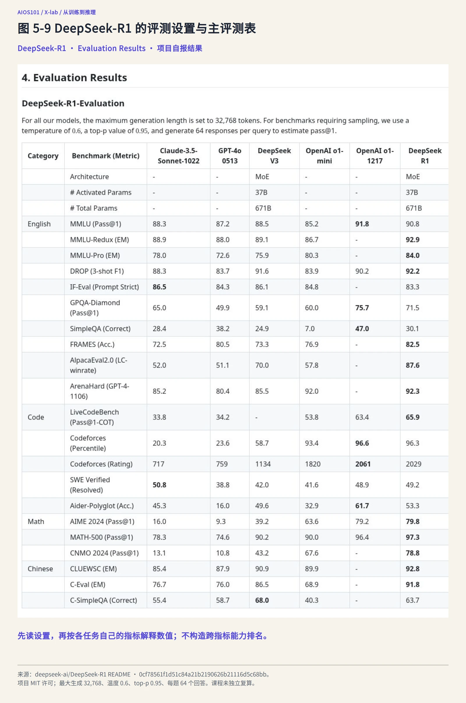

图 5-9　DeepSeek-R1 固定 README 的 Evaluation Results 设置与主评测表。保留最大生成长度 32,768、温度 0.6、top-p 0.95、每题 64 个回答及四类任务；数值为项目自报，课程未独立复算。来源：DeepSeek-AI，提交 0cf7856；MIT License。

### 4. 项目自报、复算与独立复核不是同一证据等级

固定 README 中的结果是项目公开提供的材料。本书阅读并重述这些数值，不等于重新运行了模型、取得了原始输出或独立复算。进一步研究还应区分：

- **项目自报**：由模型或项目发布者提供的设置与结果；
- **课程复算**：课程使用固定材料重新执行并记录结果，且实际完成程度明确；
- **独立复核**：由相对独立的主体检查数据、配置、实现或结果；
- **真实情境评价**：在目标用户和实际任务中检查适用性。

这些证据可以相互补充，没有哪一种在所有问题上都天然充分。公开模型、评测代码和配置有助于他人复核，但公开可得不代表复核已经发生。

### 5. 常见的榜单阅读陷阱

**一是忽略比较对象。** 不同模型版本、发布日期、提示和生成预算混在一起，名次可能反映配置差异而非单一模型能力。表中其他模型的结果同样需要按其来源理解。

**二是忽略数据污染。** 第四章已经说明，评价题或其变体进入训练或优化过程，会削弱测试独立性。公开基准流传广泛，更需要关注去污染声明和检查方法；没有证据时不能简单断言“有污染”或“绝对无污染”。

**三是忽略样本与不确定性。** 少量样本、单次输出或只报告平均数，可能掩盖不同题型和失败模式。多次生成可以降低部分采样不确定性，却不能自动解决样本代表性问题。

**四是忽略指标错配。** 完全匹配适合某些答案形式，却可能把意思正确但格式不同的回答判错；人工偏好适合比较表达，却不等于事实核查；代码测试通过也不等于无安全问题。

**五是忽略真实使用成本。** 更长输出、更多次采样或更复杂系统可能改善某些指标，也会增加时间、费用和资源消耗。评价“哪个方案更适合”时，需要把质量、成本与风险放在同一任务中讨论，而不是只追求最高分。

## 九、从模型运行走向检索、工具与智能体

本章讨论的推理系统已经包含模型、引擎、服务、硬件和客户端，但模型生成仍主要依据本次上下文与参数。当任务需要查阅最新资料、使用一个大型文档库、调用计算器、查询数据库或执行外部操作时，系统还需要显式加入检索和工具。

这会引出新的证据问题：回答中的事实来自参数、检索片段还是工具返回？检索没有找到合适材料时怎么办？模型生成的是工具调用请求，还是工具已经真实执行？第六章将把这些问题拆解为 RAG、工具调用、智能体循环和运行轨迹，并讨论人的授权、核验与责任。

在进入下一章之前，应保留本章的一个基本习惯：**先确认正在观察哪个对象，再记录它的配置和输出，最后依据与任务匹配的证据作出有限判断。** 这一习惯比记住任何单一模型分数都更可持续。

## 十、本章小结

推理是使用已经形成的模型处理输入并得到输出的计算过程。普通推理与训练不同：它通常不更新参数。语言模型先处理输入上下文，再通过预填充和解码逐步生成 token，直到满足停止条件。上下文长度、最大生成长度与实际输出长度是不同概念。

模型为候选 token 提供概率分布，贪心、采样、温度、top-k、top-p、随机设置和停止条件共同影响具体输出。公平的生成对照需要固定模型与输入，只改变预先声明的主要变量，记录完整配置，并通过重复和失败记录理解随机性。

实际回答还经过推理引擎、服务、硬件、网络与客户端。首 token 延迟、完整响应时间与吞吐测量不同系统表现，并发、负载、排队、超时、中间状态管理和并行会影响资源与等待，却不能直接证明模型输出更正确。DeepSeek-R1 的 vLLM 示例和 vLLM 的固定项目说明展示了模型之外的运行条件。

评价应从真实任务出发，明确样本、基线、指标、配置、重复和失败。DeepSeek-R1 的公开评测提供了生成设置、四类任务与项目自报结果，但 EM、Correct、Acc、F1 与 pass@1 等口径不能混用，平均结果也不能替代失败分布；这些数字不能替代课程复算、独立复核或真实情境评价。

因此，理解 AI 系统运行与评价的关键，是分别回答：**输出怎样生成，系统在哪些条件下运行，证据支持哪一种有限结论。**

## 关键术语

- **推理（inference）**：使用已经形成的模型处理输入并得到输出的计算过程，不等同于训练，也不只指人的逻辑思考。
- **提示（prompt）**：提供给模型的指令或输入内容。
- **上下文（context）**：模型在一次生成时能够利用的输入范围，可能包含系统指令、用户输入、历史对话和其他材料。
- **上下文长度**：模型或运行配置一次能够处理的 token 范围，通常需要同时考虑输入与输出。
- **最大生成长度**：本次允许新生成的 token 上限，不等于上下文总长度或实际输出长度。
- **预填充（prefill）**：处理已有输入上下文并为后续生成建立计算状态的过程。
- **解码（decode）**：根据当前上下文逐步产生新 token 的过程。
- **自回归生成**：把已生成 token 加入后续输入，再逐步产生后续 token 的生成方式。
- **贪心解码**：每一步选择当前概率最高候选的生成策略，不保证整段输出全局最佳或正确。
- **采样**：按照候选分布和生成规则随机选择 token 的过程。
- **温度**：影响候选分布集中程度和采样随机性的常见生成参数。
- **top-k 采样**：在按概率排序后的前 k 个候选 token 中进行后续选择；与检索前 k 个文档片段是不同场景。
- **top-p 采样**：在按概率排序、累计概率达到阈值的最小候选集合中进行选择的采样方式。
- **推理引擎**：执行模型推理并管理计算、中间状态、请求和相关资源的软件系统。
- **并发／队列／负载**：并发是相近时间内需要处理的多个请求，队列是等待处理的任务序列，负载是系统当前承担的工作量。
- **流式输出**：在全部生成结束前逐步返回和呈现已生成内容的方式。
- **延迟**：完成某项操作所经历的时间，可按首 token 或完整响应等口径分别测量。
- **吞吐**：单位时间内完成的处理量，必须说明按 token、请求或其他单位统计。
- **连续批处理**：动态组织多个请求的生成计算，以提高资源利用和请求处理效率的一种调度方式。
- **KV 缓存**：注意力推理中保存键和值相关中间状态、支持后续生成的一类缓存，会占用内存。
- **基线**：评价中用于比较起点的简单规则、现有流程、另一模型或人工结果。
- **指标**：衡量正确性、完整性、效率或其他某方面表现的规则，必须与任务相匹配。
- **EM／Correct／Acc**：分别常用于完全匹配、基准规定的正确性和正确样本比例；具体定义取决于基准。
- **精确率／召回率／F1**：精确率衡量给出结果中真正相关的比例，召回率衡量真正相关结果被找回的比例，F1 综合二者。
- **pass@1**：关注单次回答通过任务要求比例的一类指标，多次生成可用于估计其在采样条件下的表现。
- **项目自报**：由项目或模型发布者提供的配置与结果，不等于他人已经复算或独立复核。

## 思考与探究

1. 为什么“同一个模型问两次得到不同回答”不能直接证明模型已经重新训练？
2. 上下文长度、最大生成长度和实际输出长度分别是什么？把它们混同会怎样影响评价？
3. top-p 为 0.95 为什么不表示答案有 95% 的正确率？温度降低又为什么不保证事实更可靠？
4. 如果一次对照同时改变了提示、温度和模型版本，输出差异为什么难以解释？
5. 一项服务响应变慢，可能涉及模型、引擎、服务、硬件和网络中的哪些环节？还需要什么证据才能定位？
6. 为什么吞吐提高不一定意味着每位用户的等待时间都缩短？
7. 在 AIInfra 新生导言任务中，为什么“语言流畅”不足以成为唯一评价指标？
8. 阅读 DeepSeek-R1 公开评测时，为什么 MATH-500 的 97.3 与 SimpleQA 的 30.1 不能直接作差比较能力？
9. 一个项目公开了完整评测代码和配置，但尚未有人复算。你可以说“结果可复核”，还是“结果已经独立复核”？为什么？

## 延伸学习

- **希望核对真实生成与运行配置**：阅读 [DeepSeek-R1 固定 README](https://github.com/deepseek-ai/DeepSeek-R1/blob/0cf78561f1d51c84a21b2190626b21116d5c68bb/README.md)的 How to Run Locally 与 Usage Recommendations，分别记录模型标识、引擎、并行、上下文、温度、提示和重复测试要求。重点理解这些配置各自属于哪一层，不要求实际运行大模型。
- **希望练习阅读公开评测**：继续阅读同一文档的 Evaluation Results，先抄写生成设置，再选择两个不同任务，写出指标、项目自报结果、支持的有限结论和不能推出的内容。不要把不同基准数字合成一个自定义总分。
- **希望理解推理引擎为什么重要**：阅读 [vLLM 固定 README](https://github.com/vllm-project/vllm/blob/ab0e5ef7954190de2a74a6715d1382b08f5accc4/README.md)的 About 部分，把 PagedAttention、连续批处理、分块预填充、前缀缓存、流式输出和分布式推理分别对应到内存、调度、输入处理、状态复用、呈现和硬件层。该阅读用于系统分层，不代表这些功能已在你的环境中验证。
- **希望进一步连接 AI 系统知识**：阅读 AIInfra 固定版本的“分布式推理”课程目录，观察推理流程、KV 缓存、架构调度、长序列、输出采样和模型压缩怎样被组织为后续专题。它适合作为本章之后的进阶地图，不要求初学者立即掌握各专题的工程细节。
